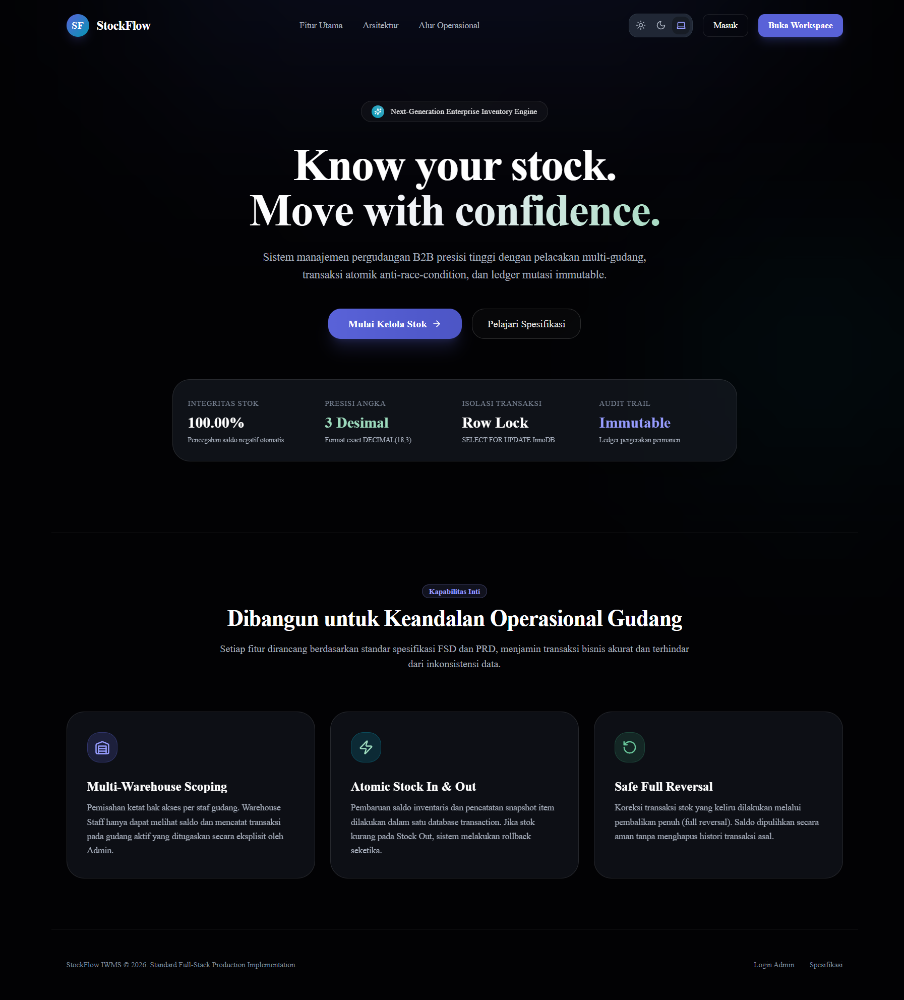
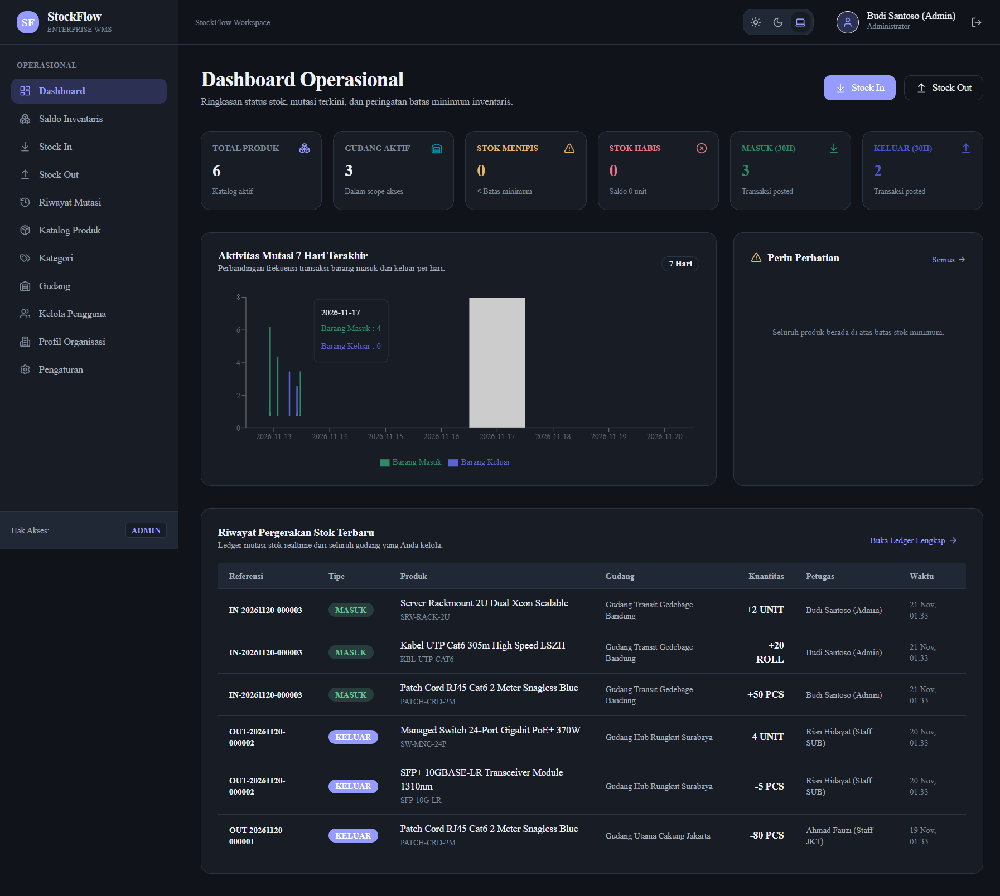
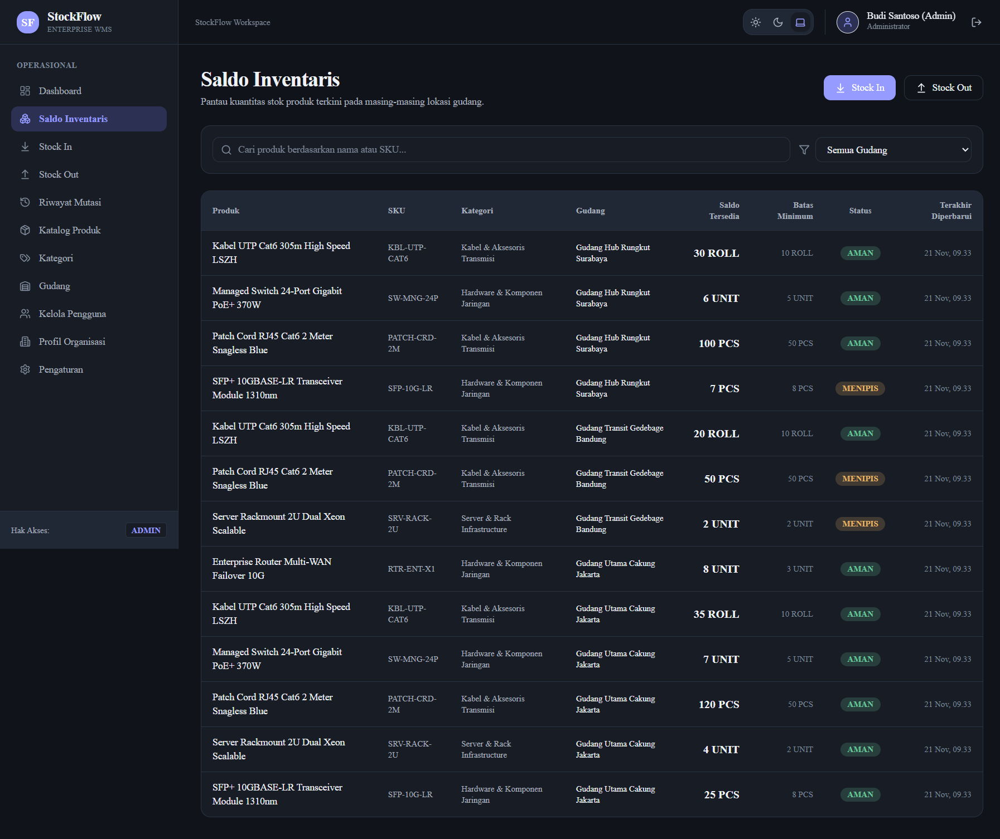
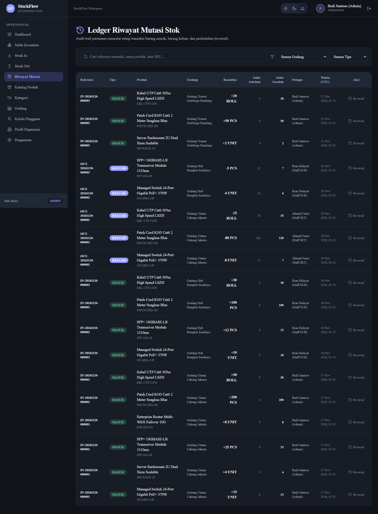

# StockFlow: Professional Inventory and Warehouse Management System

> **Know your stock. Move with confidence.**  
> Sistem manajemen inventaris dan pergudangan multi-lokasi (B2B SaaS IWMS) level produksi dengan transaksi atomik, pencegahan saldo negatif berbasis locking, audit ledger immutable, dan kontrol akses berbutir halus (RBAC).

[](#)
[](#)
[](#)
[](#)
[](#)
[](#)
[](#)

---

## 1. Problem Statement & Solusi

### Tantangan Bisnis
Banyak bisnis distribusi dan ritel menghadapi kendala kritis dalam pengelolaan persediaan:
1. **Pencatatan Stok Tersebar**: Data inventaris di beberapa gudang dicatat pada spreadsheet terpisah, memicu selisih stok fisik dan catatan sistem.
2. **Race Condition & Overselling**: Transaksi pengeluaran barang yang terjadi secara bersamaan dapat menyebabkan saldo menjadi negatif atau barang dijual melebihi ketersediaan fisik.
3. **Audit Trail yang Lemah**: Sulit menelusuri siapa petugas yang memutasikan barang, kapan mutasi terjadi, dan apa referensi transaksinya saat terjadi audit atau selisih stok.
4. **Kebocoran Akses Antar-Gudang**: Staf operasional sering kali dapat melihat atau mengubah data stok di fasilitas gudang yang bukan wewenangnya.

### Solusi StockFlow
StockFlow menyediakan platform terpusat dengan jaminan integritas tingkat enterprise:
- **Pessimistic Concurrency Locking**: Menggunakan `SELECT ... FOR UPDATE` pada transaksi database MySQL InnoDB untuk mencegah race condition dan menjamin saldo tidak pernah negatif.
- **Audit Ledger Immutable**: Setiap mutasi (Stock In dan Stock Out) menghasilkan rekaman riwayat permanen dengan snapshot nama, SKU, unit, saldo sebelum (`balance_before`), dan saldo sesudah (`balance_after`).
- **Full Reversal Mechanism**: Koreksi transaksi dilakukan melalui pembalikan penuh yang terdokumentasi rapi tanpa menghapus data historis.
- **Strict Role-Based Access Control & Warehouse Scoping**: Warehouse Staff dibatasi secara ketat hanya pada gudang aktif yang ditugaskan secara eksplisit oleh Admin.

---

## 2. Arsitektur Sistem

StockFlow dibangun dengan pemisahan tanggung jawab (Separation of Concerns) yang ketat antara Frontend, Backend, dan Database.

```text
+-------------------------------------------------------------------+
|                        CLIENT BROWSER                             |
|  - Desktop / Tablet / Smartphone Responsive Workspace             |
|  - Next.js 15 App Router, React 19 Client Components              |
|  - Tailwind CSS, shadcn/ui Primitives, Recharts, Motion           |
+----------------------------------+--------------------------------+
                                   |
                       HTTP / JSON | (Port 3000 Single Ingress)
                                   v
+----------------------------------+--------------------------------+
|                   FRONTEND TIER (Next.js 15)                      |
|  - Server-Side Rendering (SSR) & Layout Inheritance               |
|  - Same-Origin Reverse Proxy (/api/v1 -> backend:4000)           |
|  - Client State Management & Interactive Form Validation          |
|  - Theme Management (Light, Dark, System Preference)             |
+----------------------------------+--------------------------------+
                                   |
          Internal Docker Network  | (backend:4000, Host Port Closed)
                       REST API v1 | Cookie: sf_session, sf_csrf
                                   v
+----------------------------------+--------------------------------+
|                    BACKEND TIER (Express.js)                      |
|  - Security Middleware: Helmet, CORS Allowlist, Rate Limiting    |
|  - Session-Based Cookie Auth (bcrypt cost 12 / SHA-256 Hashing)  |
|  - Double-Submit Cookie CSRF Protection (X-CSRF-Token)            |
|  - Role-Based Access Control & Warehouse Scoping Middleware       |
|  - Zod Request Schema Validation & Normalization                  |
|  - Business Services: Stock In, Stock Out, Full Reversal          |
|  - Pessimistic Row Lock Concurrency Manager                      |
|  - Transactional Sequence Generator (IN-*, OUT-*)                |
+----------------------------------+--------------------------------+
                                   |
          Internal Docker Network  | (db:3306, Host Port Closed)
                        Prisma ORM | MySQL Protocol
                                   v
+----------------------------------+--------------------------------+
|                  DATABASE TIER (MySQL 8.4 LTS)                    |
|  - Storage Engine: InnoDB (ACID Compliant)                        |
|  - Collation: utf8mb4_0900_as_ci, UUID in CHAR(36) ascii_bin      |
|  - Precision: DECIMAL(18,3) for Quantity, DECIMAL(18,2) for Cost |
|  - Check Constraints: quantity >= 0, balance >= 0                 |
|  - 14 Normalized Relational Tables                                |
+-------------------------------------------------------------------+
```

---

## 3. Tech Stack Breakdown

### Frontend
- **Framework**: Next.js 15 (App Router Architecture), React 19.
- **Language**: TypeScript (Strict Mode).
- **Styling**: Tailwind CSS dengan custom design tokens (Indigo & Mint).
- **UI Components**: Radix UI Primitives (shadcn/ui pattern).
- **Visual & Charts**: Motion for React, Recharts.
- **Icons**: Lucide React.
- **HTTP Client**: Axios dengan automatic CSRF header injection.

### Backend
- **Runtime**: Node.js 24 LTS.
- **Framework**: Express.js.
- **Language**: TypeScript.
- **Validation**: Zod (Schema parsing and runtime validation).
- **Cryptography**: Argon2id / bcryptjs (password hashing), SHA-256 (token hashing).
- **Security**: Helmet, CORS allowlist, Express Rate Limit, Cookie Parser.

### Database & ORM
- **Database**: MySQL 8.4 LTS (InnoDB Storage Engine).
- **ORM**: Prisma 6 (Type-safe interactive transactions).
- **Precision**: `DECIMAL(18,3)` untuk kuantitas stok tanpa floating point error.

### DevOps & Containerization
- **Container**: Docker dengan Multi-Stage Builds (Non-root security context).
- **Orchestration**: Docker Compose (Terpisah antara development dan production).

### Quality Assurance & Testing
- **Test Runner**: Vitest.
- **API Testing**: Supertest.
- **Frontend Testing**: React Testing Library.

---

## 4. Fitur Utama & Highlight Rekayasa

### A. Alur Transaksi Barang Masuk (Stock In)
- Multi-item entry dalam satu nomor transaksi referensi unik (`IN-YYYYMMDD-XXXXXX`).
- Snapshot informasi produk (nama, SKU, unit) saat transaksi dicatat untuk menjaga histori audit.
- Penambahan saldo inventaris secara atomik di database.

### B. Alur Transaksi Barang Keluar (Stock Out) & Concurrency
- Validasi ketersediaan stok secara realtime di backend menggunakan `SELECT ... FOR UPDATE`.
- Jika stok kurang, transaksi dibatalkan seketika (automatic rollback) dan mengembalikan status 422 `INSUFFICIENT_STOCK`. Saldo tidak pernah menjadi negatif.

### C. Pembalikan Transaksi Penuh (Full Reversal)
- Fitur koreksi aman untuk membatalkan transaksi yang keliru tanpa menghapus data asal.
- Sistem otomatis menerbitkan transaksi penyeimbang dengan referensi `correction_of_transaction_id`.

### D. Kontrol Akses Berbasis Peran (RBAC) & Scope Gudang
- **Admin**: Memiliki wewenang penuh atas konfigurasi organisasi, katalog produk, kategori, seluruh gudang, dan pengelolaan akun pengguna.
- **Warehouse Staff**: Dibatasi hanya dapat melihat saldo dan mencatat mutasi pada gudang yang ditugaskan secara aktif oleh Admin.

### E. Dashboard Operasional Komprehensif
- KPI cards real-time (Total Produk, Total Gudang, Stok Menipis, Stok Habis, Mutasi Masuk/Keluar 30 Hari).
- Grafik batang 7 hari mutasi stok dengan Recharts.
- Peringatan dini produk yang menyentuh batas stok minimum.
- Daftar riwayat mutasi stok terbaru.

### F. UI/UX Kreatif Terinspirasi MotionSites Vertex
- Landing page bernuansa dark mode premium dengan efek pencahayaan dinamis dan tombol CTA glow.
- Dukungan penuh pergantian tema: Light Mode, Dark Mode, dan System Preference.
- Desain responsif di layar ponsel pintar, tablet, maupun monitor desktop.

### G. Visual Gallery & Live Walkthrough

| Landing Page (Vertex Dark Theme) | Operational Dashboard |
|:---:|:---:|
|  |  |

| Inventory Balances & Status Gudang | Audit Ledger & Full Reversal |
|:---:|:---:|
|  |  |

> Video rekaman interaksi pengguna dari alur autentikasi hingga inspeksi saldo tersedia di [walkthrough-recording.mp4](docs/assets/walkthrough-recording.mp4).

---

## 5. Panduan Menjalankan Aplikasi

StockFlow dirancang sebagai sistem Localhost Portfolio Edition yang berjalan pada mesin lokal pengembang (`http://localhost:3000`) dengan arsitektur produksi terisolasi: single ingress frontend port 3000, internal backend API di `backend:4000`, dan database MySQL 8.4 di `db:3306` (keduanya tertutup dari publikasi port host).

### Opsi A: Menjalankan Menggunakan Docker Compose (Direkomendasikan)

Pastikan Docker Desktop sudah terpasang dan berjalan di komputer Anda.

```powershell
# 1. Clone repositori
git clone https://github.com/username/StockFlow.git
cd StockFlow

# 2. Jalankan skrip inisialisasi lingkungan lokal terenkripsi (PowerShell)
# Skrip ini menghasilkan file .env dan .secrets/initial_admin_password.txt secara kriptografis tanpa mengekspos rahasia
powershell -ExecutionPolicy Bypass -File scripts/init-local.ps1

# 3. Inisialisasi Administrator Awal melalui bootstrap service
# Service membaca password awal secara eksklusif melalui Docker Compose Secrets
docker compose --profile bootstrap run --rm bootstrap

# 4. Jalankan seluruh layanan aplikasi di latar belakang
docker compose up -d
```

Aplikasi siap diakses pada:
- **Frontend Web & Single Ingress API**: `http://localhost:3000` (terikat loopback 127.0.0.1)
- **Internal Backend REST API**: Mengalir via same-origin reverse proxy Next.js (`/api/v1`) ke `backend:4000` (port host tertutup)
- **Internal MySQL 8.4 Database**: `db:3306` (port host tertutup)

#### Prosedur Akses Pertama Kali:
1. Buka file password awal administrator menggunakan editor teks lokal (misal: `notepad .secrets/initial_admin_password.txt`).
2. Akses antarmuka aplikasi di peramban web pada `http://localhost:3000`.
3. Login menggunakan email `admin@stockflow.com` dan password dari file rahasia tersebut.
4. Sistem akan langsung memicu forced password change demi standar keamanan. Masukkan password awal dan tentukan password baru permanen Anda.
5. Setelah penggantian password berhasil, Anda akan dialihkan ke Dashboard operasional. File `.secrets/initial_admin_password.txt` dapat dihapus secara manual setelah inisialisasi selesai.

---

### Opsi B: Menjalankan di Mesin Lokal (Development Mode)

#### Prasyarat
- Node.js v20+ atau v24 LTS
- MySQL Server 8.4 LTS berjalan di port 3306

#### Langkah 1: Setup Backend
```bash
cd backend

# Salin konfigurasi environment
cp .env.example .env

# Pasang dependensi
npm install

# Generate Prisma Client
npx prisma generate

# Terapkan migrasi database
npx prisma migrate dev

# Isi data awal role dan akun demo
npm run db:seed

# Jalankan server backend
npm run dev
```
Backend berjalan di `http://localhost:4000`.

#### Langkah 2: Setup Frontend
Buka terminal baru:
```bash
cd frontend

# Salin konfigurasi environment
cp .env.example .env

# Pasang dependensi
npm install

# Jalankan server frontend
npm run dev
```
Frontend berjalan di `http://localhost:3000`.

---

## 6. Kredensial Demo Siap Pakai

> PENTING: Kredensial demo di bawah ini HANYA berlaku untuk mode development lokal yang diisi via seeder (`npm run db:seed`). Pada mode kontainer Docker (production build), akun administrator diinisialisasi secara kriptografis menggunakan `scripts/init-local.ps1` dan tersimpan di `.secrets/initial_admin_password.txt`.

Data demo siap pakai development (`backend/prisma/seed.ts`):

| Peran (Role) | Email | Password | Hak Akses & Scope |
|---|---|---|---|
| **Administrator** | `admin@stockflow.com` | `AdminStockFlow2026!` | Akses penuh ke seluruh gudang, manajemen master data, user management, dan organisasi |
| **Warehouse Staff (Jakarta)** | `staff.jakarta@stockflow.com` | `StaffStockFlow2026!` | Terbatas pada Gudang Cakung Jakarta (`WH_JKT_01`) dan Gudang Bandung (`WH_BDG_01`) |
| **Warehouse Staff (Surabaya)** | `staff.surabaya@stockflow.com` | `StaffStockFlow2026!` | Terbatas pada Gudang Rungkut Surabaya (`WH_SUB_01`) |

---

## 7. Pengujian (Testing Suite)

Proyek ini dilengkapi dengan pengujian otomatis menyeluruh:

```bash
# Menjalankan pengujian backend (Unit, Integration API, Security, & Bootstrap - 111 tests)
cd backend
npm test

# Menjalankan pengujian frontend (Unit & Workflow Logic - 9 tests)
cd frontend
npm test

# Menjalankan pengujian lingkungan lokal terisolasi otomatis (Init script test - 19 scenarios)
powershell -ExecutionPolicy Bypass -File tests/test-init-local.ps1

# Menjalankan pengujian integrasi bootstrap terisolasi (MySQL 8.4 disposable container - 3 tests)
powershell -ExecutionPolicy Bypass -File scripts/run-bootstrap-test.ps1

# Menjalankan pengujian browser End-to-End terisolasi (Playwright Chromium pada port 3100 - 3 tests, 13 stages)
powershell -ExecutionPolicy Bypass -File scripts/run-e2e.ps1

# Menjalankan pemindaian rahasia dan kredensial komprehensif (Multi-vector regex scanner)
powershell -ExecutionPolicy Bypass -File scripts/scan-secrets.ps1

# Menjalankan verifikasi rilis 8 gerbang kualitas
powershell -ExecutionPolicy Bypass -File scripts/verify-release.ps1
```

### Ringkasan Hasil Pengujian v1.6.2:
- **Backend Tests**: 111 tests passed across 14 test files (AppError, Zod Validation, RBAC Permissions, CSRF Token Security, Origin Allowlist, Rate Limiting, Idempotency Hashing, Pessimistic Concurrency Locking, Multi-Table Atomic Rollbacks, Environment Validation, Bootstrap In-Memory Unit Tests, Bootstrap Guard Unit Tests, and Bootstrap Disposable Database Integration Test).
- **Frontend Tests**: 9 tests passed across 2 test files (Utils formatters, Concurrency calculation, Audit ledger reconciliation, Reversal logic).
- **Setup Automation Tests**: 19 scenarios passed in `tests/test-init-local.ps1` (fresh generation, overwrite guards, password complexity, entropy checks, console hygiene, Windows ACL with well-known SIDs, Set-StrictMode Latest compatibility, and 4 transactional fault injection rollbacks).
- **Bootstrap Integration Tests**: 3 tests passed in `backend/tests/bootstrap.integration.test.ts` against real disposable MySQL 8.4 container on port 3307.
- **Playwright Browser E2E**: 3 tests / 13-stage comprehensive inventory lifecycle workflow passed in ~8.4s against isolated E2E Docker stack on port 3100 (fresh disposable database initialization, bootstrap admin login, forced password change, real REST API, and zero static/hardcoded credentials).
- **Release Verification Gate**: 8/8 gates passed in `scripts/verify-release.ps1` (archive integrity, checksum matching, file presence, zero leaks, clean git status, zero en/em dashes).
- **Total**: 147 automated tests and verification gates passing 100% green dengan exit code 0.

---

## 8. Struktur Direktori Proyek

```text
StockFlow/
├── arahan/                      # Arsip dokumen spesifikasi resmi (PRD, FSD, ERD, Schema)
├── docker-compose.yml           # Konfigurasi container produksi (Port 3000, project: stockflow-prod)
├── docker-compose.dev.yml       # Konfigurasi container development hot-reload (Port 127.0.0.1:3000)
├── docker-compose.e2e.yml       # Konfigurasi container E2E terisolasi (Port 3100, project: dynamic)
├── docker-compose.bootstrap-test.yml # Konfigurasi container bootstrap disposable (Port 3307)
├── .env.example                 # Blueprint variabel environment
├── SPEC.md                      # Dokumen spesifikasi acuan engineering
├── README.md                    # Dokumentasi utama proyek portofolio
├── scripts/
│   ├── init-local.ps1           # Generator kredensial kriptografis .NET dengan Windows ACL & rollback
│   ├── run-bootstrap-test.ps1   # Runner pengujian integrasi bootstrap MySQL 8.4 sekali pakai
│   ├── run-e2e.ps1              # Orkestrator pengujian Playwright E2E pada stack terisolasi port 3100
│   ├── scan-secrets.ps1         # Scanner pendeteksi kebocoran kredensial multi-vektor dengan self-test
│   ├── verify-release.ps1       # Verifikator 8 gerbang kualitas dan integritas rilis
│   └── package-release.ps1      # Pemaket release resmi dengan eksklusi ketat artefak debug
├── tests/
│   └── test-init-local.ps1      # 19 skenario pengujian otomatis untuk skrip inisialisasi lokal
├── tasks/
│   ├── plan.md                  # Rencana arsitektur dan milestone bertahap
│   └── todo.md                  # Checklist eksekusi tugas
├── docs/
│   ├── engineering/             # Dokumentasi teknis & rekayasa perangkat lunak
│   │   ├── ARCHITECTURE_DECISIONS.md  # Catatan keputusan arsitektur (ADR-001 s.d. ADR-013)
│   │   ├── SECURITY_REVIEW.md         # Threat modeling & audit OWASP Top 10
│   │   ├── TESTING_STRATEGY.md        # Rencana piramida testing
│   │   ├── TEST_RESULTS.md            # Catatan riwayat eksekusi pengujian (147 test gates)
│   │   ├── BUG_LOG.md                 # Pelacakan issue dan regresi bug (BUG-001 s.d. BUG-022)
│   │   ├── DEPLOYMENT_GUIDE.md        # Panduan deployment production, isolasi E2E, & release
│   │   ├── DATABASE_MAINTENANCE.md    # Backup, restore, dan migrasi database
│   │   ├── E2E_REPORT.md              # Laporan pengujian browser Playwright E2E 13 tahap
│   │   ├── FINAL_RELEASE_REPORT_V1_6_2.md # Laporan komprehensif rilis final v1.6.2
│   │   └── TROUBLESHOOTING.md         # Solusi masalah teknis umum
│   └── learning/                # Dokumentasi materi fundamental
│       ├── LEARNING_ROADMAP.md        # Peta jalan pembelajaran teknologi
│       ├── LEARNING_PROGRESS.md       # Pelacakan progres pemahaman konsep
│       ├── ARCHITECTURE_OVERVIEW.md   # Gambaran teknis arsitektur 3-tier
│       ├── TECHNOLOGY_GLOSSARY.md     # Glosarium istilah rekayasa software
│       └── guides/                    # Modul panduan teknologi kontekstual (01-09)
├── backend/                     # REST API Express.js & TypeScript
│   ├── Dockerfile
│   ├── vitest.config.ts         # Konfigurasi vitest backend dengan fileParallelism: false
│   ├── prisma/
│   │   ├── schema.prisma        # 14 Tabel relasional MySQL
│   │   └── seed.ts              # Seeder data realistis multi-gudang
│   ├── src/
│   │   ├── middleware/          # Auth, CSRF, RBAC, Warehouse Scope, Error
│   │   ├── modules/             # Auth, Users, Org, Categories, Products, Warehouses, Inventory, Movements, Dashboard
│   │   ├── utils/               # AppError, Logger, Transaction Sequence Generator, Bootstrap Guard
│   │   ├── app.ts               # Express configuration
│   │   └── server.ts            # Server entrypoint & graceful shutdown
│   └── tests/                   # Vitest unit & integration test suite (111 tests)
└── frontend/                    # Next.js 15 App Router & React 19
    ├── Dockerfile
    ├── playwright.config.ts     # Konfigurasi Playwright E2E terikat ke port 3100
    ├── tailwind.config.ts       # Design tokens Indigo & Mint
    ├── src/
    │   ├── app/                 # Next.js Pages: (marketing), (auth), (dashboard)
    │   ├── components/          # Reusable UI & Layout components
    │   ├── lib/                 # API client, CSRF interceptor, formatters
    │   └── types/               # TypeScript domain contracts
    └── tests/                   # Vitest frontend (9 tests) & Playwright E2E (3 tests)
```

---

## 9. Lisensi & Hak Cipta

Proyek ini dibangun sebagai portofolio profesional Full-Stack Software Engineering yang mendemonstrasikan standar rekayasa perangkat lunak skala enterprise. Seluruh hak cipta dilindungi.
