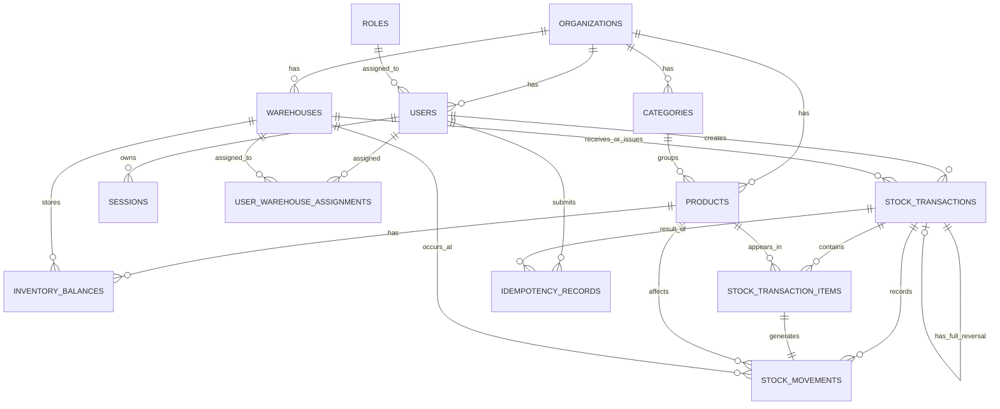

# StockFlow ERD & Database Specification

**Dokumen:** ERD dan Database Specification  
**Versi:** 1.0  
**Tanggal:** 12 November 2026  
**Status:** Draft implementasi untuk direview sebelum migration production  
**Produk:** StockFlow  
**Acuan:** PRD StockFlow v1.0.1, FSD StockFlow v1.0.1, StockFlow Design System UI/UX Spec v1.0  
**Database:** MySQL 8.4 LTS  
**Storage Engine:** InnoDB  
**ORM:** Prisma  
**Character Set:** utf8mb4  
**Timezone penyimpanan:** UTC

---

## 1. Tujuan Dokumen

Dokumen ini menetapkan rancangan konseptual dan fisik database StockFlow agar implementasi backend, ORM, migration, testing, dan deployment menggunakan struktur data yang konsisten.

Dokumen ini menjadi acuan untuk:

1. Menentukan entitas dan relasi antarentitas.
2. Menetapkan nama tabel, kolom, tipe data, dan nullability.
3. Menetapkan primary key, foreign key, unique constraint, check constraint, dan indeks.
4. Menentukan aturan persistensi saldo, transaksi stok, movement, assignment gudang, dan idempotency.
5. Menentukan perilaku penghapusan data dan retensi data historis.
6. Menjadi dasar pembuatan Prisma schema dan migration SQL.

Dokumen ini tidak menggantikan business rule pada PRD/FSD. Jika terdapat perbedaan, requirement produk pada PRD dan aturan proses pada FSD tetap menjadi acuan. Penyesuaian teknis pada dokumen ini dijelaskan pada bagian keputusan desain.

## 2. Referensi dan Batasan

| Referensi | Penggunaan |
|---|---|
| PRD StockFlow v1.0.1 | Kebutuhan produk, role, akses gudang, transaksi, dashboard, dan aturan bisnis |
| FSD StockFlow v1.0.1 | Struktur proses, kontrak data, transaksi atomik, koreksi, idempotency, dan rancangan awal entitas |
| Design System UI/UX Spec v1.0 | Konteks tampilan; tidak menjadi sumber definisi struktur database |

### 2.1 Batasan MVP

- Satu instalasi StockFlow hanya memiliki satu organisasi aktif. Tabel `organizations` tetap dipakai agar data organisasi memiliki relasi eksplisit.
- Role yang digunakan adalah `ADMIN` dan `WAREHOUSE_STAFF`.
- Tidak ada public registration.
- Tidak ada multi-company tenant switching.
- Tidak ada draft transaksi stok. Transaksi bisnis yang tersimpan harus berstatus `POSTED`.
- Master data menggunakan status aktif/nonaktif. Hard delete tidak tersedia melalui alur aplikasi normal.
- Stok dikelola per kombinasi produk dan gudang.
- Kuantitas menggunakan tiga angka desimal.
- Koreksi transaksi hanya berupa reversal penuh, bukan edit atau reversal parsial.

## 3. Konvensi Database

| Item | Standar |
|---|---|
| Table name | `snake_case`, plural |
| Column name | `snake_case` |
| Primary key | UUID dalam `CHAR(36)` |
| UUID collation | `ascii_bin` |
| Text | `utf8mb4` |
| Timestamp | `DATETIME(3)` dalam UTC |
| Date bisnis sequence | `DATE` berdasarkan timezone organisasi |
| Quantity | `DECIMAL(18,3)` |
| Cost price | `DECIMAL(18,2)` |
| Boolean | `BOOLEAN` / `TINYINT(1)` |
| JSON response | MySQL `JSON` |
| Storage engine | InnoDB |
| Delete policy | `RESTRICT` untuk data yang memiliki relasi historis |
| ORM mapping | Prisma `@map` dan `@@map` untuk nama fisik snake_case |

### 3.1 Aturan UUID

1. UUID disimpan dalam format canonical string `CHAR(36)`.
2. UUID dibuat oleh aplikasi/Prisma pada saat insert.
3. UUID bersifat immutable setelah record dibuat.
4. Seluruh kolom FK UUID harus mempunyai tipe, character set, dan collation yang sama dengan kolom referensinya.

### 3.2 Aturan waktu

1. Seluruh kolom `DATETIME(3)` menyimpan waktu UTC.
2. Backend mengubah waktu lokal organisasi menjadi UTC sebelum query rentang tanggal.
3. `organizations.timezone` menjadi sumber timezone untuk tampilan, dashboard, dan penomoran transaksi.
4. `stock_transaction_sequences.period_date` menyimpan tanggal lokal organisasi, bukan tanggal UTC.
5. API harus mengirim timestamp dalam format ISO 8601 yang menyertakan offset atau `Z`.

### 3.3 Aturan decimal

1. Backend harus menggunakan tipe decimal presisi tinggi, bukan floating point, untuk quantity dan cost price.
2. Operasi penjumlahan/pengurangan saldo harus dilakukan menggunakan nilai decimal.
3. Frontend hanya melakukan formatting nilai; frontend tidak menjadi sumber perhitungan saldo.
4. Nilai quantity harus positif pada item transaksi.
5. Saldo akhir tidak boleh negatif.

## 4. ERD Konseptual



**Catatan:** `stock_transaction_sequences` tidak memiliki relasi foreign key ke `organizations` dan tidak memiliki `organization_id` pada MVP karena satu instalasi hanya memiliki satu organisasi. Scope sequence mengikuti konfigurasi organisasi instalasi pada application layer. `STOCK_TRANSACTIONS` memiliki relasi self-reference melalui `correction_of_transaction_id`. Satu transaksi asal dapat memiliki nol atau satu transaksi koreksi penuh; setiap transaksi koreksi menunjuk tepat satu transaksi asal.

## 5. Ringkasan Entitas

| No. | Tabel | Fungsi | Kategori |
|---:|---|---|---|
| 1 | `organizations` | Profil dan konfigurasi organisasi | Configuration |
| 2 | `roles` | Master role aplikasi | Authorization |
| 3 | `users` | Akun pengguna dan role | Identity |
| 4 | `sessions` | Session login yang dapat dicabut | Security |
| 5 | `categories` | Kategori produk | Master data |
| 6 | `products` | Katalog produk | Master data |
| 7 | `warehouses` | Master gudang | Master data |
| 8 | `user_warehouse_assignments` | Penugasan akses gudang untuk Warehouse Staff | Authorization |
| 9 | `inventory_balances` | Saldo terkini per produk dan gudang | Inventory |
| 10 | `stock_transactions` | Header Stock In, Stock Out, dan reversal | Transaction |
| 11 | `stock_transaction_items` | Detail produk dan kuantitas transaksi | Transaction |
| 12 | `stock_movements` | Ledger dampak transaksi terhadap stok | Inventory ledger |
| 13 | `stock_transaction_sequences` | Penomoran referensi transaksi | Support |
| 14 | `idempotency_records` | Mencegah transaksi ganda saat retry request | Reliability |

## 6. Data Dictionary

Tipe data pada tabel di bawah adalah tipe fisik MySQL. Semua UUID memakai `CHAR(36) CHARACTER SET ascii COLLATE ascii_bin`. Semua timestamp memakai `DATETIME(3)` dan UTC kecuali dinyatakan berbeda.

### 6.1 `organizations`

Menyimpan identitas dan konfigurasi utama instalasi.

| Kolom | Tipe | Null | Default | Constraint / Aturan |
|---|---|---:|---|---|
| `id` | CHAR(36) | No | UUID aplikasi | PK |
| `name` | VARCHAR(160) | No | - | Trim, minimal 2 karakter |
| `code` | VARCHAR(40) | Yes | NULL | Unique jika diisi |
| `address` | VARCHAR(500) | Yes | NULL | - |
| `phone` | VARCHAR(40) | Yes | NULL | - |
| `email` | VARCHAR(160) | Yes | NULL | Format email jika diisi |
| `timezone` | VARCHAR(64) | No | `Asia/Makassar` | Harus berupa timezone identifier yang valid |
| `currency` | CHAR(3) | No | `IDR` | Kode mata uang ISO 4217 |
| `created_at` | DATETIME(3) | No | CURRENT_TIMESTAMP(3) | UTC |
| `updated_at` | DATETIME(3) | No | CURRENT_TIMESTAMP(3) | UTC, auto update |

**Business rule:** MVP hanya mengizinkan satu organisasi aktif per instalasi. Pembuatan organisasi dilakukan oleh bootstrap CLI bersama akun Admin di dalam satu transaksi database. Tidak ada endpoint public registration.

### 6.2 `roles`

Master role yang dibuat melalui seed/migration.

| Kolom | Tipe | Null | Default | Constraint / Aturan |
|---|---|---:|---|---|
| `id` | CHAR(36) | No | UUID tetap dari seed | PK |
| `code` | VARCHAR(40) | No | - | Unique; `ADMIN`, `WAREHOUSE_STAFF` |
| `name` | VARCHAR(80) | No | - | Label role |
| `created_at` | DATETIME(3) | No | CURRENT_TIMESTAMP(3) | UTC |

Role tidak dibuat, diubah, atau dihapus melalui UI MVP. Permission ditetapkan di application layer sesuai FSD dan tidak memerlukan tabel permission terpisah pada MVP.

### 6.3 `users`

Menyimpan akun, role, status, dan preferensi pengguna.

| Kolom | Tipe | Null | Default | Constraint / Aturan |
|---|---|---:|---|---|
| `id` | CHAR(36) | No | UUID aplikasi | PK |
| `organization_id` | CHAR(36) | No | - | FK `organizations.id` |
| `role_id` | CHAR(36) | No | - | FK `roles.id` |
| `name` | VARCHAR(120) | No | - | Trim, panjang 2-120 karakter |
| `email` | VARCHAR(160) | No | - | Unique case-insensitive; dinormalisasi sebelum disimpan |
| `password_hash` | VARCHAR(255) | No | - | Argon2id hash, tidak boleh plaintext |
| `status` | ENUM(`ACTIVE`,`INACTIVE`) | No | `ACTIVE` | Status akun |
| `must_change_password` | BOOLEAN | No | `FALSE` | TRUE untuk password bootstrap/reset sementara |
| `theme_preference` | ENUM(`LIGHT`,`DARK`,`SYSTEM`) | No | `SYSTEM` | Preferensi tema |
| `last_login_at` | DATETIME(3) | Yes | NULL | UTC |
| `created_at` | DATETIME(3) | No | CURRENT_TIMESTAMP(3) | UTC |
| `updated_at` | DATETIME(3) | No | CURRENT_TIMESTAMP(3) | UTC, auto update |
| `created_by` | CHAR(36) | Yes | NULL | FK self-reference ke `users.id` |
| `updated_by` | CHAR(36) | Yes | NULL | FK self-reference ke `users.id` |

**Business rule:**

- Admin memiliki akses ke seluruh gudang dan tidak memerlukan record assignment.
- Warehouse Staff aktif wajib memiliki minimal satu assignment ke gudang aktif.
- Email disimpan dalam bentuk trim dan normalized lowercase. Unique constraint database menjadi perlindungan akhir terhadap duplikasi.
- Menonaktifkan user harus mencabut seluruh session aktif.
- User tidak dihapus permanen melalui alur normal.
- Validasi minimal assignment, satu-satunya Admin aktif, serta perubahan role wajib dilakukan di service layer dalam transaksi database.

### 6.4 `sessions`

Menyimpan session login yang dapat dicabut tanpa menyimpan token mentah.

| Kolom | Tipe | Null | Default | Constraint / Aturan |
|---|---|---:|---|---|
| `id` | CHAR(36) | No | UUID aplikasi | PK |
| `user_id` | CHAR(36) | No | - | FK `users.id` |
| `token_hash` | CHAR(64) | No | - | Unique, SHA-256 hex digest |
| `csrf_token_hash` | CHAR(64) | No | - | SHA-256 hex digest |
| `expires_at` | DATETIME(3) | No | - | UTC |
| `revoked_at` | DATETIME(3) | Yes | NULL | UTC; NULL berarti belum dicabut |
| `last_seen_at` | DATETIME(3) | Yes | NULL | UTC |
| `created_at` | DATETIME(3) | No | CURRENT_TIMESTAMP(3) | UTC |

Session valid hanya ketika belum expired, belum revoked, dan user berstatus `ACTIVE`.

### 6.5 `categories`

Menyimpan kategori katalog produk.

| Kolom | Tipe | Null | Default | Constraint / Aturan |
|---|---|---:|---|---|
| `id` | CHAR(36) | No | UUID aplikasi | PK |
| `organization_id` | CHAR(36) | No | - | FK `organizations.id` |
| `name` | VARCHAR(100) | No | - | Unique bersama organization, case-insensitive |
| `description` | VARCHAR(500) | Yes | NULL | - |
| `is_active` | BOOLEAN | No | `TRUE` | Status aktif |
| `created_at` | DATETIME(3) | No | CURRENT_TIMESTAMP(3) | UTC |
| `updated_at` | DATETIME(3) | No | CURRENT_TIMESTAMP(3) | UTC, auto update |
| `created_by` | CHAR(36) | No | - | FK `users.id` |
| `updated_by` | CHAR(36) | No | - | FK `users.id` |

**Unique:** (`organization_id`, `name`). Nama di-trim sebelum validasi dan penyimpanan. Kategori yang sudah digunakan produk tidak boleh dihapus permanen. Kategori nonaktif tidak tersedia untuk produk baru, tetapi tetap muncul pada data historis.

### 6.6 `products`

Menyimpan katalog produk dan parameter stok.

| Kolom | Tipe | Null | Default | Constraint / Aturan |
|---|---|---:|---|---|
| `id` | CHAR(36) | No | UUID aplikasi | PK |
| `organization_id` | CHAR(36) | No | - | FK `organizations.id` |
| `category_id` | CHAR(36) | No | - | FK `categories.id` |
| `name` | VARCHAR(160) | No | - | Trim |
| `sku` | VARCHAR(64) | No | - | Uppercase, unique per organization |
| `unit` | VARCHAR(24) | No | - | Satuan dasar produk |
| `minimum_stock` | DECIMAL(18,3) | No | `0.000` | CHECK >= 0 |
| `cost_price` | DECIMAL(18,2) | Yes | NULL | Harga pokok per satu unit dasar, CHECK >= 0 |
| `description` | VARCHAR(1000) | Yes | NULL | - |
| `is_active` | BOOLEAN | No | `TRUE` | Status aktif |
| `created_at` | DATETIME(3) | No | CURRENT_TIMESTAMP(3) | UTC |
| `updated_at` | DATETIME(3) | No | CURRENT_TIMESTAMP(3) | UTC, auto update |
| `created_by` | CHAR(36) | No | - | FK `users.id` |
| `updated_by` | CHAR(36) | No | - | FK `users.id` |

**Unique:** (`organization_id`, `sku`).  
**Index:** (`organization_id`, `name`), (`category_id`, `is_active`).

**Business rule:**

- Metadata katalog produk dapat dibaca semua pengguna terautentikasi.
- Saldo, status stok, nilai stok, dan movement produk selalu mengikuti warehouse access scope pengguna.
- `minimum_stock` dibandingkan dengan saldo agregat produk pada warehouse access scope pengguna.
- `cost_price` adalah harga per satu unit dasar produk. NULL berarti nilai harga pokok belum tersedia.
- `cost_price` digunakan untuk estimasi nilai stok saat ini, bukan valuasi historis transaksi.
- Produk yang sudah memiliki transaksi atau saldo tidak boleh dihapus permanen.

### 6.7 `warehouses`

Menyimpan lokasi penyimpanan stok.

| Kolom | Tipe | Null | Default | Constraint / Aturan |
|---|---|---:|---|---|
| `id` | CHAR(36) | No | UUID aplikasi | PK |
| `organization_id` | CHAR(36) | No | - | FK `organizations.id` |
| `name` | VARCHAR(160) | No | - | Nama gudang |
| `code` | VARCHAR(32) | No | - | Unique per organization, normalized uppercase |
| `location` | VARCHAR(255) | Yes | NULL | - |
| `description` | VARCHAR(500) | Yes | NULL | - |
| `is_active` | BOOLEAN | No | `TRUE` | Status aktif |
| `created_at` | DATETIME(3) | No | CURRENT_TIMESTAMP(3) | UTC |
| `updated_at` | DATETIME(3) | No | CURRENT_TIMESTAMP(3) | UTC, auto update |
| `created_by` | CHAR(36) | No | - | FK `users.id` |
| `updated_by` | CHAR(36) | No | - | FK `users.id` |

**Unique:** (`organization_id`, `code`).  
Gudang yang sudah memiliki transaksi, saldo, movement, atau assignment tidak boleh dihapus permanen.

### 6.8 `user_warehouse_assignments`

Tabel junction untuk akses gudang Warehouse Staff.

| Kolom | Tipe | Null | Default | Constraint / Aturan |
|---|---|---:|---|---|
| `user_id` | CHAR(36) | No | - | PK part, FK `users.id` |
| `warehouse_id` | CHAR(36) | No | - | PK part, FK `warehouses.id` |
| `assigned_by` | CHAR(36) | No | - | FK `users.id` |
| `created_at` | DATETIME(3) | No | CURRENT_TIMESTAMP(3) | UTC |

**Primary key:** (`user_id`, `warehouse_id`).  
**Index tambahan:** (`warehouse_id`, `user_id`).

**Business rule:**

- Hanya Warehouse Staff yang memiliki assignment operasional.
- Assignment hanya boleh menunjuk gudang aktif pada organisasi instalasi yang sama.
- Assignment diganti secara atomik.
- Array assignment kosong ditolak untuk Warehouse Staff aktif.
- Assignment tetap disimpan saat gudang atau user dinonaktifkan demi mempertahankan jejak konfigurasi.
- Warehouse Staff hanya boleh melihat saldo, transaksi, movement, ringkasan gudang, dan alert dari gudang yang ditugaskan dan aktif.
- Admin tidak difilter oleh tabel ini.
- Backend tetap memvalidasi role, status user, status gudang, dan assignment pada setiap request.

### 6.9 `inventory_balances`

Menyimpan saldo terkini produk pada setiap gudang.

| Kolom | Tipe | Null | Default | Constraint / Aturan |
|---|---|---:|---|---|
| `id` | CHAR(36) | No | UUID aplikasi | PK |
| `product_id` | CHAR(36) | No | - | FK `products.id` |
| `warehouse_id` | CHAR(36) | No | - | FK `warehouses.id` |
| `quantity` | DECIMAL(18,3) | No | `0.000` | CHECK >= 0 |
| `created_at` | DATETIME(3) | No | CURRENT_TIMESTAMP(3) | UTC |
| `updated_at` | DATETIME(3) | No | CURRENT_TIMESTAMP(3) | UTC, auto update |

**Unique:** (`product_id`, `warehouse_id`).  
**Index tambahan:** (`warehouse_id`, `product_id`).

**Business rule:**

- Satu kombinasi produk dan gudang hanya memiliki satu row saldo.
- Row dapat dibuat saat Stock In atau Stock Out pertama kali memerlukan pemeriksaan saldo.
- Stock Out tidak boleh menyebabkan saldo negatif.
- Semua update saldo wajib terjadi dalam transaksi database bersama header, item, movement, dan idempotency record.
- Saldo tidak boleh diubah langsung melalui endpoint CRUD. Penyesuaian hanya melalui transaksi stok yang sah.
- Row saldo tidak boleh dihapus selama memiliki keterkaitan historis.

### 6.10 `stock_transactions`

Header untuk Stock In, Stock Out, dan reversal penuh.

| Kolom | Tipe | Null | Default | Constraint / Aturan |
|---|---|---:|---|---|
| `id` | CHAR(36) | No | UUID aplikasi | PK |
| `organization_id` | CHAR(36) | No | - | FK `organizations.id` |
| `warehouse_id` | CHAR(36) | No | - | FK `warehouses.id` |
| `created_by` | CHAR(36) | No | - | FK `users.id` |
| `created_by_name_snapshot` | VARCHAR(120) | No | - | Nama pembuat saat transaksi |
| `type` | ENUM(`IN`,`OUT`) | No | - | Arah perubahan stok |
| `reference_number` | VARCHAR(40) | No | - | Unique |
| `status` | ENUM(`POSTED`) | No | `POSTED` | Hanya transaksi sukses yang disimpan |
| `note` | VARCHAR(1000) | Yes | NULL | Catatan transaksi/alasan koreksi |
| `external_reference` | VARCHAR(120) | Yes | NULL | Referensi dokumen eksternal |
| `correction_of_transaction_id` | CHAR(36) | Yes | NULL | Unique nullable FK self-reference ke transaksi asal |
| `warehouse_name_snapshot` | VARCHAR(160) | No | - | Nama gudang ketika transaksi dibuat |
| `warehouse_code_snapshot` | VARCHAR(32) | No | - | Kode gudang ketika transaksi dibuat |
| `posted_at` | DATETIME(3) | No | - | UTC |
| `created_at` | DATETIME(3) | No | CURRENT_TIMESTAMP(3) | UTC |

**Unique:** `reference_number`; `correction_of_transaction_id` (nullable unique).  
**Index:** (`posted_at`), (`type`, `posted_at`), (`warehouse_id`, `posted_at`).

**Business rule:**

- Satu header hanya memiliki satu gudang.
- Transaksi tidak dapat diedit atau dihapus setelah berhasil diposting.
- Koreksi harus membalik arah transaksi asal: asal `IN` dikoreksi dengan `OUT`, dan asal `OUT` dikoreksi dengan `IN`.
- Koreksi wajib memakai gudang, produk, dan kuantitas yang sama persis dengan transaksi asal.
- Satu transaksi asal hanya boleh memiliki satu koreksi penuh.
- Transaksi koreksi tidak boleh dikoreksi kembali.
- Koreksi transaksi asal `IN` harus memastikan saldo tersedia pada setiap produk.
- Validasi di atas dilakukan oleh backend dalam satu transaksi database. Unique FK hanya menjadi perlindungan akhir terhadap koreksi ganda.

### 6.11 `stock_transaction_items`

Detail item produk pada setiap header transaksi.

| Kolom | Tipe | Null | Default | Constraint / Aturan |
|---|---|---:|---|---|
| `id` | CHAR(36) | No | UUID aplikasi | PK |
| `transaction_id` | CHAR(36) | No | - | FK `stock_transactions.id` |
| `product_id` | CHAR(36) | No | - | FK `products.id` |
| `product_name_snapshot` | VARCHAR(160) | No | - | Nama produk saat transaksi |
| `sku_snapshot` | VARCHAR(64) | No | - | SKU saat transaksi |
| `unit_snapshot` | VARCHAR(24) | No | - | Satuan dasar saat transaksi |
| `quantity` | DECIMAL(18,3) | No | - | CHECK > 0 |
| `balance_before` | DECIMAL(18,3) | No | - | CHECK >= 0 |
| `balance_after` | DECIMAL(18,3) | No | - | CHECK >= 0 |
| `created_at` | DATETIME(3) | No | CURRENT_TIMESTAMP(3) | UTC |

**Unique:** (`transaction_id`, `product_id`).  
**Index:** (`product_id`, `transaction_id`).

Satu produk hanya boleh muncul satu kali pada satu transaksi. Snapshot menyimpan informasi tampilan historis ketika nama, SKU, atau satuan master produk berubah setelah transaksi diposting.

### 6.12 `stock_movements`

Ledger untuk menelusuri dampak transaksi terhadap stok.

| Kolom | Tipe | Null | Default | Constraint / Aturan |
|---|---|---:|---|---|
| `id` | CHAR(36) | No | UUID aplikasi | PK |
| `transaction_id` | CHAR(36) | No | - | FK `stock_transactions.id` |
| `transaction_item_id` | CHAR(36) | No | - | Unique FK `stock_transaction_items.id` |
| `product_id` | CHAR(36) | No | - | FK `products.id` |
| `warehouse_id` | CHAR(36) | No | - | FK `warehouses.id` |
| `type` | ENUM(`IN`,`OUT`) | No | - | Arah movement |
| `quantity` | DECIMAL(18,3) | No | - | CHECK > 0 |
| `balance_before` | DECIMAL(18,3) | No | - | CHECK >= 0 |
| `balance_after` | DECIMAL(18,3) | No | - | CHECK >= 0 |
| `created_at` | DATETIME(3) | No | CURRENT_TIMESTAMP(3) | UTC |

**Unique:** `transaction_item_id`, sehingga satu item menghasilkan tepat satu movement.  
**Index:** (`product_id`, `created_at`), (`warehouse_id`, `created_at`), (`type`, `created_at`).

**Business rule:** movement bersifat append-only dan tidak boleh diedit/dihapus melalui aplikasi normal. Kolom `transaction_id`, `transaction_item_id`, `product_id`, dan `warehouse_id` harus merepresentasikan transaksi dan item yang sama. SQL schema memakai composite FK untuk menjaga sebagian konsistensi relasi ini.

### 6.13 `stock_transaction_sequences`

Menjaga nomor referensi transaksi agar unik per tipe dan tanggal lokal.

| Kolom | Tipe | Null | Default | Constraint / Aturan |
|---|---|---:|---|---|
| `id` | CHAR(36) | No | UUID aplikasi | PK |
| `transaction_type` | ENUM(`IN`,`OUT`) | No | - | Tipe sequence |
| `period_date` | DATE | No | - | Tanggal lokal organisasi |
| `last_number` | INT UNSIGNED | No | `0` | Nomor terakhir; tidak negatif |

**Unique:** (`transaction_type`, `period_date`).

Format default:

- Stock In: `IN-YYYYMMDD-000001`
- Stock Out: `OUT-YYYYMMDD-000001`

Increment harus dilakukan di dalam transaksi database dengan row-level lock. Jika transaksi bisnis rollback, perubahan sequence ikut rollback. Unique constraint `stock_transactions.reference_number` menjadi perlindungan akhir.

### 6.14 `idempotency_records`

Mencegah satu request menghasilkan transaksi bisnis ganda saat terjadi retry atau timeout.

| Kolom | Tipe | Null | Default | Constraint / Aturan |
|---|---|---:|---|---|
| `id` | CHAR(36) | No | UUID aplikasi | PK |
| `user_id` | CHAR(36) | No | - | FK `users.id` |
| `idempotency_key` | VARCHAR(128) | No | - | Unique bersama user |
| `request_hash` | CHAR(64) | No | - | SHA-256 hash payload canonical |
| `transaction_id` | CHAR(36) | Yes | NULL | FK `stock_transactions.id` |
| `response_status` | SMALLINT UNSIGNED | Yes | NULL | HTTP status hasil |
| `response_body` | JSON | Yes | NULL | Response sukses untuk replay |
| `created_at` | DATETIME(3) | No | CURRENT_TIMESTAMP(3) | UTC |
| `expires_at` | DATETIME(3) | No | - | UTC |

**Unique:** (`user_id`, `idempotency_key`).  
**Index:** (`expires_at`).

**Business rule:**

- Key yang sama dan payload hash sama mengembalikan hasil request pertama jika sudah sukses.
- Key yang sama dengan payload berbeda menghasilkan `409 IDEMPOTENCY_KEY_REUSED`.
- Klaim key, transaksi stok, dan response sukses harus di-commit secara atomik.
- Key yang sudah expired dapat dibersihkan sesuai retention policy setelah periode deduplikasi yang ditentukan operasional.
- Kunci idempotency tidak menggantikan unique reference number atau constraint koreksi.

## 7. Relasi dan Foreign Key

| Parent | Child | Relasi | Delete policy |
|---|---|---|---|
| `organizations` | `users` | 1:N | RESTRICT |
| `organizations` | `categories` | 1:N | RESTRICT |
| `organizations` | `products` | 1:N | RESTRICT |
| `organizations` | `warehouses` | 1:N | RESTRICT |
| `organizations` | `stock_transactions` | 1:N | RESTRICT |
| `roles` | `users` | 1:N | RESTRICT |
| `users` | `sessions` | 1:N | RESTRICT |
| `users` | `user_warehouse_assignments` | 1:N | RESTRICT |
| `warehouses` | `user_warehouse_assignments` | 1:N | RESTRICT |
| `categories` | `products` | 1:N | RESTRICT |
| `products` | `inventory_balances` | 1:N | RESTRICT |
| `warehouses` | `inventory_balances` | 1:N | RESTRICT |
| `users` | `stock_transactions` | 1:N | RESTRICT |
| `warehouses` | `stock_transactions` | 1:N | RESTRICT |
| `stock_transactions` | `stock_transaction_items` | 1:N | RESTRICT |
| `products` | `stock_transaction_items` | 1:N | RESTRICT |
| `stock_transactions` | `stock_movements` | 1:N | RESTRICT |
| `stock_transaction_items` | `stock_movements` | 1:1 setelah transaksi commit | RESTRICT |
| `products` | `stock_movements` | 1:N | RESTRICT |
| `warehouses` | `stock_movements` | 1:N | RESTRICT |
| `users` | `idempotency_records` | 1:N | RESTRICT |
| `stock_transactions` | `idempotency_records` | 1:N | RESTRICT |

### 7.1 Kebijakan penghapusan

1. Tidak menggunakan cascade delete pada data operasional.
2. Organisasi, user, kategori, produk, dan gudang yang memiliki data turunan tidak boleh dihapus permanen melalui aplikasi normal.
3. User dinonaktifkan melalui `users.status`.
4. Kategori, produk, dan gudang dinonaktifkan melalui `is_active`.
5. Assignment dipertahankan saat user atau gudang dinonaktifkan.
6. Transaksi, item, movement, dan saldo historis dipertahankan.
7. Session dapat dihapus setelah retention policy keamanan terpenuhi, tetapi pencabutan session normal dilakukan dengan `revoked_at`.
8. Idempotency record dapat dihapus setelah `expires_at` dan masa retensi operasional terpenuhi.

## 8. Constraint dan Validasi

### 8.1 Constraint database

| Tabel | Constraint | Tujuan |
|---|---|---|
| `organizations` | UNIQUE(`code`) | Kode organisasi tidak duplikat jika diisi |
| `users` | UNIQUE(`email`) | Identitas login tidak duplikat |
| `categories` | UNIQUE(`organization_id`,`name`) | Nama kategori unik per organisasi |
| `products` | UNIQUE(`organization_id`,`sku`) | SKU unik per organisasi |
| `warehouses` | UNIQUE(`organization_id`,`code`) | Kode gudang unik per organisasi |
| `user_warehouse_assignments` | PK(`user_id`,`warehouse_id`) | Assignment tidak duplikat |
| `inventory_balances` | UNIQUE(`product_id`,`warehouse_id`) | Satu saldo per produk-gudang |
| `inventory_balances` | CHECK(`quantity` >= 0) | Mencegah saldo negatif |
| `products` | CHECK(`minimum_stock` >= 0) | Minimum stock tidak negatif |
| `products` | CHECK(`cost_price` IS NULL OR `cost_price` >= 0) | Harga pokok tidak negatif |
| `stock_transactions` | UNIQUE(`reference_number`) | Nomor transaksi unik |
| `stock_transactions` | UNIQUE(`correction_of_transaction_id`) | Maksimal satu koreksi per transaksi asal |
| `stock_transaction_items` | UNIQUE(`transaction_id`,`product_id`) | Satu SKU sekali per transaksi |
| `stock_transaction_items` | CHECK(`quantity` > 0) | Kuantitas transaksi positif |
| `stock_transaction_items` | CHECK saldo sebelum/sesudah >= 0 | Snapshot saldo valid |
| `stock_movements` | UNIQUE(`transaction_item_id`) | Satu movement per item |
| `stock_movements` | CHECK(`quantity` > 0) | Movement positif |
| `stock_transaction_sequences` | UNIQUE(`transaction_type`,`period_date`) | Satu counter per tipe dan tanggal |
| `idempotency_records` | UNIQUE(`user_id`,`idempotency_key`) | Mencegah request ganda |

### 8.2 Validasi yang wajib dilakukan service layer

Constraint database tidak menggantikan validasi bisnis berikut:

- User aktif dengan role Warehouse Staff memiliki minimal satu assignment gudang aktif.
- Assignment hanya menghubungkan user dan gudang pada organisasi instalasi yang sama.
- Assignment hanya diberikan kepada `WAREHOUSE_STAFF`.
- Admin tidak dapat menonaktifkan atau menghilangkan satu-satunya Admin aktif.
- Warehouse Staff hanya dapat mengakses gudang yang ditugaskan.
- Produk dan gudang pada transaksi harus aktif dan berasal dari organisasi instalasi yang sama.
- Stock Out tidak boleh melebihi saldo aktual.
- Satu transaksi koreksi harus membalik tipe, gudang, produk, dan kuantitas transaksi asal secara penuh.
- Transaksi koreksi tidak boleh dikoreksi kembali.
- Transaksi asal hanya boleh dikoreksi sekali.
- `stock_movements.type`, `quantity`, `balance_before`, dan `balance_after` harus konsisten dengan item dan header transaksi.
- Saldo harus sama dengan hasil rekonstruksi ledger movement.
- Idempotency key yang sama tidak boleh digunakan untuk payload yang berbeda.

Validasi ini harus dijalankan di backend. Validasi UI hanya membantu pengalaman pengguna dan bukan mekanisme keamanan.

## 9. Index Specification

Index di bawah adalah baseline implementasi. Index tambahan hanya boleh dibuat setelah melihat query aktual dan `EXPLAIN ANALYZE` pada dataset uji yang realistis.

| Tabel | Index | Tipe | Query yang didukung |
|---|---|---|---|
| `organizations` | `uq_organizations_code` (`code`) | UNIQUE | Pencarian kode organisasi |
| `users` | `uq_users_email` (`email`) | UNIQUE | Login dan cek email |
| `users` | `idx_users_org_status` (`organization_id`,`status`) | INDEX | Daftar pengguna aktif/nonaktif |
| `sessions` | `uq_sessions_token_hash` (`token_hash`) | UNIQUE | Lookup session |
| `sessions` | `idx_sessions_user_expires` (`user_id`,`expires_at`) | INDEX | Session per user dan cleanup |
| `categories` | `uq_categories_org_name` (`organization_id`,`name`) | UNIQUE | Validasi nama kategori |
| `categories` | `idx_categories_org_active` (`organization_id`,`is_active`) | INDEX | List kategori aktif |
| `products` | `uq_products_org_sku` (`organization_id`,`sku`) | UNIQUE | Lookup SKU |
| `products` | `idx_products_org_name` (`organization_id`,`name`) | INDEX | Search nama produk |
| `products` | `idx_products_category_active` (`category_id`,`is_active`) | INDEX | Filter kategori |
| `warehouses` | `uq_warehouses_org_code` (`organization_id`,`code`) | UNIQUE | Lookup kode gudang |
| `warehouses` | `idx_warehouses_org_active` (`organization_id`,`is_active`) | INDEX | List gudang aktif |
| `user_warehouse_assignments` | PK (`user_id`,`warehouse_id`) | UNIQUE | Assignment per user |
| `user_warehouse_assignments` | `idx_uwa_warehouse_user` (`warehouse_id`,`user_id`) | INDEX | Reverse lookup assignment |
| `inventory_balances` | `uq_balance_product_warehouse` (`product_id`,`warehouse_id`) | UNIQUE | Lookup saldo satu produk-gudang |
| `inventory_balances` | `idx_balance_warehouse_product` (`warehouse_id`,`product_id`) | INDEX | Ringkasan satu gudang |
| `stock_transactions` | `uq_transactions_reference` (`reference_number`) | UNIQUE | Detail berdasarkan referensi |
| `stock_transactions` | `uq_transactions_correction_of` (`correction_of_transaction_id`) | UNIQUE | Cegah koreksi ganda |
| `stock_transactions` | `idx_transactions_posted` (`posted_at`) | INDEX | Filter tanggal |
| `stock_transactions` | `idx_transactions_type_posted` (`type`,`posted_at`) | INDEX | Grafik IN/OUT |
| `stock_transactions` | `idx_transactions_warehouse_posted` (`warehouse_id`,`posted_at`) | INDEX | Riwayat gudang |
| `stock_transaction_items` | UNIQUE (`transaction_id`,`product_id`) | UNIQUE | Cegah produk berulang per transaksi |
| `stock_transaction_items` | `idx_items_product_transaction` (`product_id`,`transaction_id`) | INDEX | Riwayat produk |
| `stock_movements` | UNIQUE (`transaction_item_id`) | UNIQUE | Satu movement per item |
| `stock_movements` | `idx_movements_product_created` (`product_id`,`created_at`) | INDEX | Movement produk |
| `stock_movements` | `idx_movements_warehouse_created` (`warehouse_id`,`created_at`) | INDEX | Movement gudang |
| `stock_movements` | `idx_movements_type_created` (`type`,`created_at`) | INDEX | Filter tipe movement |
| `stock_transaction_sequences` | UNIQUE (`transaction_type`,`period_date`) | UNIQUE | Lock dan increment sequence |
| `idempotency_records` | UNIQUE (`user_id`,`idempotency_key`) | UNIQUE | Deduplikasi request |
| `idempotency_records` | `idx_idempotency_expires` (`expires_at`) | INDEX | Cleanup record kedaluwarsa |

Foreign key juga membutuhkan index. MySQL dapat membuat index pendukung FK secara otomatis bila belum tersedia, tetapi nama dan definisi index hasil migration harus tetap diperiksa agar tidak terjadi duplikasi index yang tidak dibutuhkan.

## 10. Database Transaction dan Concurrency

### 10.1 Prinsip umum

Operasi Stock In, Stock Out, dan reversal wajib menggunakan InnoDB transaction. Semua perubahan header, item, movement, saldo, sequence, dan idempotency result harus commit atau rollback sebagai satu kesatuan.

### 10.2 Urutan pemrosesan transaksi stok

1. Autentikasi dan authorization di backend.
2. Validasi payload dan warehouse access scope.
3. Mulai database transaction.
4. Klaim `Idempotency-Key`.
5. Validasi status gudang dan produk.
6. Buat row `inventory_balances` bernilai nol bila belum ada dengan operasi upsert yang aman.
7. Lock seluruh row balance yang diperlukan berdasarkan urutan `product_id` konsisten.
8. Baca saldo aktual.
9. Validasi ketersediaan stok jika Stock Out.
10. Lock dan increment sequence berdasarkan tipe transaksi serta tanggal lokal organisasi.
11. Insert header transaksi.
12. Insert transaction items.
13. Update row balance.
14. Insert stock movements.
15. Simpan response pada idempotency record.
16. Commit.

Jika satu langkah database gagal, seluruh perubahan harus rollback.

### 10.3 Lock saldo

- Gunakan row-level lock, misalnya `SELECT ... FOR UPDATE` melalui query raw SQL terparameterisasi Prisma jika diperlukan.
- Untuk transaksi dengan beberapa produk, lock berdasarkan urutan UUID produk yang konsisten.
- Jangan mengunci seluruh tabel.
- Terapkan retry terbatas untuk deadlock yang teridentifikasi. Retry memakai idempotency key yang sama.
- Bila retry habis, kembalikan error sementara dan pastikan tidak ada perubahan parsial.

### 10.4 Stock Out

Untuk setiap item, setelah saldo dikunci, pastikan `quantity <= balance_before`. Jika satu item gagal, seluruh transaksi dibatalkan. Backend tidak boleh menyimpan sebagian item dari transaksi multi-produk.

### 10.5 Full reversal

- Lock transaksi asal.
- Pastikan transaksi asal `POSTED`, belum pernah dikoreksi, dan bukan transaksi koreksi.
- Tentukan arah koreksi sebagai kebalikan tipe asal.
- Gunakan gudang, produk, dan kuantitas identik.
- Jika asal `IN`, pastikan saldo terkini cukup untuk mengeluarkan seluruh kuantitas.
- Jika asal `OUT`, masukkan kembali seluruh kuantitas.
- Insert transaksi koreksi dan update saldo/movement dalam transaction yang sama.
- Unique constraint pada `correction_of_transaction_id` menjadi pertahanan akhir terhadap concurrent correction.

### 10.6 Sequence nomor transaksi

- Sequence dipisahkan untuk `IN` dan `OUT`.
- Periode sequence mengikuti tanggal lokal organisasi.
- Row sequence di-lock saat increment.
- Unique reference number menjadi pertahanan terakhir terhadap collision.
- Jika transaksi rollback, increment sequence ikut rollback.

### 10.7 Idempotency

| Kondisi | Hasil |
|---|---|
| Key baru dan payload valid | Request diproses |
| Key sama, hash sama, transaksi sudah sukses | Response tersimpan dikembalikan |
| Key sama, hash berbeda | `409 IDEMPOTENCY_KEY_REUSED` |
| Request paralel dengan key sama | Unique constraint mengoordinasikan; request kedua menunggu atau menerima conflict sesuai implementasi API |
| Request pertama rollback | Tidak ada transaksi bisnis sukses; retry dapat memproses ulang |
| Client timeout setelah commit | Retry dengan key sama menerima hasil pertama |

## 11. Aturan Akses Data Berdasarkan Role

| Data | Admin | Warehouse Staff |
|---|---|---|
| Organisasi | Baca/ubah sesuai permission | Baca profil sesuai kebutuhan aplikasi |
| User management | Seluruh fungsi Admin | Tidak boleh |
| Kategori | Metadata organisasi | Metadata organisasi |
| Produk | Metadata dan seluruh stok | Metadata organisasi; stok hanya scope gudang assignment |
| Gudang | Seluruh gudang | Hanya gudang yang ditugaskan |
| Inventory balance | Seluruh gudang | Hanya gudang yang ditugaskan |
| Stock transaction | Seluruh gudang | Hanya gudang yang ditugaskan |
| Stock movement | Seluruh gudang | Hanya gudang yang ditugaskan |
| Assignment gudang | Kelola semua assignment | Tidak boleh melihat/mengubah assignment pengguna lain |

Penerapan scope harus dilakukan di query backend. Jangan mengambil semua data lalu menyembunyikan data yang tidak berhak dilihat pada frontend.

## 12. Konsistensi Saldo dan Ledger

### 12.1 Sumber data

- `inventory_balances` adalah saldo terkini untuk kebutuhan query operasional yang cepat.
- `stock_movements` adalah ledger perubahan stok yang append-only.
- `stock_transactions` dan `stock_transaction_items` menyimpan dokumen transaksi beserta snapshot historis.

### 12.2 Invariant saldo

Untuk setiap pasangan produk-gudang:

`current_balance = SUM(IN movement.quantity) - SUM(OUT movement.quantity)`

Perhitungan rekonsiliasi harus mempertimbangkan seluruh movement yang berhasil diposting pada pasangan produk-gudang tersebut.

### 12.3 Rekonsiliasi

Sediakan job/command internal untuk:

1. Menghitung ulang saldo dari ledger movement.
2. Membandingkan hasil ledger dengan `inventory_balances.quantity`.
3. Mencatat selisih dan identitas produk-gudang yang terdampak.
4. Tidak mengubah saldo secara otomatis tanpa kebijakan pemulihan yang terdokumentasi.
5. Mendukung pemeriksaan saat restore backup atau investigasi insiden.

## 13. Dashboard Query Rules

| Metrik | Sumber dan aturan |
|---|---|
| Total SKU | Jumlah produk aktif di organisasi, tidak dibatasi assignment gudang |
| Produk dengan Stok | Jumlah produk aktif dengan saldo agregat > 0 dalam warehouse access scope |
| Low Stock | Produk aktif dengan saldo agregat > 0 dan <= `minimum_stock` dalam scope |
| Out of Stock | Produk aktif dengan saldo agregat = 0 dalam scope |
| Estimasi nilai stok | Saldo scope dikalikan `cost_price` per unit dasar; produk dengan cost price NULL tidak masuk nominal |
| Coverage nilai stok | Jumlah/persentase produk bersaldo yang memiliki `cost_price` |
| Pergerakan hari ini | Jumlah header transaksi `IN` dan `OUT` yang berhasil diposting pada tanggal lokal organisasi |
| Grafik pergerakan | Jumlah header transaksi per hari, bukan agregat quantity lintas satuan |
| Recent movement | Movement pada gudang dalam scope akses pengguna |

Filter gudang pada chart, recent movement, dan ringkasan gudang tidak mengubah KPI utama yang mengikuti seluruh access scope pengguna.

## 14. Prisma Mapping Guidance

Prisma schema harus memetakan nama model ke tabel snake_case dan kolom ke nama fisik dengan `@map`/`@@map`.

Contoh pola mapping:

```prisma
model InventoryBalance {
  id          String   @id @db.Char(36)
  productId   String   @map("product_id") @db.Char(36)
  warehouseId String   @map("warehouse_id") @db.Char(36)
  quantity    Decimal  @default(0) @db.Decimal(18, 3)
  createdAt   DateTime @default(now()) @map("created_at") @db.DateTime(3)
  updatedAt   DateTime @updatedAt @map("updated_at") @db.DateTime(3)

  @@unique([productId, warehouseId], map: "uq_balance_product_warehouse")
  @@index([warehouseId, productId], map: "idx_balance_warehouse_product")
  @@map("inventory_balances")
}
```

Pedoman:

1. Gunakan Prisma `Decimal` untuk semua field decimal.
2. Gunakan enum Prisma yang identik dengan enum database.
3. Definisikan relation field untuk seluruh foreign key.
4. Beri nama index dan constraint agar migration dapat direview.
5. Jangan memakai JavaScript `number` untuk aritmetika saldo atau cost price. Gunakan Prisma Decimal atau library decimal yang kompatibel.
6. Gunakan query raw SQL terparameterisasi untuk `SELECT ... FOR UPDATE`, sequence lock, atau atomic operation yang tidak dapat dimodelkan dengan aman di Prisma Client.
7. Migration yang sudah diterapkan ke environment bersama tidak boleh diedit secara retroaktif. Buat migration baru untuk perubahan.
8. Jalankan `prisma migrate deploy` pada deployment, bukan `prisma migrate dev`.

## 15. Urutan Migration

Urutan pembuatan tabel untuk menghindari foreign key yang belum tersedia:

1. `organizations`
2. `roles`
3. `users`
4. `sessions`
5. `categories`
6. `products`
7. `warehouses`
8. `user_warehouse_assignments`
9. `inventory_balances`
10. `stock_transactions`
11. `stock_transaction_items`
12. `stock_movements`
13. `stock_transaction_sequences`
14. `idempotency_records`

Seed role dijalankan setelah tabel `roles` tersedia. Bootstrap organisasi dan Admin dijalankan melalui command terpisah setelah migration dan seed berhasil.

## 16. Seed dan Bootstrap Data

### 16.1 Role seed

Role awal:

| Code | Name |
|---|---|
| `ADMIN` | Administrator |
| `WAREHOUSE_STAFF` | Warehouse Staff |

Seed harus idempotent: menjalankan seed berulang kali tidak boleh membuat role duplikat atau mengubah code role yang sudah ada secara tidak sengaja.

### 16.2 Bootstrap organisasi dan Admin

1. Pastikan database dapat diakses.
2. Pastikan role seed sudah tersedia.
3. Pastikan belum ada organisasi dan Admin hasil bootstrap.
4. Kumpulkan nama organisasi, nama Admin, email Admin, dan password awal melalui input aman.
5. Normalisasi email.
6. Buat organisasi dan user Admin dalam satu transaksi database.
7. Hash password dengan Argon2id.
8. Set `must_change_password = TRUE`.
9. Rollback seluruh proses jika salah satu insert gagal.
10. Jangan menulis password atau database credential ke log.

## 17. Retention, Backup, dan Recovery

### 17.1 Backup

- Gunakan backup terjadwal untuk database production.
- Backup harus mencakup tabel master, saldo, transaksi, item, movement, sequence, session sesuai kebutuhan keamanan, dan idempotency sesuai retention policy.
- Backup disimpan terenkripsi dan tidak ditempatkan di repository aplikasi.
- Jadwal backup, retensi, dan lokasi penyimpanan harus ditetapkan pada deployment runbook.

### 17.2 Restore

- Restore dilakukan ke environment terisolasi terlebih dahulu.
- Setelah restore, jalankan pemeriksaan referential integrity dan rekonsiliasi saldo terhadap movement.
- Pastikan organisasi, role, Admin, dan konfigurasi timezone tersedia.
- Cabut session yang berpotensi tidak valid setelah restore lintas environment.

### 17.3 Retention awal yang perlu ditetapkan operasional

FSD/PRD belum menetapkan angka retention untuk sessions, idempotency records, backup, atau log. Nilai retention harus ditentukan sebelum production dan tidak boleh diasumsikan dari dokumen ini.

## 18. Database Acceptance Criteria

### 18.1 Schema

- [ ] Seluruh 14 tabel tersedia dengan nama dan kolom sesuai specification.
- [ ] Primary key UUID konsisten menggunakan `CHAR(36)`.
- [ ] Foreign key dan delete policy menggunakan `RESTRICT` untuk data operasional.
- [ ] Unique constraint mencegah duplikasi email, SKU, kode gudang, saldo produk-gudang, reference number, item produk per transaksi, movement per item, sequence, dan idempotency key.
- [ ] Check constraint mencegah quantity atau saldo negatif sesuai definisi.
- [ ] Seluruh timestamp operasional menggunakan UTC.

### 18.2 Authorization dan assignment

- [ ] Admin dapat melihat seluruh gudang.
- [ ] Warehouse Staff hanya dapat membaca gudang yang ditugaskan dan aktif.
- [ ] Assignment lintas organisasi ditolak.
- [ ] Warehouse Staff aktif tidak dapat disimpan tanpa minimal satu assignment gudang aktif pada operasi normal.
- [ ] Menonaktifkan gudang tidak menghapus assignment historis.

### 18.3 Stock transaction

- [ ] Stock In menambah saldo dan menciptakan header, item, serta movement secara atomik.
- [ ] Stock Out mengurangi saldo dan menolak saldo tidak cukup.
- [ ] Multi-item Stock Out rollback seluruh transaksi apabila satu item gagal.
- [ ] Saldo tidak pernah negatif.
- [ ] Satu kombinasi produk-gudang hanya mempunyai satu row balance.
- [ ] Satu item transaksi menghasilkan tepat satu movement.
- [ ] Transaksi yang sudah diposting tidak dapat diedit atau dihapus.

### 18.4 Correction dan idempotency

- [ ] Satu transaksi asal hanya dapat dikoreksi penuh satu kali.
- [ ] Koreksi membalik jenis transaksi dan menggunakan gudang, produk, serta kuantitas yang sama.
- [ ] Koreksi transaksi IN ditolak jika saldo kini tidak mencukupi.
- [ ] Transaksi koreksi tidak dapat dikoreksi kembali.
- [ ] Request dengan idempotency key sama dan payload sama tidak membuat transaksi ganda.
- [ ] Request dengan idempotency key sama dan payload berbeda ditolak dengan conflict.

### 18.5 Reliability dan recovery

- [ ] Concurrent Stock Out pada saldo terbatas tidak menyebabkan saldo negatif.
- [ ] Concurrent correction tidak menghasilkan dua koreksi.
- [ ] Deadlock retry terbatas tidak menggandakan transaksi.
- [ ] Backup dapat direstore.
- [ ] Saldo hasil restore dapat direkonsiliasi dengan ledger movement.

## 19. Keputusan Desain dan Catatan Implementasi

| ID | Keputusan | Dasar / Status |
|---|---|---|
| DB-DEC-001 | MySQL 8.4 LTS dan InnoDB | Mengikuti PRD/FSD |
| DB-DEC-002 | Prisma sebagai ORM dan migration manager | Mengikuti PRD/FSD |
| DB-DEC-003 | UUID `CHAR(36)` | Mengikuti struktur FSD |
| DB-DEC-004 | Semua timestamp disimpan UTC | Mengikuti FSD |
| DB-DEC-005 | Quantity `DECIMAL(18,3)` | Mengikuti FSD |
| DB-DEC-006 | Cost price `DECIMAL(18,2)` per base unit | Mengikuti FSD v1.0.1 |
| DB-DEC-007 | Satu organisasi per instalasi pada MVP | Mengikuti FSD |
| DB-DEC-008 | Assignment gudang memakai composite PK | Mengikuti FSD |
| DB-DEC-009 | Stock balance dipisahkan dari movement ledger | Mengikuti FSD |
| DB-DEC-010 | Transaksi posted bersifat immutable | Mengikuti PRD/FSD |
| DB-DEC-011 | Koreksi menggunakan reversal penuh | Mengikuti FSD v1.0.1 |
| DB-DEC-012 | Idempotency disimpan bersama hasil transaksi | Mengikuti FSD |
| DB-DEC-013 | Check constraint untuk nilai non-negatif/positif | Penegasan teknis untuk implementasi MySQL 8.4 |
| DB-DEC-014 | Composite FK movement-item/header untuk mencegah relasi silang | Penegasan integritas referensial pada schema SQL |
| DB-DEC-015 | Role permission tetap di application layer pada MVP | Selaras dengan dua role tetap di FSD |

## 20. Hal yang Harus Dikonfirmasi Sebelum Production

Hal-hal berikut belum ditetapkan secara eksplisit dalam PRD/FSD. Nilainya tidak boleh di-hardcode sebagai kebijakan final sebelum disepakati:

1. Apakah email harus unik global per instalasi atau unik per organisasi. FSD saat ini menyebut email unik dan MVP hanya satu organisasi per instalasi; schema ini menerapkan unique global.
2. Durasi session dan kebijakan rotasi session.
3. Retention `idempotency_records`, session kedaluwarsa, backup, dan application log.
4. Batas maksimum quantity dan cost price pada UI/API, di luar batas tipe decimal database.
5. Apakah kelak diperlukan audit log terpisah untuk perubahan master data dan administrasi assignment. Belum termasuk dalam 14 tabel MVP.
6. Apakah multi-organization dalam satu database akan menjadi kebutuhan. Rancangan MVP mengasumsikan satu organisasi per instalasi; ekspansi multi-tenant memerlukan penguatan composite foreign key dan unique scope per organisasi.
7. Apakah pencarian nama produk memerlukan full-text index. Baseline hanya menyediakan B-tree index; keputusan perlu berdasarkan volume dan pola pencarian aktual.

## 21. Checklist Handoff ke Tahap Berikutnya

- [ ] Review ERD oleh backend developer dan database developer.
- [ ] Validasi nama kolom dan tipe data terhadap DTO/API contract.
- [ ] Finalisasi aturan unique email.
- [ ] Review check constraint MySQL dan mapping Prisma.
- [ ] Generate Prisma schema dari rancangan yang disetujui.
- [ ] Buat migration awal dan seed roles.
- [ ] Jalankan migration pada database kosong.
- [ ] Jalankan integration test FK, unique, check, atomicity, concurrency, correction, dan idempotency.
- [ ] Review query plan untuk dashboard, product list, warehouse balance, transaction history, dan movement history.

---

**Akhir Dokumen ERD & Database Specification StockFlow v1.0**
