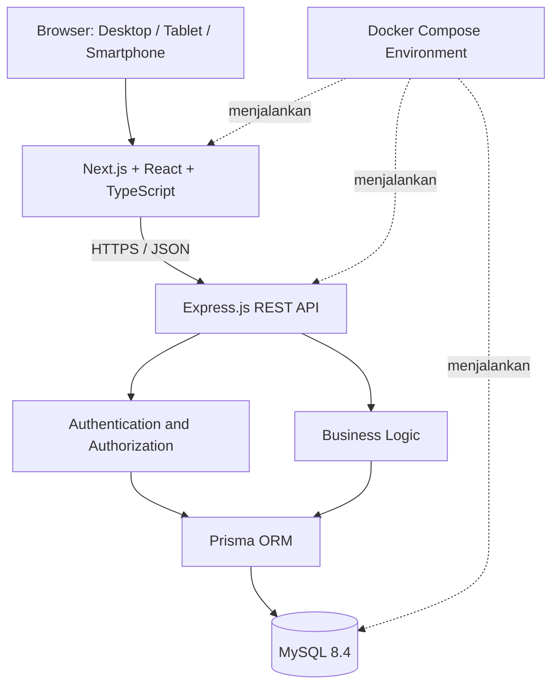
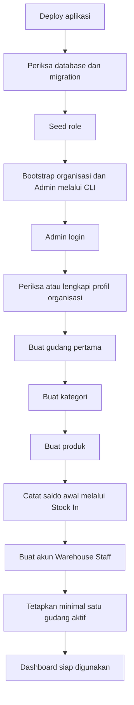
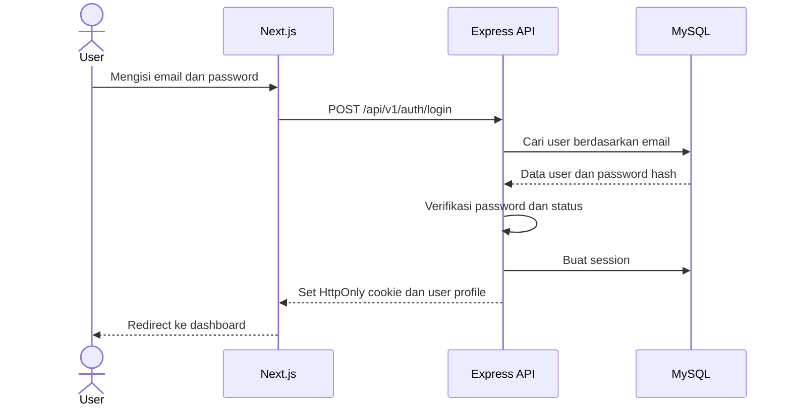
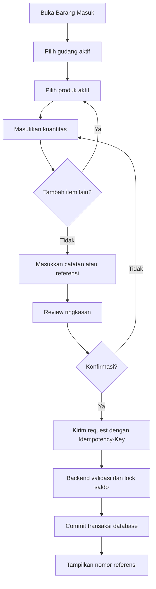
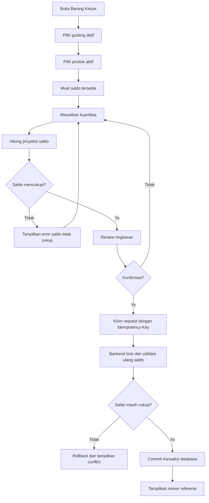
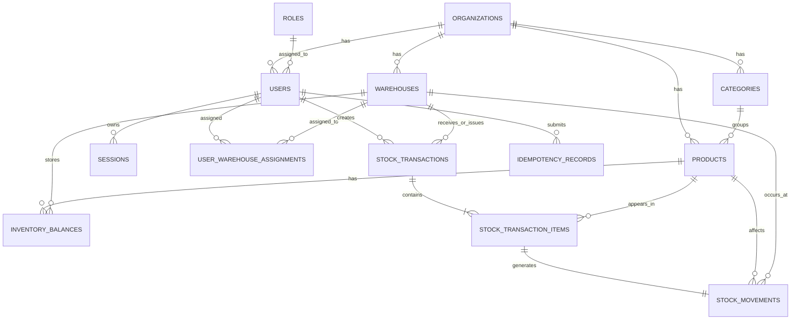

# Functional Specification Document (FSD)

## StockFlow

**Produk:** StockFlow  
**Dokumen:** Functional Specification Document  
**Versi:** 1.0.1  
**Status:** Revisi terarah berdasarkan PRD v1.0.1 dan Design System v1.0  
**Tanggal:** 12 November 2026  
**Platform:** Web application, responsive desktop, tablet, dan smartphone  
**Bahasa antarmuka:** Bahasa Indonesia  
**Frontend:** Next.js, React, TypeScript  
**Backend:** Node.js, Express.js, TypeScript  
**Database:** MySQL 8.4 LTS  
**ORM:** Prisma  
**Containerization:** Docker dan Docker Compose

### Dokumen acuan

1. `PRD_StockFlow_v1.0.1.md`
2. `StockFlow_Design_System_UIUX_Spec_v1.0.md`

---

## Riwayat dokumen

| Versi | Tanggal | Perubahan |
|---|---|---|
| 1.0 | 12 November 2026 | Penyusunan spesifikasi fungsional awal berdasarkan PRD dan Design System v1.0 |
| 1.0.1 | 12 November 2026 | Penegasan pembatasan akses gudang per Warehouse Staff, perbaikan metrik dashboard, koreksi transaksi penuh, konsolidasi endpoint, dependency frontend/motion, dan urutan bootstrap organisasi. |

## 1. Pendahuluan

### 1.1 Tujuan dokumen

FSD ini menerjemahkan kebutuhan produk pada PRD dan ketentuan visual pada Design System menjadi spesifikasi implementasi yang dapat digunakan oleh frontend developer, backend developer, database developer, QA, dan pihak yang melakukan review produk.

Dokumen ini menetapkan:

- Arsitektur logis dan batas tanggung jawab setiap aplikasi.
- Aktor, role, dan matriks hak akses.
- Alur proses dan aturan bisnis.
- Detail perilaku setiap modul MVP.
- Validasi input dan penanganan kondisi gagal.
- Model data relasional dan aturan integritas.
- Kontrak REST API tingkat implementasi.
- Perilaku antarmuka, state, responsive layout, dan motion.
- Kebutuhan keamanan, performa, reliability, dan pengujian.
- Kriteria penerimaan per modul.

### 1.2 Hubungan dengan dokumen lain

| Dokumen | Tanggung jawab |
|---|---|
| PRD StockFlow v1.0.1 | Sumber kebutuhan produk, persona, ruang lingkup, prioritas, dan target MVP |
| Design System & UI/UX Specification v1.0 | Sumber identitas visual, token, layout, komponen, motion, responsive behavior, dan UX state |
| FSD StockFlow v1.0.1 | Spesifikasi alur, aturan sistem, validasi, data, API, hak akses, dan acceptance criteria |
| ERD / Database Specification | Detail fisik database, migration, indeks, dan constraint final |
| API Specification / OpenAPI | Kontrak API terperinci yang diturunkan dari bagian API FSD |
| Test Plan | Test case rinci yang diturunkan dari acceptance criteria FSD |

PRD menjadi sumber utama untuk scope dan kebutuhan produk. Design System menjadi sumber utama untuk perilaku visual. FSD tidak mengaktifkan fitur hanya karena fitur tersebut muncul sebagai contoh pada navigation atau page inventory Design System.

### 1.3 Istilah normatif

- **Harus:** wajib dipenuhi dalam implementasi MVP.
- **Tidak boleh:** kondisi yang dilarang oleh aturan sistem.
- **Dapat:** perilaku opsional yang diperbolehkan.
- **Default FSD:** keputusan implementasi yang dipilih untuk menutup open decision PRD. Keputusan ini perlu dicatat bila diubah.
- **Di luar MVP:** tidak boleh diimplementasikan sebagai fitur aktif dalam rilis MVP tanpa perubahan scope.

### 1.4 Tujuan fungsional sistem

StockFlow harus memungkinkan pengguna yang berwenang untuk:

1. Mengelola data organisasi, kategori, produk, pengguna, dan gudang.
2. Melihat saldo produk secara total dan per gudang.
3. Mencatat barang masuk dan barang keluar.
4. Mencegah saldo negatif dan transaksi stok ganda.
5. Menelusuri pergerakan stok beserta referensi dan pengguna pembuatnya.
6. Memantau Low Stock dan Out of Stock dari dashboard.
7. Menggunakan fungsi inti pada desktop, tablet, dan smartphone.

---

## 2. Ruang lingkup sistem

### 2.1 Fitur MVP

| ID | Modul | Cakupan fungsional | Prioritas |
|---|---|---|---|
| SCOPE-001 | Application foundation | App shell, navigation, theme, responsive layout | Must Have |
| SCOPE-002 | Public landing page | Informasi produk dan CTA menuju login atau demo sesuai implementasi | Must Have |
| SCOPE-003 | Authentication | Login, logout, session, bootstrap Admin | Must Have |
| SCOPE-004 | User management | Daftar, tambah, ubah profil/role, dan nonaktifkan pengguna oleh Admin | Must Have |
| SCOPE-005 | Organization profile | Lihat dan ubah informasi dasar organisasi | Must Have |
| SCOPE-006 | Category management | CRUD terbatas melalui create, read, update, deactivate | Must Have |
| SCOPE-007 | Product management | Kelola produk, SKU, kategori, satuan, minimum stock, harga pokok opsional, dan status | Must Have |
| SCOPE-008 | Warehouse management | Kelola gudang, kode, lokasi, dan status | Must Have |
| SCOPE-009 | Inventory balance | Saldo per produk per gudang dan saldo agregat sesuai lingkup akses pengguna | Must Have |
| SCOPE-010 | Stock In | Transaksi barang masuk dengan satu atau beberapa item | Must Have |
| SCOPE-011 | Stock Out | Transaksi barang keluar dengan pemeriksaan stok tersedia | Must Have |
| SCOPE-012 | Stock movement history | Daftar dan detail transaksi stok | Must Have |
| SCOPE-013 | Dashboard | KPI dasar, Low Stock, Out of Stock, movement chart, recent movement | Must Have |
| SCOPE-014 | Search and list controls | Search, filter, sorting, pagination, empty state | Must Have |
| SCOPE-015 | Personal preferences | Light, Dark, System | Must Have |
| SCOPE-016 | Runtime environment | Docker Compose, persistent MySQL volume, health check | Must Have |
| SCOPE-017 | API documentation | OpenAPI / Swagger | Should Have |
| SCOPE-018 | Automated testing | Unit dan integration test untuk alur kritis | Should Have |
| SCOPE-019 | Warehouse assignment | Admin menetapkan satu atau beberapa gudang aktif kepada setiap Warehouse Staff | Must Have |
| SCOPE-020 | Admin password reset | Admin mereset password pengguna melalui mekanisme password sementara dan force change | Should Have |

### 2.2 Fitur yang tidak aktif pada MVP

Fitur berikut dapat muncul pada referensi navigasi atau desain konseptual, tetapi tidak boleh dibuat sebagai alur operasional aktif pada MVP:

- Supplier management.
- Purchase Order.
- Goods receiving yang terhubung ke Purchase Order.
- Stock Transfer antar gudang.
- Stock Opname.
- Stock Adjustment terpisah.
- Reports and CSV export lanjutan.
- Audit Log lengkap untuk seluruh perubahan master data.
- Notification center.
- Barcode support.
- Multi-tenant SaaS.
- Aplikasi mobile native.
- Integrasi akuntansi, ERP, atau sistem eksternal.
- Lot, batch, serial number, dan expiration date.
- Stock reservation, marketplace, invoice, dan pembayaran.
- Prediksi stok dengan machine learning.
- Offline transaction dan sinkronisasi offline penuh.
- Approval berlapis.

### 2.3 Batas organisasi

1. Satu instalasi StockFlow hanya memiliki satu organisasi pada MVP.
2. Organisasi dapat memiliki beberapa gudang.
3. Tidak tersedia pendaftaran organisasi secara mandiri.
4. Akun Admin pertama dibuat melalui proses bootstrap organisasi dan Admin secara bersamaan.
5. Admin memiliki akses seluruh gudang. Setiap Warehouse Staff aktif harus ditugaskan ke minimal satu gudang aktif oleh Admin dan hanya dapat mengakses gudang yang ditugaskan.
6. Seluruh data operasional berada dalam konteks organisasi tersebut.
7. Tidak ada pemisahan tenant atau billing subscription pada MVP.

### 2.4 Pengguna sistem

| Aktor | Deskripsi |
|---|---|
| Public Visitor | Pengunjung landing page yang belum login |
| Admin | Pemilik atau administrator organisasi yang mengelola konfigurasi dan master data |
| Warehouse Staff | Pengguna operasional yang melihat stok dan mencatat Stock In / Stock Out |
| System Process | Proses internal backend untuk validasi, sequence, session, agregasi, dan pembaruan saldo |

---

## 3. Gambaran arsitektur sistem

### 3.1 Arsitektur logis

StockFlow menggunakan pemisahan frontend, backend, dan database.



### 3.2 Tanggung jawab frontend

Frontend Next.js bertanggung jawab atas:

- Rendering halaman publik dan halaman aplikasi.
- App shell, navigasi, breadcrumb, topbar, dan responsive layout.
- Pengumpulan input dan validasi awal.
- Menampilkan data dari REST API.
- Menampilkan loading, empty, error, success, disabled, dan permission state.
- Mengelola pilihan tema Light, Dark, dan System.
- Menjalankan motion dan interaksi visual sesuai Design System.
- Mengirim request API dengan session cookie dan CSRF token sesuai kontrak backend.
- Menyediakan konfirmasi sebelum transaksi dikirim.

Frontend tidak boleh:

- Mengakses MySQL secara langsung.
- Menetapkan saldo akhir sebagai sumber kebenaran.
- Menentukan hak akses hanya dengan menyembunyikan tombol.
- Menganggap preview saldo sebagai hasil transaksi final.
- Menyimpan password, database credential, atau secret pada bundle frontend.

### 3.3 Tanggung jawab backend

Backend Express.js bertanggung jawab atas:

- Authentication dan session lifecycle.
- Authorization berdasarkan role.
- Validasi request pada sisi server.
- Business rules seluruh modul.
- Nomor referensi transaksi.
- Pembuatan transaksi dan movement.
- Penguncian saldo serta kontrol konkurensi.
- Idempotency dan deduplikasi request transaksi.
- Penghitungan saldo dan agregasi dashboard.
- Akses database melalui Prisma dan query transaksional yang diperlukan.
- Error mapping dan response contract.
- Logging operasional tanpa membocorkan secret atau data sensitif.

### 3.4 Tanggung jawab database

MySQL menjadi sumber data utama untuk:

- Organisasi.
- Pengguna, role, session, dan penugasan gudang per Warehouse Staff.
- Kategori, produk, dan gudang.
- Saldo inventaris.
- Header dan item transaksi stok.
- Stock movement.
- Sequence nomor transaksi.
- Idempotency record.

Perubahan saldo dan pencatatan movement wajib dilakukan dalam satu database transaction.

### 3.5 Alur komunikasi

1. Browser membuka halaman Next.js.
2. Frontend mengambil data melalui REST API.
3. Request privat menyertakan session cookie.
4. Backend memvalidasi session dan status akun.
5. Backend memeriksa role sebelum menjalankan business logic.
6. Untuk request berbasis gudang, backend memeriksa assignment Warehouse Staff sebelum membaca atau mengubah data gudang.
7. Backend memvalidasi payload.
8. Prisma menjalankan query dan transaksi database.
9. Backend mengembalikan response JSON.
10. Frontend memperbarui UI berdasarkan response yang diterima.
11. UI hanya menampilkan status berhasil setelah backend mengembalikan hasil sukses.

### 3.6 Struktur service Docker

| Service | Tanggung jawab | Port development default |
|---|---|---:|
| `frontend` | Next.js application | `3000` |
| `backend` | Express REST API | `4000` |
| `db` | MySQL 8.4 LTS | `3306` internal |

Port dapat disesuaikan melalui environment. Pada deployment production, database tidak boleh diekspos ke jaringan publik. Frontend dan backend harus dapat berkomunikasi melalui jaringan internal atau konfigurasi reverse proxy yang terdokumentasi.

---

## 4. Aktor dan hak akses

### 4.1 Definisi role

**Admin**

Memiliki akses administratif untuk mengelola pengguna, organisasi, kategori, produk, dan gudang. Admin juga dapat melihat dashboard dan melakukan transaksi stok.

**Warehouse Staff**

Memiliki akses operasional untuk melihat dashboard, produk, gudang, saldo, riwayat transaksi, serta melakukan Stock In dan Stock Out hanya pada gudang yang ditugaskan oleh Admin. Setiap Warehouse Staff harus memiliki minimal satu penugasan gudang aktif sebelum dapat menggunakan fitur operasional berbasis gudang. Warehouse Staff tidak memiliki akses administrasi.

### 4.2 Matriks hak akses MVP

| Modul / tindakan | Public | Admin | Warehouse Staff |
|---|---:|---:|---:|
| Landing page | Ya | Ya | Ya |
| Login | Ya | Ya | Ya |
| Dashboard | Tidak | Ya | Ya |
| Melihat produk | Tidak | Ya | Ya |
| Membuat / mengubah produk | Tidak | Ya | Tidak |
| Menonaktifkan produk | Tidak | Ya | Tidak |
| Melihat kategori | Tidak | Ya | Sesuai kebutuhan tampilan produk yang dapat diakses |
| Mengelola kategori | Tidak | Ya | Tidak |
| Melihat gudang | Tidak | Ya, semua gudang | Ya, hanya gudang yang ditugaskan |
| Membuat / mengubah gudang | Tidak | Ya | Tidak |
| Menonaktifkan gudang | Tidak | Ya | Tidak |
| Menetapkan gudang kepada Warehouse Staff | Tidak | Ya | Tidak |
| Melihat saldo | Tidak | Ya, seluruh gudang | Ya, hanya gudang yang ditugaskan |
| Stock In | Tidak | Ya | Ya, pada gudang yang ditugaskan dan aktif |
| Stock Out | Tidak | Ya | Ya, pada gudang yang ditugaskan dan aktif |
| Melihat movement | Tidak | Ya, seluruh gudang | Ya, hanya gudang yang ditugaskan |
| Melihat detail transaksi | Tidak | Ya, seluruh gudang | Ya, hanya gudang yang ditugaskan |
| Mengelola pengguna | Tidak | Ya | Tidak |
| Mengubah profil organisasi | Tidak | Ya | Tidak |
| Mengubah preferensi tema pribadi | Tidak | Ya | Ya |

**Catatan:** Hak akses Warehouse Staff terhadap daftar kategori hanya untuk kebutuhan membaca informasi yang terkait dengan produk. Tidak tersedia halaman atau tindakan manajemen kategori bagi role tersebut.

### 4.3 Aturan otorisasi

1. Semua endpoint privat harus memvalidasi session.
2. Backend harus membaca role pengguna yang masih berlaku dari database atau mekanisme session yang selalu diperbarui.
3. Perubahan role harus berlaku pada request berikutnya dan tidak boleh menunggu pengguna logout secara manual.
4. Endpoint administrasi hanya dapat dijalankan oleh Admin.
5. Stock In dan Stock Out dapat dijalankan Admin dan Warehouse Staff.
6. Admin dapat mengakses semua gudang dalam organisasi.
7. Warehouse Staff hanya dapat mengakses gudang yang tercatat pada `user_warehouse_assignments` miliknya. Penugasan diperiksa ulang oleh backend pada setiap request berbasis gudang.
8. Daftar gudang, saldo, transaksi, movement, alert, dan dashboard untuk Warehouse Staff wajib dibatasi pada gudang yang ditugaskan.
9. Warehouse Staff hanya dapat membuat transaksi pada gudang yang ditugaskan dan berstatus aktif.
10. Warehouse Staff tanpa penugasan gudang tetap dapat login dan mengakses preferensi pribadi, tetapi dashboard operasional menampilkan empty state dan tindakan Stock In/Stock Out tidak tersedia. Ini hanya fallback defensif untuk data hasil migrasi/pemulihan yang tidak normal; pembuatan user, perubahan role, dan deaktivasi gudang harus mencegah kondisi tersebut pada operasi normal.
11. Request tanpa hak akses umum menghasilkan HTTP `403`. Request terhadap gudang di luar lingkup penugasan menghasilkan `403 WAREHOUSE_ACCESS_DENIED`.
12. Request tanpa session valid menghasilkan HTTP `401`.
13. Frontend hanya menyelaraskan tampilan dengan permission. Backend tetap menjadi kontrol otorisasi utama.

### 4.4 Matriks permission internal

| Permission code | Admin | Warehouse Staff |
|---|---:|---:|
| `dashboard.read` | Ya | Ya |
| `product.read` | Ya | Ya |
| `product.create` | Ya | Tidak |
| `product.update` | Ya | Tidak |
| `product.deactivate` | Ya | Tidak |
| `category.read` | Ya | Ya |
| `category.manage` | Ya | Tidak |
| `warehouse.read` | Ya | Ya |
| `warehouse.manage` | Ya | Tidak |
| `inventory.read` | Ya | Ya |
| `stock_in.create` | Ya | Ya |
| `stock_out.create` | Ya | Ya |
| `movement.read` | Ya | Ya |
| `user.manage` | Ya | Tidak |
| `user.warehouse_assignment.manage` | Ya | Tidak |
| `organization.manage` | Ya | Tidak |
| `preference.manage_self` | Ya | Ya |

Permission code dipetakan secara statis pada backend untuk dua role MVP. Antarmuka untuk membuat role atau permission baru tidak termasuk MVP.

---

## 5. Alur proses utama

### 5.1 Setup awal organisasi

**Aktor utama:** Admin  
**Kondisi awal:** Instalasi baru, database siap, akun Admin belum tersedia.  
**Hasil akhir:** Organisasi, gudang, kategori, produk, dan akun staff siap digunakan.



**Detail proses:**

1. Operator menjalankan Docker Compose dan migration database.
2. Operator menjalankan seed role Admin dan Warehouse Staff. Seed tidak membuat akun pengguna.
3. Operator menjalankan command bootstrap organisasi dan Admin.
4. Command meminta nama organisasi awal, nama Admin, email Admin, dan password awal melalui prompt aman atau input rahasia yang tidak masuk log.
5. Command memeriksa bahwa belum ada organisasi dan belum ada Admin pada instalasi.
6. Command membuat record organisasi dan akun Admin yang terhubung ke organisasi dalam satu database transaction.
7. Password awal disimpan sebagai hash dan akun ditandai `must_change_password`.
8. Admin login dan mengganti password awal.
9. Admin melengkapi atau memperbarui informasi organisasi.
10. Admin membuat gudang pertama.
11. Admin membuat kategori dan produk.
12. Admin mencatat saldo awal melalui Stock In dengan catatan `Saldo Awal`.
13. Admin membuat akun Warehouse Staff dan menetapkan minimal satu gudang aktif kepada akun tersebut.
14. Warehouse Staff dapat login dan hanya melihat serta mengoperasikan gudang yang ditugaskan.

**Pengecualian:**

- Jika database belum tersedia, bootstrap dihentikan dan error operasional dicatat.
- Jika organisasi atau Admin sudah tersedia, bootstrap ditolak tanpa mengubah data.
- Jika pembuatan organisasi atau Admin gagal, seluruh operasi bootstrap di-rollback.
- Jika belum ada gudang aktif, dashboard menampilkan onboarding setup.
- Warehouse Staff yang belum memiliki penugasan gudang menampilkan empty state penugasan dan tidak dapat membuat transaksi stok.

### 5.2 Login

**Aktor:** Admin atau Warehouse Staff  
**Precondition:** Akun telah dibuat dan berstatus aktif.



**Alur normal:**

1. Pengguna membuka halaman Login.
2. Pengguna mengisi email dan password.
3. Frontend memvalidasi format dasar.
4. Frontend mengirim request login.
5. Backend mencari email secara case-insensitive.
6. Backend memverifikasi password hash.
7. Backend memeriksa status akun.
8. Jika valid, backend membuat session baru.
9. Backend mengatur cookie session dengan atribut keamanan.
10. Frontend mengambil profil pengguna dan mengarahkan pengguna ke dashboard.

**Kondisi gagal:**

| Kondisi | Hasil |
|---|---|
| Email tidak ditemukan | Pesan kredensial tidak valid |
| Password salah | Pesan kredensial tidak valid |
| Akun nonaktif | Pesan akun tidak dapat digunakan |
| Rate limit tercapai | HTTP `429` dan informasi waktu mencoba kembali |
| Database tidak tersedia | Pesan layanan sementara tidak tersedia |
| Session gagal dibuat | Login gagal, tanpa menampilkan detail internal |

Pesan kesalahan login tidak boleh membedakan apakah email terdaftar atau tidak.

### 5.3 Logout

1. Pengguna memilih menu Logout.
2. Frontend mengirim `POST /api/v1/auth/logout`.
3. Backend menghapus atau mencabut session aktif.
4. Backend menghapus cookie session pada browser.
5. Frontend menghapus state pengguna dari memory aplikasi.
6. Frontend mengarahkan pengguna ke halaman Login.

Logout harus mengakhiri session server, bukan hanya menghapus tampilan pengguna pada frontend.

### 5.4 Alur Stock In

**Aktor:** Admin atau Warehouse Staff  
**Precondition:**

- Pengguna telah login.
- Gudang tujuan berstatus aktif.
- Semua produk yang dipilih aktif.
- Kuantitas setiap item lebih besar dari nol.



**Detail proses:**

1. Pengguna membuka menu Barang Masuk.
2. Sistem memuat daftar gudang aktif.
3. Pengguna memilih satu gudang tujuan.
4. Pengguna mencari dan memilih produk aktif.
5. Pengguna memasukkan kuantitas.
6. Pengguna dapat menambahkan baris produk lain.
7. Sistem menampilkan saldo sebelum dan proyeksi saldo setelah transaksi.
8. Pengguna mengisi catatan atau referensi eksternal bila diperlukan.
9. Pengguna membuka review transaksi.
10. Pengguna memeriksa jumlah item, total kuantitas, gudang, dan perubahan saldo.
11. Pengguna menekan tombol Konfirmasi.
12. Frontend mengirim `POST /stock-transactions` dengan tipe `IN` dan `Idempotency-Key`.
13. Backend memvalidasi user, permission, gudang, produk, kuantitas, dan payload.
14. Backend membuat header transaksi, item, movement, serta memperbarui saldo dalam satu database transaction.
15. Backend mengembalikan nomor referensi.
16. Frontend menampilkan state sukses dan tautan ke detail transaksi.

**Pengecualian:**

- Gudang nonaktif: transaksi ditolak.
- Produk nonaktif: transaksi ditolak.
- Kuantitas nol, negatif, atau melampaui precision: transaksi ditolak.
- SKU tidak ditemukan: baris produk harus diperbaiki sebelum konfirmasi.
- Request duplikat: response transaksi pertama dikembalikan tanpa menambah saldo kembali.
- Database gagal sebelum commit: seluruh perubahan di-rollback.

### 5.5 Alur Stock Out

**Aktor:** Admin atau Warehouse Staff  
**Precondition:**

- Pengguna telah login.
- Gudang asal aktif.
- Produk aktif.
- Kuantitas positif dan tidak melebihi saldo tersedia.



**Detail proses:**

1. Pengguna membuka menu Barang Keluar.
2. Sistem memuat gudang aktif.
3. Pengguna memilih gudang asal.
4. Pengguna memilih produk aktif.
5. Sistem menampilkan saldo tersedia dari gudang tersebut.
6. Pengguna memasukkan kuantitas.
7. Frontend menghitung proyeksi saldo setelah transaksi untuk membantu pengguna.
8. Jika kuantitas melebihi saldo yang terakhir dimuat, frontend menampilkan error awal.
9. Jika input valid, pengguna memeriksa ringkasan.
10. Pengguna mengonfirmasi transaksi.
11. Frontend mengirim request dengan `Idempotency-Key`.
12. Backend mengunci row saldo yang relevan dan membaca ulang saldo terkini.
13. Jika saldo mencukupi, backend memperbarui saldo, header, item, dan movement secara atomik.
14. Jika saldo tidak mencukupi, backend me-rollback seluruh perubahan dan mengembalikan error bisnis.
15. Frontend menampilkan hasil sesuai response backend.

**Catatan penting:** pemeriksaan saldo pada frontend hanya bersifat informatif. Pemeriksaan final selalu dilakukan di backend pada saat transaksi diproses.

### 5.6 Pemeriksaan stok

1. Pengguna membuka daftar produk atau detail gudang.
2. Pengguna mencari produk berdasarkan nama atau SKU; metadata katalog produk dan kategori dapat dibaca oleh seluruh pengguna terautentikasi.
3. Sistem menampilkan saldo agregat sesuai lingkup akses pengguna: seluruh gudang untuk Admin dan gudang yang ditugaskan untuk Warehouse Staff.
4. Sistem hanya menampilkan saldo per gudang yang boleh diakses pengguna.
5. Sistem menentukan status stok dari saldo agregat dalam lingkup akses dan minimum stock produk.
6. Pengguna membuka riwayat pergerakan untuk menelusuri perubahan pada gudang yang boleh diaksesnya.
7. Pengguna membuka detail transaksi untuk melihat referensi, kuantitas, gudang, waktu, dan pembuat.

### 5.7 Penanganan Low Stock

1. Dashboard menghitung Low Stock berdasarkan saldo agregat pada seluruh gudang untuk Admin atau hanya gudang yang ditugaskan untuk Warehouse Staff.
2. Dashboard memisahkan produk Out of Stock berdasarkan lingkup gudang yang sama.
3. Pengguna membuka panel produk yang membutuhkan perhatian.
4. Pengguna membuka detail produk.
5. Sistem hanya menampilkan saldo dari gudang yang boleh diakses pengguna.
6. Jika barang tersedia, pengguna dapat mencatat Stock In pada gudang aktif yang boleh diaksesnya.
7. Purchase Order atau pembelian formal belum tersedia dalam MVP.

### 5.8 Pembuatan dan penonaktifan akun pengguna

**Membuat pengguna:**

1. Admin membuka Pengguna.
2. Admin memilih Tambah Pengguna.
3. Admin mengisi nama, email, role, dan password awal atau mekanisme password sementara.
4. Jika role adalah Warehouse Staff, Admin wajib memilih minimal satu gudang aktif pada langkah yang sama.
5. Sistem memvalidasi email unik, role, serta seluruh gudang dalam assignment.
6. Pembuatan user dan assignment awal disimpan secara atomik.
7. Admin menerima konfirmasi bahwa akun berhasil dibuat.

**Menonaktifkan pengguna:**

1. Admin membuka detail atau menu aksi pengguna.
2. Sistem meminta konfirmasi.
3. Backend memeriksa bahwa target bukan satu-satunya Admin aktif.
4. Backend mengubah status akun menjadi nonaktif.
5. Semua session target dicabut.
6. Assignment tidak dihapus otomatis; assignment historis dipertahankan dan tidak lagi memberi akses karena akun nonaktif.
7. Request berikutnya dari akun tersebut ditolak.

---

## 6. Spesifikasi modul fungsional

### 6.1 Public landing page

**Tujuan:** menjelaskan produk StockFlow dan mengarahkan pengunjung ke login atau CTA yang disediakan.

**Route:** `/`

**Aktor:** Public Visitor, Admin, Warehouse Staff.

**Komponen halaman:**

1. Navigation bar.
2. Hero.
3. Product preview interaktif.
4. Problem and solution.
5. Key capabilities.
6. Workflow overview.
7. Use cases.
8. Trust and security notes.
9. CTA final.
10. Footer.

**Perilaku:**

- CTA utama `Mulai Kelola Inventaris` diarahkan ke halaman Login atau jalur akses yang disediakan.
- CTA `Lihat Cara Kerja` melakukan scroll ke section workflow.
- Navbar berubah elevation/background saat scroll sesuai Design System.
- Hero dapat memakai staggered text reveal, subtle parallax, dan floating product preview.
- Konten, navigasi, dan CTA tetap dapat diakses ketika reduced motion aktif.
- Tidak boleh menampilkan klaim jumlah pengguna, persentase efisiensi, atau testimoni yang belum diverifikasi.
- Link placeholder atau tombol yang tidak mempunyai tindakan tidak boleh ditampilkan sebagai interaksi aktif.

**Acceptance criteria:**

- [ ] Landing page dapat dibuka tanpa login.
- [ ] CTA mengarah ke tujuan yang benar.
- [ ] Layout responsif.
- [ ] Motion tidak menghalangi CTA.
- [ ] Reduced motion didukung.
- [ ] Tidak menampilkan data atau klaim fiktif.

### 6.2 Authentication

**Route:**

- `/login`
- `/api/v1/auth/login`
- `/api/v1/auth/logout`
- `/api/v1/auth/me`
- `/api/v1/auth/change-password`

**Input login:**

| Field | Tipe | Required | Aturan |
|---|---|---:|---|
| `email` | String | Ya | Format email valid, trim whitespace |
| `password` | String | Ya | Tidak kosong, dikirim melalui HTTPS |

**Aturan:**

1. Email dinormalisasi menjadi lowercase sebelum lookup.
2. Password disimpan menggunakan Argon2id atau algoritma password hashing yang setara dan terkonfigurasi aman.
3. Password plaintext tidak pernah disimpan atau dicatat pada log.
4. Login response tidak mengembalikan password hash.
5. Session dibuat hanya untuk akun aktif.
6. Login gagal menghasilkan pesan umum.
7. Rate limit diberlakukan untuk percobaan login.
8. Session expired mengarahkan pengguna ke Login.
9. Tidak ada public self-registration.
10. Link `Lupa Password` pada halaman Login menjelaskan bahwa reset dilakukan melalui Admin. Reset mandiri berbasis email belum menjadi bagian MVP.

**Default strategi session FSD:**

- Menggunakan opaque random session token.
- Token disimpan dalam cookie `HttpOnly`.
- Cookie menggunakan `Secure` pada production, `SameSite=Lax`, dan path yang sesuai.
- Database hanya menyimpan hash token session.
- Session memiliki waktu kedaluwarsa dan dapat dicabut.
- Perubahan role atau status user diperiksa pada request privat berikutnya.
- Request state-changing yang menggunakan session memerlukan validasi Origin dan CSRF token.
- Cookie `sf_session` bersifat HttpOnly. Cookie `sf_csrf` dapat dibaca frontend dan digunakan untuk mengisi header `X-CSRF-Token`.
- Backend memverifikasi kecocokan CSRF cookie, header, dan hash token pada session.
- Login sebelum session dibuat memvalidasi Origin, Content-Type, dan SameSite cookie.
- CORS dibatasi pada origin frontend yang telah dikonfigurasi.

### 6.3 Bootstrap Organisasi dan Admin

**Tujuan:** membuat record organisasi pertama dan akun Admin yang terhubung ke organisasi tersebut tanpa public registration.

**Cara eksekusi:** command CLI backend yang dijalankan operator instalasi setelah migration dan seed role selesai.

**Input command:** nama organisasi, nama Admin, email Admin, dan password awal. Password diberikan melalui prompt interaktif yang tidak di-echo atau mekanisme secret sementara yang tidak dicatat ke log.

**Aturan:**

1. Role Admin dan Warehouse Staff harus tersedia melalui seed sebelum bootstrap dijalankan.
2. Command hanya dapat dijalankan oleh operator yang memiliki akses ke environment/container backend.
3. Command memeriksa apakah record organisasi atau akun Admin awal sudah tersedia. Jika salah satu sudah ada, command berhenti tanpa membuat duplikasi dan memberikan instruksi pemulihan yang aman.
4. Pembuatan organisasi dan akun Admin dilakukan dalam satu database transaction agar foreign key `users.organization_id` selalu valid. Jika salah satu insert gagal, seluruh proses di-rollback.
5. Password harus diberikan secara aman melalui prompt interaktif atau secret sementara yang tidak dicatat.
6. Credential tidak boleh memiliki nilai default tetap di source code, image, seed, atau dokumentasi.
7. Password awal harus diganti ketika login pertama melalui `must_change_password`.
8. Command tidak boleh mencetak password atau secret ke log permanen.
9. Bootstrap tidak tersedia sebagai endpoint publik.
10. Setelah bootstrap berhasil, Admin login, melengkapi profil organisasi, membuat gudang, kategori, produk, mencatat saldo awal, membuat akun Warehouse Staff, lalu menetapkan gudang untuk setiap staff.

### 6.4 User management

**Route UI:** `/app/settings/users`

**API:**

- `GET /api/v1/users`
- `POST /api/v1/users`
- `GET /api/v1/users/:id`
- `PATCH /api/v1/users/:id`
- `POST /api/v1/users/:id/deactivate`
- `POST /api/v1/users/:id/reset-password`

**Field pengguna:**

| Field | Tipe | Required saat create | Aturan |
|---|---|---:|---|
| `name` | String | Ya | 2 sampai 120 karakter setelah trim |
| `email` | String | Ya | Email valid dan unik |
| `roleCode` | Enum | Ya | `ADMIN` atau `WAREHOUSE_STAFF` |
| `warehouseIds` | UUID array | Wajib untuk Warehouse Staff | Minimal satu gudang aktif; tidak berlaku untuk Admin |
| `status` | Enum | Default aktif | `ACTIVE` atau `INACTIVE` |
| `password` | String | Sesuai mekanisme pembuatan/reset | Tidak disimpan plaintext |

**Aturan bisnis:**

1. Hanya Admin yang dapat mengelola user dan penugasan gudang.
2. Email bersifat unik dan dibandingkan secara case-insensitive.
3. Role hanya dapat berisi Admin atau Warehouse Staff.
4. Admin tidak dapat menonaktifkan satu-satunya Admin aktif.
5. Admin tidak dapat menghilangkan akses administratif terakhir tanpa mekanisme pemulihan.
6. Menonaktifkan user mencabut semua session.
7. Mengubah role berlaku pada request berikutnya.
8. Warehouse Staff tidak dapat mengakses endpoint user management.
9. Setiap Warehouse Staff harus memiliki minimal satu gudang aktif yang ditugaskan. Admin tidak memerlukan penugasan karena mempunyai akses ke seluruh gudang.
10. Gudang yang ditugaskan harus berasal dari organisasi yang sama dan berstatus aktif saat assignment dibuat atau diperbarui.
11. Ketika gudang dinonaktifkan, assignment tetap disimpan untuk menjaga jejak konfigurasi, tetapi gudang tersebut tidak dapat digunakan untuk transaksi baru. Jika gudang diaktifkan kembali, assignment yang masih ada kembali berlaku.
12. Jika role pengguna diubah dari Warehouse Staff menjadi Admin, assignment tidak digunakan untuk pembatasan akses. Jika role diubah dari Admin menjadi Warehouse Staff, Admin wajib menetapkan minimal satu gudang aktif dalam operasi yang sama.
13. Hard delete user tidak tersedia pada alur normal.
14. Riwayat transaksi tetap mempertahankan identitas pembuat melalui relasi user dan snapshot nama pembuat.

**Reset password oleh Admin:**

1. Admin memilih Reset Password.
2. Backend membuat password sementara yang kuat atau menerima password sementara sesuai kebijakan UI.
3. Sistem menyimpan hash password baru dan menandai `must_change_password`.
4. Semua session user target dicabut.
5. Password sementara hanya ditampilkan satu kali kepada Admin jika mekanisme temporary password digunakan.
6. Pada login berikutnya user diarahkan ke halaman ubah password.
7. Password baru harus memenuhi kebijakan password.
8. Sistem menghapus flag `must_change_password` setelah password baru berhasil disimpan.

Reset melalui email tidak termasuk MVP karena PRD belum menetapkan integrasi email.

### 6.4.1 Warehouse assignment

**Tujuan:** membatasi akses Warehouse Staff pada satu atau beberapa gudang yang menjadi tanggung jawabnya.

**API:**

- `GET /api/v1/users/:id/warehouses`
- `PUT /api/v1/users/:id/warehouses`

**Payload PUT:**

```json
{
  "warehouseIds": ["uuid-warehouse-1", "uuid-warehouse-2"]
}
```

**Aturan bisnis:**

1. Hanya Admin dengan permission `user.warehouse_assignment.manage` yang dapat membaca atau mengubah assignment pengguna lain.
2. Endpoint hanya berlaku untuk target user ber-role `WAREHOUSE_STAFF`. Admin memiliki akses penuh dan tidak menggunakan assignment sebagai pembatasan.
3. `warehouseIds` harus berupa array UUID unik tanpa duplikasi.
4. Minimal satu gudang aktif wajib ditetapkan kepada Warehouse Staff. Array kosong ditolak untuk user aktif.
5. Semua gudang harus berasal dari organisasi instalasi dan berstatus aktif pada saat assignment disimpan.
6. Penggantian daftar assignment dilakukan secara atomik: seluruh assignment lama diganti oleh daftar baru atau tidak ada perubahan sama sekali.
7. Assignment yang sudah ada tetap tersimpan ketika gudang dinonaktifkan. Gudang nonaktif tidak dapat dipakai untuk transaksi baru dan tidak muncul sebagai pilihan transaksi.
8. Warehouse Staff hanya dapat membaca gudang, saldo, transaksi, movement, dan ringkasan dashboard pada gudang yang ditugaskan.
9. Backend harus memvalidasi assignment saat request diproses; tidak boleh bergantung pada permission cache di frontend.
10. Warehouse Staff tanpa assignment aktif tidak dapat melakukan Stock In, Stock Out, atau membaca endpoint data gudang. Kondisi ini ditangani dengan empty state, bukan error aplikasi. Ini hanya fallback defensif untuk data hasil migrasi/pemulihan; operasi normal wajib menjaga minimal satu assignment gudang aktif.
11. Perubahan assignment berlaku pada request berikutnya. Jika konteks UI sedang terbuka, frontend harus memuat ulang data atau meminta pengguna memperbarui halaman.

**Acceptance criteria:**

- [ ] Admin dapat menetapkan satu atau beberapa gudang aktif kepada Warehouse Staff.
- [ ] Admin dapat mengganti daftar gudang yang ditugaskan.
- [ ] Penugasan ke gudang nonaktif atau tidak dikenal ditolak.
- [ ] Warehouse Staff tidak dapat membaca saldo atau transaksi gudang yang tidak ditugaskan.
- [ ] Warehouse Staff tidak dapat membuat transaksi pada gudang yang tidak ditugaskan.
- [ ] Admin tetap dapat mengakses seluruh gudang.

### 6.5 Organization profile

**Route UI:** `/app/settings/organization`

**API:**

- `GET /api/v1/organization`
- `PATCH /api/v1/organization`

**Field:**

| Field | Tipe | Aturan |
|---|---|---|
| `name` | String | Wajib, 2 sampai 160 karakter |
| `code` | String | Opsional, jika digunakan harus unik |
| `address` | String | Opsional |
| `phone` | String | Opsional |
| `email` | String | Opsional, format email |
| `timezone` | IANA timezone | Default instalasi `Asia/Makassar`, dapat diubah Admin |
| `currency` | String | Default `IDR` pada MVP |

**Aturan:**

1. Hanya Admin yang dapat mengubah profil organisasi.
2. Instalasi hanya memiliki satu organisasi.
3. Zona waktu digunakan dalam formatting tanggal dan penentuan periode dashboard serta nomor transaksi.
4. Penyimpanan timestamp tetap menggunakan UTC.
5. Perubahan timezone tidak mengubah timestamp transaksi yang sudah tersimpan.
6. Currency default `IDR`; konfigurasi multi-currency tidak termasuk MVP.
7. Jika data opsional kosong, UI menampilkan placeholder yang sesuai dan tidak membuat data palsu.

### 6.6 Category management

**Route UI:** `/app/inventory/categories`

**API:**

- `GET /api/v1/categories`
- `POST /api/v1/categories`
- `GET /api/v1/categories/:id`
- `PATCH /api/v1/categories/:id`
- `POST /api/v1/categories/:id/deactivate`

**Field:**

| Field | Tipe | Required | Aturan |
|---|---|---:|---|
| `name` | String | Ya | 2 sampai 100 karakter |
| `description` | String | Tidak | Maksimal 500 karakter |
| `isActive` | Boolean | Default true | Status kategori |

**Aturan bisnis:**

1. Admin dapat membuat, melihat, mengubah, dan menonaktifkan kategori.
2. Nama kategori harus unik dalam satu instalasi setelah normalisasi trim dan case-insensitive.
3. Kategori nonaktif tidak dapat dipilih untuk produk baru atau perubahan kategori produk.
4. Produk yang sudah terhubung tetap mempertahankan referensi kategori.
5. Kategori yang masih digunakan produk tidak boleh dihapus permanen.
6. Deaktivasi tidak menghapus relasi historis.
7. Warehouse Staff hanya membaca nama kategori yang diperlukan pada tampilan produk.

### 6.7 Product management

**Route UI:**

- `/app/inventory/products`
- `/app/inventory/products/new`
- `/app/inventory/products/:id`
- `/app/inventory/products/:id/edit`

**API:**

- `GET /api/v1/products`
- `POST /api/v1/products`
- `GET /api/v1/products/:id`
- `PATCH /api/v1/products/:id`
- `POST /api/v1/products/:id/deactivate`

**Field produk:**

| Field | Tipe | Required | Aturan |
|---|---|---:|---|
| `name` | String | Ya | 2 sampai 160 karakter |
| `sku` | String | Ya | 1 sampai 64 karakter, unik |
| `categoryId` | UUID | Ya | Harus menunjuk kategori aktif |
| `unit` | String | Ya | 1 sampai 24 karakter, satu satuan dasar |
| `minimumStock` | Decimal(18,3) | Default 0 | Tidak boleh negatif |
| `costPrice` | Decimal(18,2) | Tidak | Biaya per satu satuan dasar produk; tidak boleh negatif |
| `description` | String | Tidak | Maksimal 1.000 karakter |
| `isActive` | Boolean | Default true | Status produk |

**Aturan bisnis:**

1. Hanya Admin yang dapat membuat, mengubah, dan menonaktifkan produk.
2. Admin dan Warehouse Staff dapat melihat daftar dan detail produk.
3. SKU unik dan dibandingkan secara case-insensitive.
4. SKU dinormalisasi dengan trim dan uppercase sebelum disimpan.
5. Produk harus memiliki kategori aktif saat dibuat atau kategori diubah.
6. Metadata katalog produk (nama, SKU, kategori, satuan, minimum stock, dan status) dapat dibaca oleh seluruh pengguna terautentikasi dalam satu organisasi.
7. Produk memiliki tepat satu satuan dasar.
8. Tidak ada konversi satuan otomatis.
9. Minimum stock merupakan atribut produk pada tingkat organisasi, bukan per gudang; evaluasi status stok tetap mengikuti lingkup akses pengguna.
10. Harga pokok bersifat opsional dan dinyatakan per satu satuan dasar produk.
11. Produk nonaktif tidak dapat dipilih pada Stock In atau Stock Out baru.
12. Saldo produk tidak dapat diedit melalui form produk.
13. Produk yang mempunyai saldo nonzero tidak boleh dinonaktifkan agar stok tidak tertahan pada produk yang tidak dapat diproses.
14. Produk dengan histori transaksi tidak boleh dihapus permanen.
15. Perubahan nama, SKU, kategori, unit, atau harga master tidak boleh mengubah nilai snapshot transaksi yang sudah tersimpan.
16. Pencarian produk menggunakan nama atau SKU.
17. Detail produk menampilkan saldo agregat, saldo per gudang, status stok, dan riwayat transaksi sesuai lingkup akses pengguna. Admin melihat seluruh gudang; Warehouse Staff hanya melihat gudang yang ditugaskan.

**Status stok produk:**

| Kondisi | Status UI |
|---|---|
| Saldo agregat dalam lingkup akses = 0 | Out of Stock |
| Saldo agregat dalam lingkup akses > 0, minimum stock > 0, dan saldo agregat <= minimum stock | Low Stock |
| Saldo agregat dalam lingkup akses > minimum stock, atau saldo agregat > 0 ketika minimum stock = 0 | In Stock |

### 6.8 Warehouse management

**Route UI:**

- `/app/inventory/warehouses`
- `/app/inventory/warehouses/:id`

**API:**

- `GET /api/v1/warehouses`
- `POST /api/v1/warehouses`
- `GET /api/v1/warehouses/:id`
- `PATCH /api/v1/warehouses/:id`
- `POST /api/v1/warehouses/:id/deactivate`

**Field:**

| Field | Tipe | Required | Aturan |
|---|---|---:|---|
| `name` | String | Ya | 2 sampai 160 karakter |
| `code` | String | Ya | 1 sampai 32 karakter, unik |
| `location` | String | Tidak | Maksimal 255 karakter |
| `description` | String | Tidak | Maksimal 500 karakter |
| `isActive` | Boolean | Default true | Status gudang |

**Aturan bisnis:**

1. Admin mengelola gudang dan dapat melihat seluruh daftar/detail gudang.
2. Warehouse Staff hanya dapat melihat daftar dan detail gudang yang ditugaskan; metadata nama dan kategori produk tetap dapat dilihat secara organisasi-wide.
3. Gudang yang tidak ditugaskan tidak boleh mengembalikan saldo, transaksi, movement, atau rincian stok kepada Warehouse Staff.
4. Kode gudang harus unik dan case-insensitive.
5. Gudang nonaktif tidak dapat dipilih untuk transaksi normal baru.
6. Saldo historis pada gudang nonaktif tetap ditampilkan kepada Admin dan Warehouse Staff yang masih memiliki assignment ke gudang tersebut.
7. Saldo pada gudang nonaktif tetap dihitung dalam total saldo produk pada lingkup akses pengguna.
8. Gudang yang memiliki saldo nonzero tidak dapat dinonaktifkan. Stok harus diproses sampai nol sebelum deaktivasi.
9. Sebelum deaktivasi, backend harus memastikan setiap Warehouse Staff aktif yang pernah ditugaskan ke gudang tersebut masih memiliki minimal satu assignment ke gudang aktif lain. Jika tidak, deaktivasi ditolak dengan `WAREHOUSE_HAS_LAST_ACTIVE_STAFF_ASSIGNMENT`.
10. Gudang dengan riwayat transaksi tidak dapat dihapus permanen melalui alur normal.
11. Data kapasitas gudang tidak ditampilkan karena belum termasuk data wajib MVP.

### 6.9 Inventory balance

**Route UI:** `/app/inventory/stock`

**Lingkup data:** Admin melihat seluruh gudang. Warehouse Staff hanya melihat gudang yang ditugaskan, termasuk saldo historis pada gudang nonaktif yang assignment-nya masih tersimpan. Gudang nonaktif tetap tidak dapat dipakai untuk transaksi baru.

**API:**

- `GET /api/v1/inventory/balances`
- `GET /api/v1/inventory/products/:productId/balances`
- `GET /api/v1/inventory/warehouses/:warehouseId/balances`

**Definisi data:**

- Saldo disimpan untuk setiap kombinasi produk dan gudang.
- Kombinasi produk dan gudang bersifat unik.
- Saldo tidak boleh negatif.
- Record saldo dapat belum ada sebelum transaksi Stock In pertama. Dalam tampilan, kombinasi tanpa record saldo diperlakukan sebagai nol.
- Stock In menambah saldo.
- Stock Out mengurangi saldo.
- Saldo diubah hanya melalui transaksi stok yang berhasil.
- Total saldo produk untuk Admin merupakan jumlah saldo pada seluruh gudang.
- Total saldo produk untuk Warehouse Staff hanya merupakan jumlah saldo pada gudang yang ditugaskan dan berada dalam lingkup aksesnya.
- Status Low Stock dan Out of Stock ditampilkan berdasarkan agregat saldo dalam lingkup akses pengguna. Untuk Admin lingkupnya seluruh gudang; untuk Warehouse Staff lingkupnya hanya gudang yang ditugaskan.
- Data gudang nonaktif tidak dapat digunakan untuk transaksi baru. Riwayat pada gudang nonaktif tetap dapat dibaca oleh Admin dan oleh Warehouse Staff yang masih memiliki assignment ke gudang tersebut.

**Default kuantitas FSD:**

- Kolom kuantitas menggunakan `DECIMAL(18,3)`.
- Input mendukung maksimum tiga angka desimal.
- Sistem tidak boleh melakukan pembulatan diam-diam.
- Nilai lebih dari tiga angka desimal ditolak.
- Frontend menggunakan string decimal untuk request dan response agar tidak kehilangan presisi.
- Backend menggunakan tipe decimal, bukan floating point JavaScript untuk perhitungan saldo.

### 6.10 Stock In

**Route UI:** `/app/inventory/stock-in`

**API:** `POST /api/v1/stock-transactions`

**Payload ringkas:**

```json
{
  "type": "IN",
  "warehouseId": "uuid",
  "note": "Penerimaan barang",
  "externalReference": "REF-PO-001",
  "items": [
    {
      "productId": "uuid",
      "quantity": "10.000"
    }
  ]
}
```

**Aturan:**

1. Pengguna harus memiliki permission `stock_in.create`.
2. Gudang harus aktif.
3. Jika pengguna adalah Warehouse Staff, gudang harus termasuk dalam daftar assignment miliknya.
4. Setiap produk harus aktif.
5. Semua item dalam satu transaksi Stock In menggunakan gudang yang sama pada header transaksi.
6. Minimal terdapat satu item.
7. `productId` tidak boleh berulang pada satu payload.
8. Quantity setiap item harus lebih besar dari nol.
9. Quantity maksimum tiga angka desimal; nilai dengan precision lebih dari tiga angka desimal ditolak, bukan dibulatkan.
10. Catatan dan external reference bersifat opsional.
11. Backend membuat nomor referensi unik.
12. Backend mencatat header, item, movement, dan perubahan saldo secara atomik.
13. Transaksi yang berhasil bersifat immutable.
14. Request transaksi harus membawa Idempotency-Key.
15. Backend mengembalikan hasil transaksi yang sama jika request duplikat dengan key dan payload yang sama diterima kembali.

**Ringkasan UI sebelum submit:**

- Gudang tujuan.
- Jumlah baris produk.
- Nama produk dan SKU.
- Saldo sebelum transaksi.
- Kuantitas masuk.
- Saldo setelah transaksi.
- Catatan atau referensi.
- Tombol Kembali ke Form.
- Tombol Konfirmasi Barang Masuk.

### 6.11 Stock Out

**Route UI:** `/app/inventory/stock-out`

**API:** `POST /api/v1/stock-transactions`

**Payload ringkas:**

```json
{
  "type": "OUT",
  "warehouseId": "uuid",
  "note": "Pengeluaran barang",
  "externalReference": "REQ-OPS-001",
  "items": [
    {
      "productId": "uuid",
      "quantity": "2.000"
    }
  ]
}
```

**Aturan:**

1. Pengguna harus memiliki permission `stock_out.create`.
2. Gudang harus aktif.
3. Jika pengguna adalah Warehouse Staff, gudang harus termasuk dalam daftar assignment miliknya.
4. Produk harus aktif.
5. Semua item dalam satu transaksi menggunakan gudang yang sama pada header transaksi.
6. Minimal terdapat satu item.
7. Product ID tidak boleh berulang pada satu payload.
8. Quantity harus lebih besar dari nol dan maksimal tiga angka desimal; nilai dengan precision lebih dari tiga angka desimal ditolak tanpa pembulatan.
9. Quantity tidak boleh melebihi saldo tersedia.
10. Pemeriksaan saldo akhir dilakukan di backend di dalam transaksi database.
11. Saldo sebelum dan sesudah transaksi ditampilkan pada review.
12. Jika salah satu item tidak memiliki saldo yang cukup, seluruh transaksi ditolak.
13. Tidak boleh ada item lain yang tetap berhasil ketika satu item gagal.
14. Transaksi yang berhasil bersifat immutable.
15. Request transaksi harus membawa Idempotency-Key.

### 6.12 Stock movement history

**Route UI:** `/app/inventory/movements`

**Route detail:** `/app/inventory/movements/:id`

**API:**

- `GET /api/v1/stock-transactions`
- `GET /api/v1/stock-transactions/:id`
- `GET /api/v1/products/:productId/movements`

**Kolom daftar:**

| Kolom | Isi |
|---|---|
| Tanggal | Waktu transaksi sesuai timezone organisasi |
| Nomor referensi | Nomor transaksi unik |
| Produk | Nama produk dan SKU snapshot |
| Gudang | Nama dan kode gudang snapshot |
| Tipe | Barang Masuk atau Barang Keluar |
| Kuantitas | Kuantitas item |
| Pengguna | Nama pembuat transaksi |
| Status | Berhasil diposting |

**Aturan:**

1. Riwayat hanya menampilkan transaksi yang sudah berhasil di-commit.
2. Transaksi yang gagal tidak muncul sebagai transaksi stok.
3. Admin dapat membaca transaksi seluruh gudang; Warehouse Staff hanya dapat membaca transaksi dari gudang yang ditugaskan.
4. Filter gudang yang diminta Warehouse Staff harus termasuk dalam assignment. Jika tidak, backend mengembalikan `403 WAREHOUSE_ACCESS_DENIED`.
5. Daftar dapat difilter berdasarkan periode, tipe, produk, dan gudang.
6. Daftar dapat dicari berdasarkan nomor referensi atau SKU.
7. Detail menampilkan header, item, movement, catatan, external reference, pembuat, dan waktu.
8. Transaksi yang sudah diposting tidak dapat diedit atau dihapus melalui UI MVP.
9. Snapshot produk, SKU, gudang, dan pembuat digunakan agar identitas historis tidak berubah ketika master data diedit.
10. Koreksi mengikuti aturan full reversal pada bagian 6.13 dan hanya dapat diakses jika pengguna memiliki permission sesuai tipe koreksi serta akses terhadap gudang asal.
11. Tidak ada tombol Edit atau Delete pada transaksi yang sudah diposting.

### 6.13 Koreksi transaksi

**Prinsip:** transaksi yang sudah diposting tidak boleh diedit atau dihapus. Pada MVP, koreksi hanya mendukung pembalikan penuh (*full reversal*) dari satu transaksi asal melalui transaksi baru yang berlawanan.

**Route UI:** `/app/inventory/movements/:id` dengan tindakan `Koreksi Transaksi` bila memenuhi syarat.

**API:** `POST /api/v1/stock-transactions/:id/correction`

**Perilaku MVP:**

1. Pengguna membuka detail transaksi asal yang berstatus `POSTED`.
2. Sistem hanya menampilkan tindakan koreksi jika transaksi tersebut belum pernah dikoreksi, bukan merupakan transaksi koreksi, dan seluruh produk serta gudang asal berstatus aktif.
3. Pengguna wajib mengisi alasan/catatan koreksi yang tidak kosong setelah trim, maksimal 1.000 karakter.
4. Backend menentukan tipe koreksi secara otomatis: transaksi asal `IN` dikoreksi dengan `OUT`; transaksi asal `OUT` dikoreksi dengan `IN`.
5. Koreksi harus menggunakan gudang, produk, dan kuantitas yang sama dengan transaksi asal. Semua item dibalik secara penuh; pemilihan item atau kuantitas parsial tidak tersedia pada MVP.
6. Backend memvalidasi session, permission untuk tipe transaksi koreksi, dan akses pengguna terhadap gudang asal. Warehouse Staff hanya dapat mengoreksi transaksi pada gudang yang ditugaskan.
7. Jika transaksi asal `IN`, backend harus memastikan saldo terkini pada gudang tersebut masih mencukupi untuk melakukan Stock Out atas seluruh kuantitas asal. Jika tidak, koreksi ditolak seluruhnya dengan `CORRECTION_STOCK_UNAVAILABLE`.
8. Jika transaksi asal `OUT`, koreksi berupa Stock In dan menambah kembali kuantitas ke gudang yang sama.
9. Jika produk atau gudang asal sudah nonaktif, koreksi ditolak dengan pesan yang meminta Admin mengaktifkan kembali master data terkait terlebih dahulu. Koreksi tidak menjadi jalur untuk memakai master data nonaktif.
10. Backend membuat transaksi koreksi, item, movement, perubahan saldo, relasi `correction_of_transaction_id`, dan idempotency record dalam satu database transaction.
11. Satu transaksi asal hanya boleh mempunyai satu koreksi penuh. Unique constraint pada `correction_of_transaction_id` mencegah koreksi ganda.
12. Transaksi koreksi tidak dapat menjadi sumber koreksi lain.
13. Transaksi asal tetap immutable dan tetap terlihat pada riwayat; detailnya menampilkan nomor referensi transaksi koreksi.
14. Transaksi koreksi juga immutable setelah berhasil diposting.
15. Request correction wajib membawa `Idempotency-Key` agar retry tidak menghasilkan transaksi koreksi ganda.

**Batasan:** partial reversal, pembatalan formal multi-level, koreksi setelah transaksi asal dikoreksi, dan approval berlapis tidak termasuk MVP.

### 6.14 Dashboard overview

**Route UI:** `/app/dashboard`

**API:**

- `GET /api/v1/dashboard/summary`
- `GET /api/v1/dashboard/movements`
- `GET /api/v1/dashboard/recent-movements`
- `GET /api/v1/dashboard/stock-alerts`

**Komposisi UI:**

- Greeting dan tanggal.
- Filter periode grafik.
- Quick action Barang Masuk, Barang Keluar, Tambah Produk sesuai permission.
- KPI Total SKU, Produk dengan Stok, Low Stock, dan Out of Stock.
- Estimasi Nilai Stok Terdata ditampilkan sebagai informasi tambahan bila data harga pokok tersedia.
- Grafik jumlah transaksi Stock In dan Stock Out per hari; tidak menjumlahkan kuantitas dari satuan berbeda.
- Dashboard mengikuti lingkup gudang pengguna: Admin seluruh gudang, Warehouse Staff hanya gudang yang ditugaskan.
- Panel Low Stock dan Out of Stock.
- Recent movements.
- Ringkasan gudang.

**Definisi KPI:**

| KPI / metrik | Definisi |
|---|---|
| Total SKU | Jumlah seluruh produk aktif dalam katalog organisasi; tidak dibatasi assignment gudang |
| Produk dengan Stok | Jumlah produk aktif dengan saldo agregat lebih besar dari nol dalam lingkup gudang pengguna. Kuantitas lintas satuan tidak dijumlahkan. |
| Low Stock | Jumlah produk aktif dengan saldo agregat > 0, minimum stock > 0, dan saldo agregat <= minimum stock dalam lingkup gudang pengguna |
| Out of Stock | Jumlah produk aktif dengan saldo agregat = 0 dalam lingkup gudang pengguna |
| Estimasi Nilai Stok Terdata | Saldo produk dikalikan cost price master untuk produk yang memiliki cost price; dilengkapi jumlah dan persentase produk bersaldo yang tercakup |

**Aturan perhitungan:**

1. Semua metrik dihitung dari data yang telah berhasil disimpan dan di-commit.
2. `Total SKU` menghitung seluruh produk aktif pada organisasi karena metadata katalog dapat dibaca oleh seluruh pengguna terautentikasi; metrik ini tidak bergantung pada assignment gudang.
3. Untuk Admin, lingkup saldo meliputi semua gudang. Untuk Warehouse Staff, lingkup saldo hanya gudang yang ditugaskan, termasuk histori saldo dari gudang nonaktif yang assignment-nya masih berlaku.
4. `Produk dengan Stok`, Low Stock, Out of Stock, estimasi nilai stok, dan daftar stok alert dihitung berdasarkan agregat saldo dalam lingkup akses pengguna.
5. Produk nonaktif tidak masuk hitungan `Total SKU`, `Produk dengan Stok`, Low Stock, dan Out of Stock.
6. Dashboard tidak menyediakan KPI yang menjumlahkan kuantitas lintas produk dengan satuan berbeda.
7. Estimasi Nilai Stok Terdata hanya menghitung produk bersaldo yang mempunyai harga pokok master.
8. Jika ada produk bersaldo tanpa harga pokok, UI harus menampilkan jumlah dan persentase cakupan harga pokok serta disclaimer bahwa nilai yang ditampilkan belum mencakup seluruh stok.
9. Nilai tersebut tidak boleh diberi label nilai akuntansi resmi.
10. Jika tidak ada produk bersaldo dalam lingkup pengguna, nilai estimasi adalah `0.00` dan cakupan bernilai 100 persen karena tidak ada saldo yang belum dinilai. Jika ada produk bersaldo tetapi tidak ada yang mempunyai cost price, amount adalah `0.00` dan coverage 0 persen.
11. Pergerakan hari ini didefinisikan sebagai jumlah header transaksi yang berhasil diposting pada tanggal lokal organisasi, dipisahkan antara Stock In dan Stock Out. Satu header multi-item dihitung sebagai satu transaksi.
12. Grafik movement menampilkan jumlah header transaksi Stock In dan Stock Out per hari, bukan total kuantitas.
13. Default periode grafik adalah 30 hari terakhir.
14. Filter periode dan gudang diterapkan pada grafik movement, recent movements, dan ringkasan gudang; filter tersebut tidak mengubah KPI saldo utama dan stock alerts.
15. Warehouse Staff hanya dapat memilih gudang yang ditugaskan. Jika tidak ada gudang aktif yang dapat diakses karena kondisi data tidak normal, panel berbasis gudang menampilkan empty state; `Total SKU` tetap menampilkan jumlah katalog organisasi.
16. Periode dan tanggal mengikuti timezone organisasi.
17. Persentase pembanding hanya ditampilkan jika data pembanding valid.
18. Tidak ada chart yang menampilkan data dummy pada dashboard produksi.

### 6.15 Search, filter, sorting, dan pagination

**Default pagination:**

| Parameter | Default | Batas |
|---|---:|---:|
| `page` | 1 | Minimum 1 |
| `pageSize` | 20 | Maksimum 100 |
| `sortBy` | Sesuai modul | Allowlist backend |
| `sortOrder` | `desc` atau default modul | `asc` / `desc` |
| `search` | Kosong | Maksimal 120 karakter |

**Aturan:**

1. Search dilakukan pada backend untuk daftar yang menggunakan pagination.
2. Search produk mencakup nama dan SKU.
3. Search movement mencakup nomor referensi dan SKU snapshot.
4. Filter hanya menerima field yang diizinkan.
5. Sorting menggunakan allowlist kolom, bukan string SQL bebas dari client.
6. Pagination harus diterapkan sebelum data dikirim ke frontend.
7. Filter aktif ditampilkan sebagai removable chip.
8. Clear All menghapus seluruh filter aktif.
9. Jika tidak ada hasil, tampilkan empty state yang sesuai.
10. Parameter invalid menghasilkan response validation error yang konsisten.

### 6.16 Personal preferences

**Route UI:** `/app/settings/preferences`

**API:**

- `GET /api/v1/preferences`
- `PATCH /api/v1/preferences`

**Field:**

| Field | Nilai |
|---|---|
| `theme` | `LIGHT`, `DARK`, `SYSTEM` |

**Aturan:**

1. Preferensi tema disimpan per user.
2. Default adalah `SYSTEM`.
3. Pilihan `SYSTEM` mengikuti `prefers-color-scheme`.
4. Theme diterapkan tanpa flash tema yang mengganggu saat initial render.
5. Preferensi tema tidak mengubah data organisasi.
6. Motion harus mengikuti `prefers-reduced-motion` sistem operasi.
7. Tidak ada preferensi bahasa tambahan pada MVP; Bahasa Indonesia menjadi bahasa awal.

---

## 7. Business rules

### 7.1 General rules

| ID | Aturan |
|---|---|
| BR-GEN-001 | Satu instalasi hanya memiliki satu organisasi pada MVP. |
| BR-GEN-002 | Semua operasi data bisnis wajib melalui backend. |
| BR-GEN-003 | Semua data transaksi menggunakan timestamp UTC dan ditampilkan sesuai timezone organisasi. |
| BR-GEN-004 | Record master yang telah direferensikan oleh transaksi tidak dihapus permanen melalui alur normal. |
| BR-GEN-005 | Semua operasi list wajib memiliki pagination. |
| BR-GEN-006 | Nominal dan kuantitas menggunakan tipe decimal, bukan floating point untuk kalkulasi bisnis. |

### 7.2 Authentication and user rules

| ID | Aturan |
|---|---|
| BR-AUTH-001 | Public self-registration tidak tersedia. |
| BR-AUTH-002 | Password tidak pernah disimpan dalam bentuk plaintext. |
| BR-AUTH-003 | User nonaktif tidak dapat membuat session atau menggunakan session aktif. |
| BR-AUTH-004 | Logout mencabut session pada backend. |
| BR-AUTH-005 | Login gagal menggunakan pesan umum dan rate limit. |
| BR-USER-001 | Role MVP hanya Admin dan Warehouse Staff. |
| BR-USER-002 | Hanya Admin yang mengelola akun. |
| BR-USER-003 | Sistem tidak boleh menonaktifkan satu-satunya Admin aktif. |
| BR-USER-004 | Deaktivasi user mencabut semua session milik user tersebut. |
| BR-USER-005 | Perubahan role berlaku pada request berikutnya. |

### 7.3 Category rules

| ID | Aturan |
|---|---|
| BR-CAT-001 | Nama kategori unik setelah normalisasi. |
| BR-CAT-002 | Kategori nonaktif tidak dapat dipakai pada produk baru atau perubahan kategori. |
| BR-CAT-003 | Kategori yang telah dipakai produk tidak dihapus permanen melalui alur normal. |
| BR-CAT-004 | Produk historis tetap mempertahankan referensi kategori. |

### 7.4 Product rules

| ID | Aturan |
|---|---|
| BR-PROD-001 | SKU unik dan case-insensitive. |
| BR-PROD-002 | SKU disimpan dalam bentuk uppercase setelah trim. |
| BR-PROD-003 | Setiap produk memiliki satu kategori dan satu unit dasar. |
| BR-PROD-004 | Minimum stock tidak boleh negatif. |
| BR-PROD-005 | Cost price opsional, dinyatakan per satu satuan dasar produk, dan tidak digunakan untuk pembukuan akuntansi. |
| BR-PROD-006 | Produk nonaktif tidak dapat dipakai pada transaksi baru. |
| BR-PROD-007 | Produk dengan saldo nonzero tidak dapat dinonaktifkan. |
| BR-PROD-008 | Produk dengan histori transaksi tidak dihapus permanen. |
| BR-PROD-009 | Edit master data tidak mengubah snapshot histori transaksi. |

### 7.5 Warehouse rules

| ID | Aturan |
|---|---|
| BR-WH-001 | Kode gudang unik dan case-insensitive. |
| BR-WH-002 | Gudang nonaktif tidak dapat dipilih pada transaksi baru. |
| BR-WH-003 | Saldo historis gudang nonaktif tetap dihitung untuk Admin dan Warehouse Staff yang masih memiliki assignment ke gudang tersebut. |
| BR-WH-004 | Gudang dengan saldo nonzero tidak dapat dinonaktifkan. |
| BR-WH-005 | Gudang dengan histori transaksi tidak dihapus permanen. |
| BR-WH-006 | Deaktivasi gudang ditolak jika akan membuat Warehouse Staff aktif kehilangan seluruh gudang aktif yang ditugaskan. |

### 7.6 Inventory rules

| ID | Aturan |
|---|---|
| BR-INV-001 | Satu kombinasi product dan warehouse hanya mempunyai satu saldo. |
| BR-INV-002 | Saldo tidak boleh kurang dari nol. |
| BR-INV-003 | Saldo diubah hanya oleh transaksi stok yang berhasil. |
| BR-INV-004 | Saldo agregat produk mencakup seluruh gudang untuk Admin dan hanya gudang yang ditugaskan untuk Warehouse Staff, termasuk saldo historis pada gudang nonaktif yang assignment-nya masih tersimpan. |
| BR-INV-005 | Tidak ada edit saldo langsung pada form master produk. |
| BR-INV-006 | Kuantitas menggunakan precision maksimum 3 angka desimal. |

### 7.7 Stock transaction rules

| ID | Aturan |
|---|---|
| BR-STK-001 | Setiap transaksi memiliki nomor referensi unik. |
| BR-STK-002 | Tipe transaksi MVP hanya `IN` dan `OUT`. |
| BR-STK-003 | Minimal ada satu item pada transaksi. |
| BR-STK-004 | Produk tidak boleh berulang dalam satu transaksi yang sama. |
| BR-STK-005 | Semua item pada satu transaksi menggunakan satu gudang yang dipilih pada header. |
| BR-STK-006 | Quantity harus lebih besar dari nol. |
| BR-STK-007 | Stock Out tidak boleh melebihi saldo tersedia. |
| BR-STK-008 | Header, item, movement, dan balance harus commit atau rollback bersama. |
| BR-STK-009 | Transaksi yang berhasil diposting bersifat immutable. |
| BR-STK-010 | Request yang sama tidak boleh menghasilkan perubahan saldo berulang. |
| BR-STK-011 | Koreksi MVP hanya berupa full reversal satu kali per transaksi asal, wajib menyimpan referensi transaksi asal dan alasan koreksi. |
| BR-STK-012 | Satu transaksi gagal menyebabkan seluruh item transaksi gagal. |

### 7.8 Low stock rules

| ID | Aturan |
|---|---|
| BR-LOW-001 | Minimum stock ditetapkan pada tingkat produk. |
| BR-LOW-002 | Low Stock jika saldo agregat dalam lingkup akses pengguna > 0, minimum stock > 0, dan saldo agregat <= minimum stock. |
| BR-LOW-003 | Out of Stock jika saldo agregat dalam lingkup akses pengguna = 0. |
| BR-LOW-004 | Minimum stock = 0 tidak menghasilkan Low Stock ketika saldo positif. |
| BR-LOW-005 | Evaluasi status menggunakan semua gudang yang berada dalam lingkup akses pengguna; Admin mencakup seluruh gudang dan Warehouse Staff hanya gudang yang ditugaskan. |
| BR-LOW-006 | Hanya produk aktif yang masuk hitungan alert dashboard. |

### 7.9 Valuation rules

| ID | Aturan |
|---|---|
| BR-VAL-001 | Cost price bersifat opsional dan dinyatakan per satu satuan dasar produk. |
| BR-VAL-002 | Estimasi nilai stok = saldo agregat dalam lingkup akses pengguna x cost price master produk yang tersedia. |
| BR-VAL-003 | Produk dengan cost price kosong tidak dianggap memiliki nilai nol untuk klaim nilai total lengkap. |
| BR-VAL-004 | Dashboard harus memberikan disclaimer jika ada produk bersaldo yang tidak memiliki cost price. |
| BR-VAL-005 | FIFO dan weighted average tidak termasuk MVP. |

### 7.10 Dashboard rules

| ID | Aturan |
|---|---|
| BR-DASH-001 | Total SKU menghitung seluruh produk aktif pada katalog organisasi tanpa dibatasi assignment gudang. |
| BR-DASH-002 | Produk dengan Stok menghitung jumlah produk aktif dengan saldo agregat positif dalam lingkup gudang pengguna; kuantitas lintas satuan tidak dijumlahkan. |
| BR-DASH-003 | Pergerakan hari ini menghitung jumlah header transaksi Stock In dan Stock Out yang berhasil pada tanggal lokal organisasi, dipisahkan berdasarkan tipe. |
| BR-DASH-004 | Grafik harian menampilkan jumlah header transaksi Stock In dan Stock Out secara terpisah, bukan total kuantitas. |
| BR-DASH-005 | Periode default grafik 30 hari terakhir. |
| BR-DASH-006 | KPI tidak menggunakan data dummy atau persentase pembanding yang tidak valid; KPI stok mengikuti lingkup akses pengguna. |

---

## 8. Validasi dan aturan input

### 8.1 Validasi umum

| Jenis | Ketentuan |
|---|---|
| String | Trim whitespace sebelum disimpan |
| Required | Field wajib tidak boleh null atau string kosong |
| UUID | Harus valid dan record harus ada |
| Email | Format valid dan dinormalisasi lowercase |
| Boolean | Hanya `true` atau `false` |
| Decimal quantity | Lebih besar dari nol untuk transaksi, maksimal 3 angka desimal |
| Decimal minimum stock | Lebih besar atau sama dengan nol, maksimal 3 angka desimal |
| Decimal cost price | Lebih besar atau sama dengan nol, maksimal 2 angka desimal |
| Date | ISO 8601 pada request |
| Pagination | Page >= 1, pageSize 1 sampai 100 |
| Sort | Hanya kolom allowlist |
| Text search | Maksimal 120 karakter |

### 8.2 Validasi transaksi

| Pemeriksaan | Stock In | Stock Out |
|---|---:|---:|
| User authenticated | Wajib | Wajib |
| Permission sesuai | Wajib | Wajib |
| Gudang aktif | Wajib | Wajib |
| Produk aktif | Wajib | Wajib |
| Minimal satu item | Wajib | Wajib |
| Product ID tidak duplikat | Wajib | Wajib |
| Quantity > 0 | Wajib | Wajib |
| Quantity precision <= 3 | Wajib | Wajib |
| Stock tersedia mencukupi | Tidak | Wajib |
| Idempotency-Key | Wajib | Wajib |
| Review sebelum konfirmasi | Wajib | Wajib |

### 8.3 Validasi tanggal dan waktu

1. Request tanggal filter menggunakan ISO 8601.
2. Backend menerjemahkan rentang tanggal lokal menjadi rentang UTC berdasarkan timezone organisasi.
3. Periode akhir tidak boleh lebih awal daripada periode mulai.
4. Tanggal tampilan menggunakan format ringkas `12 Nov 2026` sesuai Design System.
5. Timestamp yang disimpan tetap UTC.
6. Nomor referensi menggunakan tanggal lokal organisasi.

---

## 9. Spesifikasi data dan database

### 9.1 Prinsip desain database

1. Database menggunakan MySQL 8.4 LTS.
2. Prisma digunakan sebagai ORM.
3. Schema dikelola melalui migration.
4. Foreign key digunakan untuk menjaga referential integrity.
5. Unique constraint dipakai untuk identitas yang harus unik.
6. Saldo menggunakan decimal.
7. Transaksi stok menggunakan InnoDB transaction.
8. Query kritis dapat memakai raw SQL terparameterisasi melalui Prisma untuk `SELECT ... FOR UPDATE` atau operasi atomic yang tidak dapat diekspresikan dengan aman melalui ORM biasa.
9. Waktu disimpan dalam UTC.
10. Master record yang telah direferensikan tidak dihapus permanen melalui alur aplikasi normal.

### 9.2 Entitas dan relasi



### 9.3 Tabel `organizations`

| Kolom | Tipe | Constraint | Keterangan |
|---|---|---|---|
| `id` | CHAR(36) | PK | UUID |
| `name` | VARCHAR(160) | NOT NULL | Nama organisasi |
| `code` | VARCHAR(40) | UNIQUE, NULL | Kode organisasi opsional |
| `address` | VARCHAR(500) | NULL | Alamat |
| `phone` | VARCHAR(40) | NULL | Telepon |
| `email` | VARCHAR(160) | NULL | Email organisasi |
| `timezone` | VARCHAR(64) | NOT NULL | Default `Asia/Makassar` |
| `currency` | CHAR(3) | NOT NULL | Default `IDR` |
| `created_at` | DATETIME(3) | NOT NULL | UTC |
| `updated_at` | DATETIME(3) | NOT NULL | UTC |

**Constraint bisnis:** pada MVP hanya satu record organisasi aktif per instalasi. Pembuatan record dilakukan melalui bootstrap/setup, bukan public registration.

### 9.4 Tabel `roles`

| Kolom | Tipe | Constraint | Keterangan |
|---|---|---|---|
| `id` | CHAR(36) | PK | UUID |
| `code` | VARCHAR(40) | UNIQUE | `ADMIN` / `WAREHOUSE_STAFF` |
| `name` | VARCHAR(80) | NOT NULL | Label role |
| `created_at` | DATETIME(3) | NOT NULL | UTC |

Role dibuat melalui seed/migration. Role tidak dapat dibuat atau dihapus melalui UI MVP.

### 9.5 Tabel `users`

| Kolom | Tipe | Constraint | Keterangan |
|---|---|---|---|
| `id` | CHAR(36) | PK | UUID |
| `organization_id` | CHAR(36) | FK | Organisasi |
| `role_id` | CHAR(36) | FK | Role |
| `name` | VARCHAR(120) | NOT NULL | Nama pengguna |
| `email` | VARCHAR(160) | UNIQUE | Email ternormalisasi |
| `password_hash` | VARCHAR(255) | NOT NULL | Argon2id hash |
| `status` | ENUM | NOT NULL | `ACTIVE`, `INACTIVE` |
| `must_change_password` | BOOLEAN | DEFAULT false | Wajib ubah password |
| `theme_preference` | ENUM | DEFAULT `SYSTEM` | `LIGHT`, `DARK`, `SYSTEM` |
| `last_login_at` | DATETIME(3) | NULL | UTC |
| `created_at` | DATETIME(3) | NOT NULL | UTC |
| `updated_at` | DATETIME(3) | NOT NULL | UTC |
| `created_by` | CHAR(36) | NULL, FK users | Pembuat akun |
| `updated_by` | CHAR(36) | NULL, FK users | Pengubah akun |

Aturan tambahan:

- Setiap user dengan role `WAREHOUSE_STAFF` dan status `ACTIVE` harus memiliki minimal satu assignment ke gudang aktif.
- Admin tidak memerlukan assignment karena mempunyai akses ke seluruh gudang.
- Validasi aturan minimal assignment dilakukan pada service user management dalam transaksi database; constraint relasional tetap menjaga keunikan pasangan user-gudang.

### 9.6 Tabel `sessions`

| Kolom | Tipe | Constraint | Keterangan |
|---|---|---|---|
| `id` | CHAR(36) | PK | UUID |
| `user_id` | CHAR(36) | FK, INDEX | Pemilik session |
| `token_hash` | CHAR(64) | UNIQUE | Hash token session |
| `csrf_token_hash` | CHAR(64) | NOT NULL | Hash token CSRF |
| `expires_at` | DATETIME(3) | INDEX | Batas kedaluwarsa |
| `revoked_at` | DATETIME(3) | NULL | Waktu pencabutan |
| `last_seen_at` | DATETIME(3) | NULL | Aktivitas terakhir |
| `created_at` | DATETIME(3) | NOT NULL | UTC |

Session yang expired atau revoked tidak boleh digunakan.

### 9.7 Tabel `categories`

| Kolom | Tipe | Constraint | Keterangan |
|---|---|---|---|
| `id` | CHAR(36) | PK | UUID |
| `organization_id` | CHAR(36) | FK | Organisasi |
| `name` | VARCHAR(100) | NOT NULL | Nama kategori |
| `description` | VARCHAR(500) | NULL | Deskripsi |
| `is_active` | BOOLEAN | DEFAULT true | Status |
| `created_at` | DATETIME(3) | NOT NULL | UTC |
| `updated_at` | DATETIME(3) | NOT NULL | UTC |
| `created_by` | CHAR(36) | FK users | Pembuat |
| `updated_by` | CHAR(36) | FK users | Pengubah |

**Unique:** `(organization_id, name)` dengan collation case-insensitive MySQL yang disepakati. Nama di-trim sebelum disimpan.

### 9.8 Tabel `products`

| Kolom | Tipe | Constraint | Keterangan |
|---|---|---|---|
| `id` | CHAR(36) | PK | UUID |
| `organization_id` | CHAR(36) | FK | Organisasi |
| `category_id` | CHAR(36) | FK | Kategori |
| `name` | VARCHAR(160) | NOT NULL | Nama produk |
| `sku` | VARCHAR(64) | NOT NULL | SKU uppercase |
| `unit` | VARCHAR(24) | NOT NULL | Satuan dasar |
| `minimum_stock` | DECIMAL(18,3) | DEFAULT 0 | Minimum stock |
| `cost_price` | DECIMAL(18,2) | NULL | Harga pokok per satu satuan dasar produk, opsional |
| `description` | VARCHAR(1000) | NULL | Deskripsi |
| `is_active` | BOOLEAN | DEFAULT true | Status produk |
| `created_at` | DATETIME(3) | NOT NULL | UTC |
| `updated_at` | DATETIME(3) | NOT NULL | UTC |
| `created_by` | CHAR(36) | FK users | Pembuat |
| `updated_by` | CHAR(36) | FK users | Pengubah |

**Unique:** `(organization_id, sku)`.

### 9.9 Tabel `warehouses`

| Kolom | Tipe | Constraint | Keterangan |
|---|---|---|---|
| `id` | CHAR(36) | PK | UUID |
| `organization_id` | CHAR(36) | FK | Organisasi |
| `name` | VARCHAR(160) | NOT NULL | Nama gudang |
| `code` | VARCHAR(32) | NOT NULL | Kode gudang |
| `location` | VARCHAR(255) | NULL | Lokasi |
| `description` | VARCHAR(500) | NULL | Deskripsi |
| `is_active` | BOOLEAN | DEFAULT true | Status |
| `created_at` | DATETIME(3) | NOT NULL | UTC |
| `updated_at` | DATETIME(3) | NOT NULL | UTC |
| `created_by` | CHAR(36) | FK users | Pembuat |
| `updated_by` | CHAR(36) | FK users | Pengubah |

**Unique:** `(organization_id, code)`.

### 9.10 Tabel `user_warehouse_assignments`

| Kolom | Tipe | Constraint | Keterangan |
|---|---|---|---|
| `user_id` | CHAR(36) | PK part, FK users | Warehouse Staff yang ditugaskan |
| `warehouse_id` | CHAR(36) | PK part, FK warehouses | Gudang yang diberikan akses |
| `assigned_by` | CHAR(36) | FK users | Admin yang membuat assignment |
| `created_at` | DATETIME(3) | NOT NULL | Waktu assignment, UTC |

**Primary key / unique:** `(user_id, warehouse_id)`.

**Aturan:**

- Hanya user ber-role `WAREHOUSE_STAFF` yang boleh memiliki assignment operasional.
- Admin mempunyai akses seluruh gudang dan tidak dibatasi tabel ini.
- Gudang yang ditugaskan harus berada pada organisasi instalasi yang sama.
- Assignment dibuat hanya untuk gudang aktif.
- Jika gudang kemudian dinonaktifkan, assignment tetap disimpan tetapi akses transaksi baru pada gudang tersebut ditolak.
- Penggantian assignment dilakukan secara atomik.
- Jika user berubah menjadi Admin, assignment lama boleh dipertahankan sebagai data konfigurasi tetapi tidak digunakan sebagai filter akses. Jika Admin berubah menjadi Warehouse Staff, minimal satu assignment aktif harus diberikan sebelum perubahan role commit.

### 9.11 Tabel `inventory_balances`

| Kolom | Tipe | Constraint | Keterangan |
|---|---|---|---|
| `id` | CHAR(36) | PK | UUID |
| `product_id` | CHAR(36) | FK | Produk |
| `warehouse_id` | CHAR(36) | FK | Gudang |
| `quantity` | DECIMAL(18,3) | NOT NULL, DEFAULT 0 | Saldo saat ini |
| `created_at` | DATETIME(3) | NOT NULL | UTC |
| `updated_at` | DATETIME(3) | NOT NULL | UTC |

**Constraint:**

- Unique `(product_id, warehouse_id)`.
- `quantity >= 0`.
- Record dapat dibuat ketika Stock In pertama kali diterima.
- Record saldo tidak boleh dihapus selama masih terkait movement.
- Seluruh perubahan harus terjadi dalam transaksi database.

### 9.12 Tabel `stock_transactions`

| Kolom | Tipe | Constraint | Keterangan |
|---|---|---|---|
| `id` | CHAR(36) | PK | UUID |
| `organization_id` | CHAR(36) | FK | Organisasi |
| `warehouse_id` | CHAR(36) | FK | Gudang transaksi |
| `created_by` | CHAR(36) | FK users | Pembuat |
| `created_by_name_snapshot` | VARCHAR(120) | NOT NULL | Nama pembuat saat transaksi |
| `type` | ENUM | NOT NULL | `IN`, `OUT` |
| `reference_number` | VARCHAR(40) | UNIQUE | Nomor referensi |
| `status` | ENUM | NOT NULL | `POSTED` |
| `note` | VARCHAR(1000) | NULL | Catatan |
| `external_reference` | VARCHAR(120) | NULL | Referensi eksternal |
| `correction_of_transaction_id` | CHAR(36) | NULL, UNIQUE, FK self | Transaksi asal yang dikoreksi; maksimal satu koreksi penuh untuk setiap transaksi asal |
| `warehouse_name_snapshot` | VARCHAR(160) | NOT NULL | Nama gudang saat transaksi |
| `warehouse_code_snapshot` | VARCHAR(32) | NOT NULL | Kode gudang saat transaksi |
| `posted_at` | DATETIME(3) | NOT NULL | UTC |
| `created_at` | DATETIME(3) | NOT NULL | UTC |

**Aturan:** transaksi hanya disimpan sebagai `POSTED` setelah seluruh operasi berhasil. Tidak ada record transaksi bisnis setengah jadi atau draft pada MVP.

### 9.13 Tabel `stock_transaction_items`

| Kolom | Tipe | Constraint | Keterangan |
|---|---|---|---|
| `id` | CHAR(36) | PK | UUID |
| `transaction_id` | CHAR(36) | FK | Header transaksi |
| `product_id` | CHAR(36) | FK | Produk |
| `product_name_snapshot` | VARCHAR(160) | NOT NULL | Nama saat transaksi |
| `sku_snapshot` | VARCHAR(64) | NOT NULL | SKU saat transaksi |
| `unit_snapshot` | VARCHAR(24) | NOT NULL | Satuan saat transaksi |
| `quantity` | DECIMAL(18,3) | NOT NULL | Kuantitas positif |
| `balance_before` | DECIMAL(18,3) | NOT NULL | Saldo sebelum |
| `balance_after` | DECIMAL(18,3) | NOT NULL | Saldo setelah |
| `created_at` | DATETIME(3) | NOT NULL | UTC |

**Constraint:** satu product hanya muncul satu kali pada satu transaction.

### 9.14 Tabel `stock_movements`

| Kolom | Tipe | Constraint | Keterangan |
|---|---|---|---|
| `id` | CHAR(36) | PK | UUID |
| `transaction_id` | CHAR(36) | FK | Header transaksi |
| `transaction_item_id` | CHAR(36) | UNIQUE, FK | Item transaksi |
| `product_id` | CHAR(36) | FK | Produk |
| `warehouse_id` | CHAR(36) | FK | Gudang |
| `type` | ENUM | NOT NULL | `IN`, `OUT` |
| `quantity` | DECIMAL(18,3) | NOT NULL | Nilai positif |
| `balance_before` | DECIMAL(18,3) | NOT NULL | Saldo sebelum |
| `balance_after` | DECIMAL(18,3) | NOT NULL | Saldo setelah |
| `created_at` | DATETIME(3) | NOT NULL | UTC |

Satu item transaksi menghasilkan tepat satu stock movement. Movement tidak boleh diedit atau dihapus melalui aplikasi normal.

### 9.15 Tabel `stock_transaction_sequences`

| Kolom | Tipe | Constraint | Keterangan |
|---|---|---|---|
| `id` | CHAR(36) | PK | UUID |
| `transaction_type` | ENUM | NOT NULL | `IN`, `OUT` |
| `period_date` | DATE | NOT NULL | Tanggal lokal organisasi |
| `last_number` | INT UNSIGNED | NOT NULL | Urutan terakhir |

**Unique:** `(transaction_type, period_date)`.

Format nomor referensi default:

- Barang Masuk: `IN-YYYYMMDD-000001`
- Barang Keluar: `OUT-YYYYMMDD-000001`

Nomor dibuat dalam transaksi database dengan penguncian row sequence agar tidak terjadi nomor ganda. Tanggal pada nomor mengikuti timezone organisasi.

### 9.16 Tabel `idempotency_records`

| Kolom | Tipe | Constraint | Keterangan |
|---|---|---|---|
| `id` | CHAR(36) | PK | UUID |
| `user_id` | CHAR(36) | FK | Pengirim request |
| `idempotency_key` | VARCHAR(128) | NOT NULL | Key dari client |
| `request_hash` | CHAR(64) | NOT NULL | Hash payload canonical |
| `transaction_id` | CHAR(36) | NULL, FK | Transaksi hasil |
| `response_status` | SMALLINT | NULL | HTTP status |
| `response_body` | JSON | NULL | Response sukses untuk replay |
| `created_at` | DATETIME(3) | NOT NULL | UTC |
| `expires_at` | DATETIME(3) | NOT NULL | Masa retensi deduplikasi |

**Unique:** `(user_id, idempotency_key)`.

Record idempotency sukses disimpan dalam commit yang sama dengan transaksi stok. Request dengan key yang sama dan payload berbeda menghasilkan `409 IDEMPOTENCY_KEY_REUSED`.

### 9.17 Relasi dan delete policy

| Relasi | Kebijakan |
|---|---|
| Organization -> User | Restrict delete |
| Organization -> Product | Restrict delete |
| Organization -> Warehouse | Restrict delete |
| Category -> Product | Restrict delete jika masih dipakai |
| Product -> Balance | Restrict delete |
| Warehouse -> Balance | Restrict delete |
| Product -> Transaction Item | Restrict delete |
| Warehouse -> Stock Transaction | Restrict delete |
| User -> Stock Transaction | Restrict delete; snapshot pembuat tetap disimpan |
| User -> User Warehouse Assignment | Restrict delete; assignment historis dipertahankan ketika user dinonaktifkan |
| Warehouse -> User Warehouse Assignment | Restrict delete |
| Transaction -> Correction Transaction | Restrict delete; `correction_of_transaction_id` unik |
| Transaction -> Transaction Item | Restrict delete |
| Transaction Item -> Movement | Restrict delete |

Aplikasi menggunakan status nonaktif untuk master data, bukan hard delete.

### 9.18 Index yang direkomendasikan

| Tabel | Index |
|---|---|
| `users` | Unique email, `(organization_id, status)` |
| `categories` | `(organization_id, is_active)` |
| `products` | Unique `(organization_id, sku)`, `(organization_id, name)`, `(category_id, is_active)` |
| `warehouses` | Unique `(organization_id, code)`, `(organization_id, is_active)` |
| `user_warehouse_assignments` | PK/unique `(user_id, warehouse_id)`, index `(warehouse_id, user_id)` |
| `inventory_balances` | Unique `(product_id, warehouse_id)`, `(warehouse_id, product_id)` |
| `stock_transactions` | Unique `reference_number`, unique `correction_of_transaction_id`, `(posted_at)`, `(type, posted_at)`, `(warehouse_id, posted_at)` |
| `stock_transaction_items` | `(transaction_id)`, `(product_id, transaction_id)` |
| `stock_movements` | `(product_id, created_at)`, `(warehouse_id, created_at)`, `(type, created_at)` |
| `sessions` | Unique `token_hash`, `(user_id, expires_at)` |
| `idempotency_records` | Unique `(user_id, idempotency_key)`, `(expires_at)` |

Index final harus diverifikasi melalui query plan dan pengujian dengan dataset yang realistis.

---

## 10. Spesifikasi transaksi database dan concurrency

### 10.1 Prinsip atomicity

Stock In, Stock Out, dan koreksi transaksi harus memproses perubahan saldo, header, item, movement, dan idempotency record sebagai satu kesatuan database transaction. Semua operasi harus menggunakan urutan lock yang konsisten untuk mengurangi risiko deadlock.

Stock In dan Stock Out harus memproses operasi berikut sebagai satu kesatuan:

1. Validasi session dan permission sebelum masuk business transaction.
2. Validasi payload.
3. Klaim Idempotency-Key.
4. Validasi gudang dan produk.
5. Membuat row saldo jika belum tersedia.
6. Mengunci row saldo yang akan diperbarui.
7. Memvalidasi ulang saldo.
8. Membuat nomor referensi.
9. Membuat header transaksi.
10. Membuat item transaksi.
11. Memperbarui saldo.
12. Membuat movement.
13. Menyimpan response pada idempotency record.
14. Commit.

Jika salah satu langkah database gagal, seluruh perubahan pada langkah database harus di-rollback.

### 10.2 Stock In database flow

1. Mulai database transaction.
2. Insert idempotency record. Unique constraint mencegah key dipakai bersamaan.
3. Jika key sudah ada:
   - Bandingkan request hash.
   - Jika hash sama dan transaksi sudah berhasil, kembalikan response tersimpan.
   - Jika hash berbeda, kembalikan conflict.
4. Validasi status gudang dan produk pada database.
5. Untuk setiap item, buat balance row dengan quantity nol jika belum ada menggunakan operasi upsert yang aman.
6. Lock seluruh row balance terkait dengan urutan product ID yang konsisten.
7. Baca `balance_before`.
8. Hitung `balance_after = balance_before + quantity`.
9. Increment sequence nomor referensi secara atomik.
10. Insert stock transaction.
11. Insert stock transaction items.
12. Update inventory balances.
13. Insert stock movements.
14. Simpan response sukses di idempotency record.
15. Commit.
16. Kirim response ke frontend.

### 10.3 Stock Out database flow

Urutan mengikuti Stock In dengan perbedaan berikut:

1. Balance row harus dibuat atau ditemukan dan dikunci.
2. Backend membaca saldo terakhir pada row terkunci.
3. Pastikan `quantity <= balance_before`.
4. Hitung `balance_after = balance_before - quantity`.
5. Jika satu item tidak cukup, throw business error dan rollback seluruh transaksi.
6. Update balance hanya jika semua item valid.
7. Buat transaction header, items, movements, dan idempotency response.
8. Commit.

### 10.4 Strategi lock dan deadlock

1. Gunakan database transaction InnoDB.
2. Gunakan row-level lock untuk saldo.
3. Jika satu transaksi mempunyai beberapa product, lock row berdasarkan urutan product ID yang konsisten.
4. Hindari query yang mengunci seluruh tabel.
5. Deadlock dapat terjadi pada sistem transaksional. Backend dapat melakukan retry terbatas untuk deadlock yang teridentifikasi, dengan Idempotency-Key tetap sama.
6. Retry tidak boleh menjalankan dua transaksi bisnis.
7. Jika retry tetap gagal, backend mengembalikan error sementara dan saldo harus tetap konsisten.

### 10.5 Idempotency behavior

| Situasi | Hasil |
|---|---|
| Key baru + payload valid | Transaksi diproses |
| Key sama + payload sama + hasil sukses | Response transaksi sebelumnya dikembalikan |
| Key sama + payload berbeda | `409 IDEMPOTENCY_KEY_REUSED` |
| Request pertama masih diproses | Request kedua menunggu atau menerima `409 IDEMPOTENCY_REQUEST_IN_PROGRESS` sesuai implementasi |
| Request pertama rollback | Key tidak dianggap sukses; retry dapat memproses ulang |
| Frontend timeout setelah backend commit | Retry dengan key yang sama mengembalikan hasil transaksi pertama |

Frontend membuat satu key saat pengguna memulai konfirmasi. Key yang sama dipakai pada retry request yang sama. Key baru dibuat jika pengguna memulai transaksi baru atau mengubah payload transaksi.

### 10.6 Full reversal transaction flow

1. Mulai database transaction dan klaim `Idempotency-Key`.
2. Lock transaksi asal dan periksa status `POSTED`.
3. Tolak jika transaksi asal mempunyai `correction_of_transaction_id` sendiri atau sudah direferensikan oleh transaksi koreksi lain.
4. Tentukan tipe koreksi secara otomatis sebagai kebalikan dari tipe transaksi asal.
5. Periksa permission dan warehouse assignment pengguna untuk gudang transaksi asal.
6. Ambil item transaksi asal dan lock seluruh row balance yang relevan dengan urutan product ID konsisten.
7. Untuk transaksi asal `IN`, validasi saldo terkini minimal sama dengan kuantitas setiap item. Jika tidak, rollback dengan `CORRECTION_STOCK_UNAVAILABLE`.
8. Untuk transaksi asal `OUT`, tambahkan kembali kuantitas yang sama pada gudang yang sama.
9. Buat header transaksi koreksi dengan `correction_of_transaction_id` menunjuk transaksi asal dan catatan alasan wajib.
10. Buat item, movement, update balance, dan response idempotency secara atomik.
11. Unique constraint pada `correction_of_transaction_id` mencegah dua koreksi untuk transaksi asal yang sama.
12. Commit dan kembalikan nomor referensi koreksi. Jika salah satu langkah gagal, seluruh operasi di-rollback.

### 10.7 Sequence dan nomor transaksi

1. Sequence dibedakan berdasarkan tipe `IN` dan `OUT`.
2. Sequence di-reset berdasarkan tanggal lokal organisasi.
3. Sequence di-increment di dalam database transaction.
4. Unique index pada reference number menjadi perlindungan akhir.
5. Jika transaksi rollback, increment sequence ikut rollback bila sequence row berada pada transaksi yang sama.
6. Tidak boleh ada nomor referensi duplikat.

---

## 11. REST API specification

### 11.1 General API conventions

**Base path:** `/api/v1`

**Content type:** `application/json`

**Authentication:** secure session cookie.

**Header umum:**

| Header | Keterangan |
|---|---|
| `Content-Type` | `application/json` untuk JSON body |
| `Accept` | `application/json` |
| `X-CSRF-Token` | Token CSRF untuk request state-changing yang terautentikasi, dikecualikan untuk login |
| `Idempotency-Key` | Wajib untuk pembuatan transaksi stok |
| `X-Request-Id` | Dapat dikirim client untuk korelasi; server tetap membuat request ID bila tidak tersedia |

### 11.2 Format response sukses

Response tunggal:

```json
{
  "data": {
    "id": "uuid"
  }
}
```

Response daftar:

```json
{
  "data": [],
  "meta": {
    "page": 1,
    "pageSize": 20,
    "totalItems": 0,
    "totalPages": 0
  }
}
```

Response transaksi:

```json
{
  "data": {
    "id": "uuid",
    "referenceNumber": "IN-20261112-000001",
    "type": "IN",
    "status": "POSTED",
    "postedAt": "2026-11-12T02:00:00.000Z"
  }
}
```

### 11.3 Format error response

```json
{
  "error": {
    "code": "INSUFFICIENT_STOCK",
    "message": "Stok tersedia tidak mencukupi.",
    "details": [
      {
        "field": "items[0].quantity",
        "message": "Jumlah yang diminta melebihi stok tersedia."
      }
    ],
    "requestId": "req_01..."
  }
}
```

Aturan:

- Error tidak menyertakan stack trace.
- Error tidak menampilkan query SQL atau credential.
- `details` dapat kosong atau tidak disertakan jika tidak relevan.
- Pesan untuk user harus menggunakan Bahasa Indonesia.
- `requestId` disimpan pada log agar error dapat ditelusuri oleh developer.

### 11.4 Authentication endpoints

| Method | Endpoint | Permission | Fungsi |
|---|---|---|---|
| POST | `/auth/login` | Public | Membuat session |
| POST | `/auth/logout` | Authenticated | Mencabut session |
| GET | `/auth/me` | Authenticated | Profil user dan permission |
| POST | `/auth/change-password` | Authenticated | Mengubah password |

**Login request:**

```json
{
  "email": "admin@example.com",
  "password": "example-password"
}
```

**Login response:**

```json
{
  "data": {
    "user": {
      "id": "uuid",
      "name": "Admin StockFlow",
      "email": "admin@example.com",
      "role": {
        "code": "ADMIN",
        "name": "Admin"
      },
      "mustChangePassword": false
    }
  }
}
```

Session token hanya dikirim melalui cookie HttpOnly dan tidak disertakan pada JSON response.

### 11.5 User endpoints

| Method | Endpoint | Permission | Fungsi |
|---|---|---|---|
| GET | `/users` | `user.manage` | Daftar user |
| POST | `/users` | `user.manage` | Membuat user |
| GET | `/users/:id` | `user.manage` | Detail user |
| PATCH | `/users/:id` | `user.manage` | Mengubah data atau role |
| POST | `/users/:id/deactivate` | `user.manage` | Menonaktifkan user |
| POST | `/users/:id/reset-password` | `user.manage` | Reset password (Should Have) |
| GET | `/users/:id/warehouses` | `user.warehouse_assignment.manage` | Melihat gudang yang ditugaskan kepada Warehouse Staff |
| PUT | `/users/:id/warehouses` | `user.warehouse_assignment.manage` | Mengganti seluruh daftar gudang yang ditugaskan secara atomik |

Endpoint assignment hanya menerima target user ber-role `WAREHOUSE_STAFF`. Operasi penggantian assignment dan perubahan role menjadi Warehouse Staff harus dijalankan secara atomik ketika dipanggil melalui `PATCH /users/:id`. Admin tidak memiliki daftar assignment karena secara default dapat mengakses seluruh gudang.

### 11.6 Organization endpoints

| Method | Endpoint | Permission | Fungsi |
|---|---|---|---|
| GET | `/organization` | Authenticated | Melihat profil organisasi |
| PATCH | `/organization` | `organization.manage` | Mengubah profil organisasi |

### 11.7 Category endpoints

| Method | Endpoint | Permission | Fungsi |
|---|---|---|---|
| GET | `/categories` | `category.read` | Daftar kategori |
| POST | `/categories` | `category.manage` | Membuat kategori |
| GET | `/categories/:id` | `category.read` | Detail kategori |
| PATCH | `/categories/:id` | `category.manage` | Mengubah kategori |
| POST | `/categories/:id/deactivate` | `category.manage` | Menonaktifkan kategori |

### 11.8 Product endpoints

| Method | Endpoint | Permission | Fungsi |
|---|---|---|---|
| GET | `/products` | `product.read` | Daftar produk |
| POST | `/products` | `product.create` | Membuat produk |
| GET | `/products/:id` | `product.read` | Detail produk |
| PATCH | `/products/:id` | `product.update` | Mengubah produk |
| POST | `/products/:id/deactivate` | `product.deactivate` | Menonaktifkan produk |
| GET | `/products/:id/movements` | `movement.read` | Riwayat produk |

**Query daftar produk:**

```text
GET /api/v1/products?page=1&pageSize=20&search=SKU-001&categoryId=uuid&status=ACTIVE&sortBy=name&sortOrder=asc
```

Filter dan sort yang tidak terdaftar harus ditolak.

### 11.9 Warehouse endpoints

| Method | Endpoint | Permission | Fungsi |
|---|---|---|---|
| GET | `/warehouses` | `warehouse.read` | Daftar gudang |
| POST | `/warehouses` | `warehouse.manage` | Membuat gudang |
| GET | `/warehouses/:id` | `warehouse.read` | Detail gudang |
| PATCH | `/warehouses/:id` | `warehouse.manage` | Mengubah gudang |
| POST | `/warehouses/:id/deactivate` | `warehouse.manage` | Menonaktifkan gudang |

Endpoint saldo gudang hanya tersedia melalui endpoint canonical pada bagian Inventory: `GET /inventory/warehouses/:warehouseId/balances`.

### 11.10 Inventory endpoints

| Method | Endpoint | Permission | Fungsi |
|---|---|---|---|
| GET | `/inventory/balances` | `inventory.read` | Daftar saldo dalam lingkup akses pengguna |
| GET | `/inventory/products/:productId/balances` | `inventory.read` | Saldo produk pada seluruh gudang yang dapat diakses pengguna |
| GET | `/inventory/warehouses/:warehouseId/balances` | `inventory.read` | Saldo produk dalam gudang tertentu; Warehouse Staff hanya untuk gudang yang ditugaskan |

### 11.11 Stock transaction endpoints

| Method | Endpoint | Permission | Fungsi |
|---|---|---|---|
| POST | `/stock-transactions` | `stock_in.create` atau `stock_out.create` sesuai type | Membuat Stock In / Stock Out |
| POST | `/stock-transactions/:id/correction` | Permission mengikuti tipe koreksi, ditambah akses gudang | Membuat koreksi penuh satu kali atas transaksi asal |
| GET | `/stock-transactions` | `movement.read` | Daftar transaksi dalam lingkup akses pengguna |
| GET | `/stock-transactions/:id` | `movement.read` | Detail transaksi |
| GET | `/products/:productId/movements` | `movement.read` | Riwayat movement produk |

**Query daftar transaksi:**

```text
GET /api/v1/stock-transactions?page=1&pageSize=20&type=IN&warehouseId=uuid&productId=uuid&from=2026-11-01&to=2026-11-12&search=IN-20261112
```

**Correction request:**

```json
{
  "note": "Koreksi transaksi karena pencatatan penerimaan sebelumnya keliru."
}
```

Header wajib: `Idempotency-Key` unik untuk operasi koreksi ini dan `X-CSRF-Token` sesuai session.

Backend menentukan tipe koreksi dan seluruh item berdasarkan transaksi asal. Client tidak boleh mengirim `type`, `warehouseId`, `productId`, atau `quantity` untuk mengubah arah atau cakupan koreksi. Response sukses menggunakan struktur transaksi standar dan menyertakan `correctionOfReferenceNumber`.

### 11.12 Dashboard endpoints

| Method | Endpoint | Permission | Fungsi |
|---|---|---|---|
| GET | `/dashboard/summary` | `dashboard.read` | Total SKU katalog organisasi dan KPI stok dalam lingkup gudang pengguna |
| GET | `/dashboard/movements` | `dashboard.read` | Jumlah transaksi Stock In dan Stock Out per hari |
| GET | `/dashboard/recent-movements` | `dashboard.read` | Transaksi terbaru dalam lingkup gudang pengguna |
| GET | `/dashboard/stock-alerts` | `dashboard.read` | Low Stock dan Out of Stock dalam lingkup gudang pengguna |

**Response contract minimum untuk `GET /dashboard/summary`:**

```json
{
  "data": {
    "warehouseAccess": {
      "mode": "ASSIGNED",
      "activeWarehouseCount": 2
    },
    "totalSku": 120,
    "productsWithStock": 98,
    "lowStock": 8,
    "outOfStock": 14,
    "valuation": {
      "amount": "12500000.00",
      "pricedStockProductCount": 80,
      "stockedProductCount": 98,
      "coveragePercent": 81.63,
      "isComplete": false
    }
  }
}
```

Semua angka di atas adalah contoh bentuk response, bukan data seed atau angka yang boleh ditampilkan sebagai data nyata. `totalSku` selalu menghitung seluruh produk aktif pada katalog organisasi. `warehouseAccess.mode` bernilai `ALL` untuk Admin dan `ASSIGNED` untuk Warehouse Staff; `activeWarehouseCount` menunjukkan jumlah gudang aktif dalam lingkup akses pengguna. Jika pengguna tidak memiliki gudang aktif yang dapat diakses, `productsWithStock`, `lowStock`, `outOfStock`, dan valuasi bernilai nol, sedangkan `totalSku` tetap menampilkan jumlah katalog. Jika tidak ada produk bersaldo, `coveragePercent` bernilai `100` dan `amount` bernilai `0.00`; jika terdapat produk bersaldo tetapi tidak ada yang memiliki cost price, `coveragePercent` bernilai `0` dan `amount` bernilai `0.00`.

**Response contract minimum untuk `GET /dashboard/movements`:** setiap record harian memuat `date`, `stockInTransactionCount`, dan `stockOutTransactionCount`. Tidak ada field agregat `quantity` lintas satuan.

**Query contract:**

- `GET /dashboard/movements?from=YYYY-MM-DD&to=YYYY-MM-DD&warehouseId=uuid` menggunakan tanggal lokal organisasi. `from` dan `to` harus dipasangkan, valid, dan `to` tidak boleh lebih awal dari `from`. Default adalah 30 hari terakhir.
- `warehouseId` opsional. Admin boleh memilih gudang mana pun; Warehouse Staff hanya boleh memilih gudang yang ditugaskan.
- `GET /dashboard/recent-movements?from=YYYY-MM-DD&to=YYYY-MM-DD&warehouseId=uuid&page=1&pageSize=10` menggunakan rentang tanggal lokal organisasi dan dibatasi dengan aturan akses gudang yang sama. `from` dan `to` harus dipasangkan; jika tidak dikirim, daftar menggunakan periode default 30 hari terakhir.
- `GET /dashboard/summary` menghitung `totalSku` dari seluruh produk aktif organisasi. KPI stok dan `GET /dashboard/stock-alerts` menghitung data dari seluruh lingkup gudang pengguna dan tidak berubah akibat filter grafik.
- Metadata `warehouseAccess.mode` bernilai `ALL` untuk Admin atau `ASSIGNED` untuk Warehouse Staff. `activeWarehouseCount` menunjukkan jumlah gudang aktif yang dapat diakses.
- Dalam kondisi data tidak normal ketika Warehouse Staff tidak memiliki assignment aktif, endpoint ringkasan tetap mengembalikan `totalSku` organisasi, tetapi KPI stok dan valuasi bernilai nol; endpoint aktivitas mengembalikan daftar kosong. Kondisi tersebut adalah fallback, bukan alur normal karena aturan assignment dan deaktivasi gudang mencegahnya.
- Grafik mengembalikan `stockInTransactionCount` dan `stockOutTransactionCount` per hari, bukan jumlah kuantitas lintas satuan.

### 11.13 Preferences endpoints

| Method | Endpoint | Permission | Fungsi |
|---|---|---|---|
| GET | `/preferences` | `preference.manage_self` | Membaca preferensi user sendiri |
| PATCH | `/preferences` | `preference.manage_self` | Mengubah preferensi user sendiri |

### 11.14 HTTP status code

| Status | Penggunaan |
|---:|---|
| 200 | Request sukses |
| 201 | Resource atau transaksi berhasil dibuat |
| 204 | Request sukses tanpa response body |
| 400 | Payload atau query tidak valid secara sintaks |
| 401 | Tidak ada session atau session tidak valid |
| 403 | User tidak memiliki permission |
| 404 | Resource tidak ditemukan |
| 409 | Konflik data, duplicate SKU, idempotency conflict, atau saldo berubah |
| 422 | Business rule tidak terpenuhi |
| 429 | Rate limit |
| 500 | Internal server error |
| 503 | Dependency atau service tidak tersedia sementara |

### 11.15 Error code domain

| Error code | HTTP | Kondisi |
|---|---:|---|
| `VALIDATION_ERROR` | 400 | Input tidak sesuai schema |
| `UNAUTHENTICATED` | 401 | Session tidak valid |
| `PERMISSION_DENIED` | 403 | Tidak mempunyai permission |
| `RESOURCE_NOT_FOUND` | 404 | Record tidak ditemukan |
| `DUPLICATE_EMAIL` | 409 | Email sudah digunakan |
| `DUPLICATE_SKU` | 409 | SKU sudah digunakan |
| `DUPLICATE_CATEGORY_NAME` | 409 | Nama kategori sudah digunakan |
| `DUPLICATE_WAREHOUSE_CODE` | 409 | Kode gudang sudah digunakan |
| `INSUFFICIENT_STOCK` | 422 | Saldo tidak cukup |
| `INACTIVE_PRODUCT` | 422 | Produk nonaktif |
| `INACTIVE_WAREHOUSE` | 422 | Gudang nonaktif |
| `PRODUCT_HAS_STOCK` | 422 | Produk masih memiliki saldo ketika akan dinonaktifkan |
| `WAREHOUSE_HAS_STOCK` | 422 | Gudang masih memiliki saldo ketika akan dinonaktifkan |
| `WAREHOUSE_HAS_LAST_ACTIVE_STAFF_ASSIGNMENT` | 422 | Deaktivasi gudang akan membuat Warehouse Staff aktif kehilangan gudang aktif terakhir yang ditugaskan |
| `LAST_ACTIVE_ADMIN` | 422 | Operasi akan meniadakan Admin aktif terakhir |
| `WAREHOUSE_ACCESS_DENIED` | 403 | Warehouse Staff mencoba mengakses gudang di luar assignment |
| `WAREHOUSE_ASSIGNMENT_REQUIRED` | 422 | Warehouse Staff aktif belum memiliki gudang yang ditugaskan |
| `INVALID_CORRECTION_SOURCE` | 422 | Transaksi asal tidak dapat dikoreksi atau bukan transaksi sumber |
| `CORRECTION_ALREADY_EXISTS` | 409 | Transaksi asal sudah mempunyai koreksi penuh |
| `CORRECTION_STOCK_UNAVAILABLE` | 422 | Saldo saat ini tidak cukup untuk membalik transaksi Stock In asal |
| `IDEMPOTENCY_KEY_REUSED` | 409 | Key dipakai dengan payload berbeda |
| `IDEMPOTENCY_REQUEST_IN_PROGRESS` | 409 | Request dengan key yang sama masih diproses |
| `CSRF_VALIDATION_FAILED` | 403 | CSRF token atau Origin tidak valid |
| `RATE_LIMIT_EXCEEDED` | 429 | Rate limit terlampaui |
| `INTERNAL_ERROR` | 500 | Kesalahan internal |

---

## 12. Spesifikasi UI dan interaction

### 12.1 Design direction

Semua halaman harus mengikuti karakter **Creative Premium SaaS** dengan prioritas seimbang antara estetika dan produktivitas.

Karakter inti:

- Precise.
- Confident.
- Energetic.
- Approachable.

UI tidak boleh menjadi dashboard generik tanpa hierarki yang jelas. Komposisi visual, tipografi, motion, dan aksen digunakan untuk memperkuat karakter produk, bukan mengalihkan perhatian dari tugas operasional.

### 12.2 Design token

**Light mode**

| Token | Nilai |
|---|---|
| `--sf-bg` | `#F6F7F9` |
| `--sf-surface` | `#FFFFFF` |
| `--sf-surface-subtle` | `#F0F2F6` |
| `--sf-surface-hover` | `#F7F8FC` |
| `--sf-text-primary` | `#171B25` |
| `--sf-text-secondary` | `#687181` |
| `--sf-text-muted` | `#8A93A2` |
| `--sf-border` | `#E5E8EF` |
| `--sf-border-strong` | `#D4D9E3` |
| `--sf-primary` | `#5962D8` |
| `--sf-primary-hover` | `#4C55C5` |
| `--sf-primary-soft` | `#ECEEFF` |
| `--sf-accent` | `#A9DCC4` |
| `--sf-accent-strong` | `#36775D` |
| `--sf-success` | `#2F8966` |
| `--sf-warning` | `#B87925` |
| `--sf-danger` | `#C65360` |
| `--sf-info` | `#477FB7` |

**Dark mode**

| Token | Nilai |
|---|---|
| `--sf-bg` | `#10131A` |
| `--sf-surface` | `#171C25` |
| `--sf-surface-subtle` | `#202735` |
| `--sf-surface-hover` | `#242D3C` |
| `--sf-text-primary` | `#EEF1F6` |
| `--sf-text-secondary` | `#A8B0BE` |
| `--sf-text-muted` | `#7E899A` |
| `--sf-border` | `#2B3442` |
| `--sf-border-strong` | `#3A4556` |
| `--sf-primary` | `#969CFF` |
| `--sf-primary-hover` | `#A9AEFF` |
| `--sf-primary-soft` | `#2C3154` |
| `--sf-accent` | `#9DDBBD` |
| `--sf-accent-strong` | `#9DDBBD` |
| `--sf-success` | `#69C69B` |
| `--sf-warning` | `#E5B566` |
| `--sf-danger` | `#E27B85` |
| `--sf-info` | `#82B5E5` |

**Ketentuan token:**

- Warna dalam komponen menggunakan CSS custom properties.
- Tidak boleh memakai nilai warna acak pada komponen.
- Pasangan foreground/background diperiksa dengan contrast checker.
- Target kontras minimum WCAG 2.2 AA untuk teks normal dan kontrol interaktif.

### 12.3 Typography

| Style | Ukuran / line-height | Weight | Penggunaan |
|---|---:|---:|---|
| Display | 56 / 1.05 | 600 | Landing desktop |
| Display mobile | 38 / 1.08 | 600 | Landing mobile |
| H1 | 32 / 1.2 | 600 | Judul halaman |
| H2 | 24 / 1.3 | 600 | Section |
| H3 | 18 / 1.35 | 600 | Card/panel |
| Body large | 16 / 1.6 | 400 | Intro |
| Body | 14 / 1.5 | 400 | Konten aplikasi |
| Label | 13 / 1.4 | 500 | Form/tabel |
| Caption | 12 / 1.4 | 400 | Metadata |
| KPI | 30 / 1.1 | 600 | Statistik |

Gunakan Geist Sans dan Geist Mono. Fallback adalah Inter, system sans-serif, dan system monospace.

### 12.4 Spacing, radius, dan elevation

**Spacing basis 4 px**

| Token | Nilai |
|---|---:|
| `space-1` | 4 px |
| `space-2` | 8 px |
| `space-3` | 12 px |
| `space-4` | 16 px |
| `space-5` | 20 px |
| `space-6` | 24 px |
| `space-8` | 32 px |
| `space-10` | 40 px |
| `space-12` | 48 px |
| `space-16` | 64 px |
| `space-20` | 80 px |
| `space-24` | 96 px |

**Radius**

| Token | Nilai |
|---|---:|
| `radius-sm` | 6 px |
| `radius-md` | 10 px |
| `radius-lg` | 14 px |
| `radius-xl` | 20 px |
| `radius-2xl` | 28 px |
| `radius-full` | 999 px |

Card standar menggunakan radius 14 px dan padding 20 sampai 24 px. Elevation menggunakan shadow halus. Dark mode lebih mengandalkan perbedaan surface dan border.

### 12.5 Application shell

**Desktop**

| Elemen | Ukuran |
|---|---:|
| Sidebar expanded | 248 px |
| Sidebar collapsed | 76 px |
| Topbar | 68 px |
| Main content max width | 1440 px |
| Main content padding | 32 px |
| Standard card gap | 20 sampai 24 px |

Sidebar berisi navigasi aktif MVP. Topbar berisi breadcrumb atau judul, global search bila tersedia, notification hanya jika modulnya aktif, theme switcher, dan profile menu.

**Menu MVP:**

- Ringkasan
  - Dashboard
- Inventaris
  - Produk
  - Kategori
  - Stok
  - Pergerakan Stok
  - Gudang
- Pengaturan
  - Pengguna
  - Profil Organisasi
  - Preferensi

Menu Supplier, Purchase Order, Transfer, Stock Opname, Reports, Audit Log, dan Notifications disembunyikan pada MVP atau diberi label coming later tanpa tombol aksi palsu. Pilihan final adalah menyembunyikan modul yang belum aktif agar navigasi lebih ringkas.

### 12.6 Responsive behavior

| Breakpoint | Lebar | Behavior |
|---|---:|---|
| `sm` | 640 px | Smartphone besar |
| `md` | 768 px | Tablet portrait |
| `lg` | 1024 px | Tablet landscape / laptop kecil |
| `xl` | 1280 px | Desktop |
| `2xl` | 1536 px | Desktop lebar |

**Tablet:**

- Sidebar menjadi drawer atau rail.
- KPI menjadi dua kolom.
- Filter tabel dibuka melalui filter panel.
- Tabel lebar menggunakan horizontal scroll yang jelas atau card list.

**Mobile:**

- Sidebar diganti navigation drawer atau bottom navigation.
- Bottom navigation maksimal lima tujuan utama.
- Form kompleks dibagi menjadi step.
- Tabel menjadi card list atau menampilkan kolom prioritas.
- Touch target minimum 44 x 44 px.
- Tidak boleh ada horizontal page overflow.
- Quick action mudah dijangkau.

### 12.7 Page inventory MVP

| Route | Halaman | Role |
|---|---|---|
| `/` | Landing page | Public |
| `/login` | Login | Public |
| `/app/dashboard` | Dashboard | Admin, Warehouse Staff |
| `/app/inventory/products` | Product list | Admin, Warehouse Staff |
| `/app/inventory/products/new` | Product create | Admin |
| `/app/inventory/products/:id` | Product detail | Admin, Warehouse Staff |
| `/app/inventory/products/:id/edit` | Product edit | Admin |
| `/app/inventory/categories` | Category management | Admin |
| `/app/inventory/warehouses` | Warehouse list | Admin, Warehouse Staff |
| `/app/inventory/warehouses/:id` | Warehouse detail | Admin, Warehouse Staff |
| `/app/inventory/stock` | Inventory balance | Admin, Warehouse Staff |
| `/app/inventory/stock-in` | Stock In | Admin, Warehouse Staff |
| `/app/inventory/stock-out` | Stock Out | Admin, Warehouse Staff |
| `/app/inventory/movements` | Movement list | Admin, Warehouse Staff |
| `/app/inventory/movements/:id` | Movement detail | Admin, Warehouse Staff |
| `/app/settings/users` | User management | Admin |
| `/app/settings/organization` | Organization profile | Admin |
| `/app/settings/preferences` | Personal preferences | Admin, Warehouse Staff |

### 12.8 Dashboard page detail

**Lingkup data:** Admin melihat seluruh gudang. Warehouse Staff melihat hanya gudang yang ditugaskan. Jika Staff tidak mempunyai assignment, tampilkan empty state yang menjelaskan bahwa Admin harus menetapkan gudang terlebih dahulu.

**Filter gudang:** filter gudang pada dashboard memengaruhi grafik movement, recent movements, dan ringkasan gudang. Filter tersebut tidak mengubah KPI saldo utama dan stock alerts yang tetap menggunakan seluruh gudang dalam lingkup akses pengguna.

**Desktop composition:**

1. Page heading dan tanggal.
2. Filter periode grafik.
3. Quick actions.
4. Empat KPI cards: Total SKU, Produk dengan Stok, Low Stock, dan Out of Stock.
5. Estimasi Nilai Stok Terdata sebagai informasi tambahan bila data harga pokok tersedia.
6. Movement chart berbasis jumlah transaksi Stock In dan Stock Out per hari serta low stock panel.
7. Recent movement dan warehouse summary.

**Tablet:** KPI dua kolom, panel bertumpuk sesuai ruang.

**Mobile:** KPI satu atau dua kolom, chart dan list bertumpuk, quick actions mudah dijangkau.

**State:**

- Loading: skeleton KPI, chart, dan list.
- Empty: belum ada transaksi, tampilkan CTA Stock In atau setup awal sesuai permission.
- Error: pesan umum dan retry.
- Partial data: bagian yang gagal diberi pesan tersendiri.
- Success: tampilkan data aktual dari API.

### 12.9 Product list page detail

**Toolbar:**

- Page title.
- Deskripsi singkat.
- CTA Tambah Produk untuk Admin.
- Search nama/SKU.
- Filter kategori dan status.
- Sorting dan pagination.

**Tabel desktop:**

| Kolom | Keterangan |
|---|---|
| Checkbox | Bulk action hanya jika diimplementasikan dan diizinkan |
| Produk | Nama dan SKU |
| Kategori | Nama kategori |
| Saldo agregat | Seluruh gudang untuk Admin; hanya gudang yang ditugaskan untuk Warehouse Staff |
| Minimum stok | Nilai batas minimum |
| Status | In Stock, Low Stock, Out of Stock, Inactive |
| Updated date | Waktu perubahan terakhir |
| Action | Detail, Edit, Deactivate sesuai permission |

**Mobile:** card list dengan nama, SKU, total stok, status, dan menu tindakan.

Penghapusan permanen tidak tersedia. Tombol Deactivate hanya muncul jika user Admin dan aturan saldo produk mengizinkan.

### 12.10 Product create/edit page detail

**Field:**

- Nama produk.
- SKU.
- Kategori.
- Satuan.
- Minimum stock.
- Harga pokok opsional.
- Deskripsi.
- Status aktif.

**Behavior:**

- Label selalu terlihat.
- Required field ditandai.
- Error muncul di dekat field.
- SKU duplikat menghasilkan pesan spesifik.
- Input dipertahankan jika validasi gagal.
- Form tidak mengubah saldo.
- Setelah berhasil, tampilkan toast dan arahkan ke detail produk atau daftar sesuai konteks.

### 12.11 Product detail page detail

Menampilkan:

- Nama, SKU, kategori, status.
- Saldo agregat dalam lingkup akses pengguna.
- Minimum stock dan status berdasarkan saldo agregat dalam lingkup akses pengguna.
- Saldo per gudang hanya untuk gudang yang dapat diakses pengguna.
- Harga pokok jika ada; nilai stok yang ditampilkan merupakan estimasi, bukan nilai akuntansi.
- Deskripsi.
- Riwayat Stock In dan Stock Out dalam lingkup gudang yang dapat diakses pengguna.
- CTA Edit, Stock In, Stock Out sesuai permission dan status produk.

### 12.12 Warehouse page detail

**List:** nama gudang, kode, lokasi, jumlah SKU yang memiliki saldo, dan status aktif. Untuk Warehouse Staff, daftar hanya memuat gudang yang ditugaskan. Jangan menjumlahkan unit lintas produk pada ringkasan gudang jika satuannya berbeda.

**Detail:**

- Informasi gudang.
- Daftar saldo produk.
- Aktivitas terbaru.
- CTA menuju Stock In atau Stock Out hanya jika gudang aktif dan pengguna berwenang.
- Warehouse Staff yang membuka gudang di luar assignment menerima state akses ditolak.
- Ringkasan kapasitas tidak ditampilkan karena kapasitas tidak menjadi data wajib MVP.

### 12.13 Stock In dan Stock Out form

**Desktop:**

- Area form dan daftar item.
- Summary panel di sisi kanan bila ruang mencukupi.

**Tablet:**

- Summary berada di bawah form atau pada panel collapsible.

**Mobile:**

- Form step-by-step.
- Summary berada sebelum langkah konfirmasi.
- Primary action mudah dijangkau.

**Komponen:**

- Warehouse selector.
- Product search/select.
- Quantity input.
- Add item.
- Remove item.
- Note input.
- External reference input.
- Summary.
- Confirm dialog atau confirmation step.

**Aturan interaksi:**

- Loading button tidak menerima klik berulang.
- Selama request transaksi diproses, tombol konfirmasi dinonaktifkan.
- Timeout tidak langsung dianggap gagal. Frontend dapat retry dengan Idempotency-Key sama.
- Setelah response sukses diterima, tampilkan nomor referensi.
- Setelah response error, input tetap dipertahankan sejauh payload masih valid untuk diedit.

### 12.14 Movement list dan detail

**List:** tanggal, referensi, produk, gudang, tipe, kuantitas, pengguna, status.

**Filter:** periode, tipe, produk, gudang.

**Detail:** header transaksi, daftar item, snapshot produk, snapshot gudang, balance before/after, catatan, external reference, pembuat, waktu.

Tidak ada edit atau delete untuk transaksi yang telah diposting.

### 12.15 User management page

- Daftar pengguna.
- Nama.
- Email.
- Role.
- Status.
- Terakhir login.
- Tambah pengguna.
- Edit role dan profil.
- Deactivate.
- Assignment gudang untuk setiap Warehouse Staff, berupa multi-select gudang aktif.
- Reset password oleh Admin sebagai fitur Should Have.

Ketentuan assignment pada UI:

- Form pembuatan Warehouse Staff wajib memilih minimal satu gudang aktif.
- Admin dapat memperbarui assignment dari detail pengguna.
- Gudang nonaktif tidak ditawarkan sebagai pilihan assignment baru.
- Admin tidak perlu memilih gudang untuk akun Admin.
- Dialog destruktif harus menjelaskan bahwa deaktivasi user akan mencabut session user.

### 12.16 Settings page

**Organization profile:** informasi dasar organisasi dan timezone.

**Personal preferences:** Light, Dark, System.

**User settings:** manajemen akun dan role hanya untuk Admin.

### 12.17 Shared component specification

**Button**

Variants: Primary, Secondary, Tertiary/Ghost, Destructive, Link.

Sizes: Small 32 px, Medium 40 px, Large 48 px.

States: default, hover, active, focus-visible, disabled, loading.

**Form controls**

- Input standar tinggi 40 px.
- Label di atas control.
- Helper dan error text konsisten.
- Focus ring jelas.
- Number input memiliki min dan precision.
- Error tidak hanya dibedakan melalui warna.

**Card**

- KPI card.
- Chart card.
- Content card.
- Alert card.
- Empty state card.

**Table**

- Header memiliki kontras dari body.
- Row height 52 sampai 56 px.
- Angka dan kuantitas rata kanan.
- SKU dan reference dapat menggunakan Geist Mono.
- Sort indicator hanya pada kolom sortable.
- Pagination menampilkan jumlah data dan posisi halaman.

**Dialog dan drawer**

- Dialog untuk tindakan berisiko.
- Drawer untuk detail cepat atau form sekunder.
- Focus trap dan focus return.
- Data form tidak boleh hilang karena close tanpa peringatan.

**Badge**

- Digunakan untuk status.
- Status selalu mempunyai label teks.
- Warna bukan satu-satunya indikator.

**Toast dan inline feedback**

- Success, Error, Warning, Info.
- Error validasi penting tetap tampil dekat field.
- Toast tidak menggantikan form error.

### 12.18 Motion specification

Intensitas: Immersive, dengan produktivitas sebagai prioritas.

| Token | Durasi | Penggunaan |
|---|---:|---|
| `motion-instant` | 100 ms | Press feedback |
| `motion-fast` | 150 ms | Hover/focus |
| `motion-base` | 220 ms | Dropdown, tooltip, modal kecil |
| `motion-standard` | 320 ms | Card entrance, tab |
| `motion-expressive` | 480 ms | Landing reveal |
| `motion-story` | 650 ms | Hero/scroll storytelling |

**Motion matrix aplikasi:**

| Elemen | Trigger | Motion | Durasi |
|---|---|---|---:|
| Hero headline | Page load | Staggered reveal | 480-650 ms |
| Hero preview | Page load | Fade, translate, subtle scale | 650 ms |
| Feature blocks | Scroll | Staggered reveal | 400-500 ms |
| Navbar | Scroll | Background/elevation | 220 ms |
| KPI cards | Initial load | Fade + short translate | 320 ms |
| KPI number | Data ready | Count-up | 500-800 ms |
| Chart | Data ready | Line/bar reveal | 500-700 ms |
| Sidebar active item | Navigation | Sliding indicator | 220 ms |
| Dropdown | Open/close | Fade + scale | 150-220 ms |
| Modal | Open/close | Fade + scale | 220 ms |
| Toast | New message | Slide + fade | 220 ms |
| Button | Hover/press | Color, tiny scale | 100-150 ms |
| Table row | Hover | Surface tint | 120 ms |
| Theme switch | User action | Color interpolation | 180-250 ms |

**Batasan:**

- Tidak ada scroll hijacking.
- Tidak ada animasi yang menunda submit transaksi.
- Refresh data tidak mengulang entrance animation besar.
- Animasi dekoratif tidak terus berjalan tanpa alasan.
- Hindari layout shift.
- Hormati `prefers-reduced-motion`.
- Saat reduced motion aktif, nonaktifkan parallax, looping animation, dan scroll storytelling. Gunakan perubahan warna atau fade singkat.

### 12.19 Data visualization

- Line atau bar chart untuk jumlah transaksi Stock In dan Stock Out per hari.
- Jangan menjumlahkan kuantitas produk dengan unit berbeda pada satu seri agregat.
- Bar chart untuk perbandingan gudang atau kategori hanya jika metrik yang dibandingkan mempunyai satuan yang konsisten.
- Donut chart hanya untuk komposisi dengan sedikit kategori.
- Maksimal lima seri warna bila memungkinkan.
- Tooltip menampilkan nilai dan tanggal eksak.
- Empty chart menjelaskan penyebab belum ada data.
- Chart penting dilengkapi ringkasan teks atau tabel.
- Tidak menggunakan visual 3D untuk data kuantitatif.

### 12.20 UX state matrix

| State | Trigger | Perilaku UI |
|---|---|---|
| Loading | Request sedang diproses | Skeleton sesuai bentuk konten |
| Empty | Data belum tersedia | Penjelasan dan CTA yang relevan |
| Error | Request gagal | Pesan aman, opsi retry bila sesuai |
| Success | Request berhasil | Toast/confirmation dan update data |
| Validation error | Input invalid | Pesan dekat field terkait |
| Partial data | Sebagian request gagal | Data yang berhasil tetap tampil dengan indikator kegagalan |
| Permission denied | HTTP 403 | Pesan tidak memiliki akses |
| Session expired | HTTP 401/session expired | Pesan dan jalur login ulang |
| Network issue | Browser tidak dapat mencapai API | Informasi bahwa tindakan belum terkonfirmasi |
| Disabled | Aksi tidak tersedia | Alasan singkat dapat diketahui pengguna |
| Destructive confirmation | Aksi berisiko | Dialog dengan konsekuensi jelas |

### 12.21 Content design

Istilah UI utama:

| Gunakan | Konteks |
|---|---|
| Barang Masuk | Stock In |
| Barang Keluar | Stock Out |
| Pergerakan Stok | Stock movement |
| Gudang | Warehouse |
| Stok Menipis | Low Stock |
| Habis | Out of Stock |
| Pemasok | Istilah pemasok, belum menjadi modul MVP |
| Riwayat Transaksi | Transaction history |

Format:

- Locale angka default `id-ID`.
- Currency default `IDR`.
- Date ringkas contoh `12 Nov 2026`.
- Zona waktu organisasi.
- SKU dan nomor referensi tidak dilokalkan.
- Error message tidak menampilkan stack trace atau kode SQL.

---

## 13. Security specification

### 13.1 Authentication security

1. Password menggunakan Argon2id atau algoritma sekelas yang dikonfigurasi dengan parameter yang direkomendasikan saat implementasi.
2. Password plaintext tidak disimpan dalam database, log, atau response API.
3. Session token dibuat dari cryptographically secure random generator.
4. Database menyimpan hash token, bukan token asli.
5. Cookie production menggunakan `HttpOnly`, `Secure`, dan `SameSite=Lax` atau konfigurasi yang lebih ketat setelah pengujian alur.
6. Session memiliki expiry.
7. Logout mencabut session.
8. Deaktivasi user mencabut seluruh session.
9. Rate limit diterapkan pada login dan endpoint sensitif.
10. Login menggunakan pesan umum untuk mencegah account enumeration.

### 13.2 CSRF and CORS

1. Request state-changing yang menggunakan session memerlukan CSRF token.
2. Backend memvalidasi kecocokan cookie `sf_csrf`, header `X-CSRF-Token`, dan hash token pada session.
3. Cookie `sf_session` bersifat HttpOnly, sedangkan `sf_csrf` dapat dibaca frontend. Keduanya menggunakan Secure pada production dan SameSite yang sesuai.
4. Login sebelum session dibuat memvalidasi Origin dan Content-Type serta menggunakan perlindungan SameSite cookie.
5. Backend memvalidasi Origin terhadap daftar origin yang diizinkan.
6. CORS tidak menggunakan wildcard dengan credentials.
7. Frontend dan backend harus menggunakan konfigurasi origin yang eksplisit.
8. Cookie tidak boleh memiliki domain atau path lebih luas dari kebutuhan aplikasi.
9. Header dan metode HTTP yang diizinkan harus dibatasi.

### 13.3 Authorization

1. Permission diperiksa pada backend untuk setiap endpoint privat.
2. User nonaktif ditolak meskipun masih mempunyai cookie lama.
3. Role dibaca dari sumber data yang berlaku, tidak hanya dari data yang dikirim client.
4. Record di luar organisasi instalasi tidak dapat diakses.
5. Setiap request berbasis gudang untuk Warehouse Staff harus memeriksa `user_warehouse_assignments` pada backend.
6. Pengecekan assignment berlaku pada list, detail, inventory balance, Stock In, Stock Out, correction, movement history, stock alerts, dan dashboard activity.
7. Resource ID yang ditebak tidak boleh melewati kontrol akses.
8. Error permission tidak mengungkap data yang dilindungi.

### 13.4 Input and database security

1. Semua input divalidasi di frontend dan backend.
2. Backend menjadi sumber kebenaran validasi.
3. Prisma query menggunakan parameterization.
4. Raw SQL hanya digunakan untuk kebutuhan concurrency/locking dan wajib terparameterisasi.
5. String output di-escape sesuai konteks rendering.
6. File upload tidak termasuk MVP.
7. Tidak boleh menjalankan query dengan string input client yang digabungkan secara langsung.
8. Unique constraint dan foreign key diterapkan pada database, bukan hanya validasi frontend.

### 13.5 API and browser security

- Production harus menggunakan HTTPS.
- Security header yang sesuai harus dikonfigurasi.
- Content Security Policy diterapkan dan diuji dengan kebutuhan Next.js serta library UI.
- CORS dibatasi ke origin yang diizinkan.
- Rate limiting diterapkan pada authentication dan endpoint yang rentan disalahgunakan.
- Error response tidak menampilkan stack trace.
- Session cookie tidak dapat diakses JavaScript.
- Token, password, dan secret tidak boleh ditempatkan di URL.

### 13.6 Secret management

1. Secret disediakan melalui environment.
2. `.env` tidak masuk repository.
3. `.env.example` hanya berisi nama variabel dan placeholder.
4. Production secret tidak dibundel ke frontend.
5. Database password menggunakan credential terpisah dengan privilege minimum.
6. Credential tidak ditulis ke log.
7. Docker image tidak menyimpan secret build-time yang dapat diekstrak.

### 13.7 Auditability and traceability

Pada MVP, traceability transaksi disediakan melalui:

- Nomor referensi.
- User pembuat.
- Waktu transaksi.
- Gudang.
- Produk dan SKU snapshot.
- Kuantitas.
- Saldo sebelum dan sesudah.

Audit log lengkap untuk setiap perubahan master data merupakan fitur fase berikutnya. Metadata `created_by`, `updated_by`, `created_at`, dan `updated_at` tetap disimpan pada master data.

---

## 14. Non-functional requirements

### 14.1 Performance

| ID | Requirement | Target |
|---|---|---|
| NFR-PERF-001 | Endpoint baca umum | p95 < 1,5 detik pada environment uji terdokumentasi |
| NFR-PERF-002 | Endpoint transaksi umum | p95 < 2 detik pada environment uji terdokumentasi |
| NFR-PERF-003 | Daftar data | Menggunakan pagination |
| NFR-PERF-004 | Dashboard | Query agregasi dibatasi pada kebutuhan dan periode |
| NFR-PERF-005 | Motion | Tidak memblokir input dan transaksi |
| NFR-PERF-006 | Frontend | Hindari layout shift besar |

Target tersebut merupakan target awal PRD dan harus diukur berdasarkan hardware, dataset, dan beban uji yang dinyatakan.

### 14.2 Reliability and data integrity

- Header, item, movement, dan saldo harus konsisten.
- Transaksi database harus atomic.
- Stock Out memvalidasi saldo ulang di backend.
- Idempotency mencegah efek ganda.
- Concurrency tidak boleh menghasilkan saldo negatif.
- Error tidak boleh meninggalkan perubahan parsial.
- Database memakai persistent volume.
- Backup dan restore harus didokumentasikan.
- Error database tidak boleh tampil sebagai stack trace.

### 14.3 Compatibility

- Browser modern yang masih mendapatkan security updates.
- Desktop, tablet, dan smartphone.
- Tidak ada horizontal page overflow yang tidak disengaja.
- Fitur Stock In, Stock Out, search, dan pemeriksaan saldo tetap dapat digunakan pada smartphone.
- Zoom 200% tetap mempertahankan akses fungsi inti.

### 14.4 Accessibility

Target WCAG 2.2 AA sejauh relevan:

- Keyboard navigation.
- Focus visible.
- Logical tab order.
- Accessible name untuk icon-only control.
- Label form terhubung dengan input.
- Error dapat dibaca assistive technology.
- Status tidak hanya mengandalkan warna.
- Dialog memiliki focus trap dan focus return.
- Touch target minimal 44 x 44 px.
- Reduced motion didukung.

### 14.5 Maintainability

- Frontend dan backend terpisah sebagai aplikasi berbeda dalam satu repository.
- TypeScript digunakan pada kedua layer.
- Modul mengikuti domain dan tanggung jawab yang jelas.
- Database schema dikontrol melalui migration.
- Dependency dipin menggunakan lockfile.
- README menjelaskan setup, migration, seed, test, dan troubleshooting.
- Unit test serta integration test diprioritaskan pada business logic kritis.

---

## 15. Struktur aplikasi yang direkomendasikan

### 15.1 Repository

```text
stockflow/
├── apps/
│   ├── frontend/
│   │   ├── app/
│   │   ├── components/
│   │   │   ├── ui/
│   │   │   ├── layout/
│   │   │   ├── dashboard/
│   │   │   └── animations/
│   │   ├── features/
│   │   ├── hooks/
│   │   ├── lib/
│   │   ├── types/
│   │   └── public/
│   └── backend/
│       ├── src/
│       │   ├── config/
│       │   ├── common/
│       │   ├── middleware/
│       │   ├── modules/
│       │   │   ├── auth/
│       │   │   ├── users/
│       │   │   ├── warehouse-assignments/
│       │   │   ├── organization/
│       │   │   ├── categories/
│       │   │   ├── products/
│       │   │   ├── warehouses/
│       │   │   ├── inventory/
│       │   │   ├── stock-transactions/
│       │   │   ├── dashboard/
│       │   │   └── preferences/
│       │   ├── database/
│       │   ├── routes/
│       │   └── server.ts
│       └── prisma/
│           ├── schema.prisma
│           ├── migrations/
│           └── seed.ts
├── docs/
│   ├── PRD_StockFlow_v1.0.1.md
│   ├── StockFlow_Design_System_UIUX_Spec_v1.0.md
│   ├── FSD_StockFlow_v1.0.1.md
│   ├── ERD_StockFlow_v1.0.md
│   └── API_StockFlow_v1.0.yaml
├── docker/
├── docker-compose.yml
├── .env.example
├── .gitignore
└── README.md
```

Struktur dapat disesuaikan selama tanggung jawab modul tetap jelas. Tidak perlu membuat service terpisah untuk setiap domain pada MVP.

### 15.2 Backend module boundary

Setiap modul backend minimal memiliki:

- `route`: deklarasi endpoint.
- `controller`: parsing request dan penyusunan response.
- `service`: business logic.
- `repository` atau data access layer: query database.
- `schema`: validasi request/response.
- `types`: tipe domain.
- `tests`: unit dan integration test yang relevan.

Controller tidak boleh memuat seluruh business logic transaksi stok. Business logic harus berada pada service agar dapat diuji tanpa HTTP layer.

### 15.3 Frontend component boundary

- `app/`: routing, layout, loading, error, dan page composition.
- `components/ui/`: primitive UI reusable.
- `components/layout/`: sidebar, topbar, app shell, navigation.
- `components/dashboard/`: visualisasi dan komponen dashboard.
- `components/animations/`: pattern motion reusable.
- `features/`: form, hook, API integration, dan komponen berbasis domain.
- `lib/`: API client, formatter, token, dan theme utility.
- `types/`: shared frontend types.

Gunakan Server Components untuk konten yang tidak memerlukan interaksi client. Gunakan Client Components hanya jika memerlukan state, event handler, browser API, atau motion client-side.

### 15.4 Frontend dependencies and implementation rules

| Kebutuhan | Teknologi | Aturan penggunaan |
|---|---|---|
| React application framework | Next.js App Router + React + TypeScript | Frontend berdiri sebagai aplikasi terpisah dari Express API. |
| Styling | Tailwind CSS | Seluruh warna, spacing, radius, typography, dan elevation harus memakai token Design System. |
| UI primitives | shadcn/ui yang dikustomisasi | Komponen tidak boleh digunakan tanpa penyesuaian token, state, dan visual StockFlow. |
| Component motion | Motion for React (`motion/react`) | Untuk entrance, hover, gesture, modal, drawer, toast, layout transition, dan feedback interaksi. |
| Advanced landing motion | GSAP + ScrollTrigger | Hanya untuk landing page dan sequence scroll yang benar-benar memerlukan timeline kompleks. Tidak dimuat pada bundle dashboard jika tidak diperlukan. |
| Charts | Recharts | Untuk visualisasi KPI dan movement chart; nilai chart harus mengikuti kontrak data API. |
| Icons | Lucide React atau icon set yang konsisten | Icon-only control wajib memiliki accessible name. |

**Implementation rules:**

1. Motion for React menjadi library utama untuk seluruh motion komponen aplikasi.
2. GSAP tidak digunakan untuk elemen yang sudah dikendalikan Motion; satu elemen tidak boleh dikendalikan dua animation engine sekaligus.
3. GSAP harus di-import secara dinamis atau dipisahkan dalam komponen/route landing agar tidak menambah bundle dashboard.
4. Semua animasi harus mengikuti motion token dan matrix pada Design System.
5. `prefers-reduced-motion` harus mematikan parallax, looping animation, dan scroll storytelling; gunakan transisi singkat atau perubahan state non-gerak sebagai pengganti.
6. Animasi tidak boleh menunda validasi, submit, konfirmasi transaksi, atau feedback hasil backend.
7. Recharts harus menyediakan tooltip yang jelas, label, dan ringkasan data yang dapat diakses tanpa bergantung pada warna saja.
8. Chart movement menggunakan jumlah transaksi per hari, bukan penjumlahan kuantitas produk dengan unit yang berbeda.

---

## 16. Environment dan deployment specification

### 16.1 Environment variables

Contoh nama variabel yang perlu disediakan pada `.env.example`:

```dotenv
NODE_ENV=development

FRONTEND_PORT=3000
BACKEND_PORT=4000
FRONTEND_URL=http://localhost:3000
API_BASE_URL=http://localhost:4000/api/v1
CORS_ORIGIN=http://localhost:3000

DATABASE_HOST=db
DATABASE_PORT=3306
DATABASE_NAME=stockflow
DATABASE_USER=stockflow_app
DATABASE_PASSWORD=change_me
DATABASE_ROOT_PASSWORD=change_me_root
DATABASE_URL=mysql://stockflow_app:change_me@db:3306/stockflow

SESSION_COOKIE_NAME=sf_session
SESSION_TTL_HOURS=12
SESSION_SECRET=replace_with_secure_random_value

ORGANIZATION_DEFAULT_TIMEZONE=Asia/Makassar
ORGANIZATION_DEFAULT_CURRENCY=IDR
```

Nama dan isi final harus disesuaikan dengan library yang dipilih. Nilai secret pada file contoh hanya placeholder dan tidak boleh dipakai pada production.

### 16.2 Docker Compose requirements

1. Frontend, backend, dan database menjadi service terpisah.
2. Database menggunakan named volume.
3. Database memiliki health check.
4. Backend menunggu database siap sebelum menjalankan query.
5. Migration dijalankan melalui command yang terdokumentasi.
6. Seed role dan data awal tidak boleh membuat user/password default production.
7. `.dockerignore` tersedia.
8. Production build menggunakan multi-stage build bila sesuai.
9. Port database tidak dibuka ke publik.
10. Stop/start container tidak boleh menghilangkan data MySQL.

### 16.3 Bootstrap dan seed

**Seed yang diperbolehkan:**

- Role Admin.
- Role Warehouse Staff.
- Data dasar yang tidak mengandung credential default.
- Seed tidak boleh membuat akun Admin atau Warehouse Staff dengan password default.

**Bootstrap organisasi dan Admin:**

- Command CLI terpisah dan hanya dapat dijalankan oleh operator instalasi.
- Role harus sudah tersedia melalui seed sebelum bootstrap.
- Command hanya berhasil jika tabel organisasi belum memiliki record dan belum ada akun Admin.
- Command meminta nama organisasi, nama Admin, email Admin, dan password awal melalui prompt aman.
- Record organisasi dan Admin dibuat dalam satu database transaction sehingga FK `users.organization_id` selalu valid.
- Credential diinput secara aman dan tidak dicetak ke log.
- Akun Admin awal ditandai `must_change_password` dan wajib mengganti password pada login pertama.
- Tidak ada endpoint pembuatan organisasi atau Admin publik.
- Jika organisasi atau Admin sudah ada, bootstrap berhenti tanpa mengubah data.

### 16.4 Backup and restore

Sebelum production:

- Sediakan prosedur backup database.
- Backup harus mencakup seluruh tabel operasional.
- Prosedur restore diuji pada database terpisah.
- Akses backup dibatasi.
- Backup tidak boleh disimpan hanya pada container yang sama dengan database.
- Dokumentasikan frekuensi, lokasi, retensi, dan penanggung jawab backup.

---

## 17. Test specification

### 17.1 Unit testing

Unit test minimum:

| Modul | Skenario |
|---|---|
| Authentication | Normalisasi email, password verification, session expiry |
| Authorization | Mapping role ke permission |
| Product | Normalisasi SKU, validasi minimum stock |
| Category | Validasi nama dan status |
| Warehouse | Validasi kode dan status |
| Inventory | Perhitungan total saldo |
| Low stock | In Stock, Low Stock, Out of Stock |
| Stock In | Perhitungan saldo setelah masuk |
| Stock Out | Perhitungan saldo setelah keluar |
| Valuation | Cost tersedia dan cost tidak lengkap |
| Dashboard | Definisi KPI dan periode timezone |
| Formatter | Format angka, tanggal, dan IDR |

### 17.2 Integration testing

| ID | Modul | Skenario | Hasil yang diharapkan |
|---|---|---|---|
| IT-AUTH-001 | Auth | Login dengan credential valid | Session dibuat |
| IT-AUTH-002 | Auth | Login dengan password salah | Ditolak dengan pesan umum |
| IT-AUTH-003 | Auth | User nonaktif login | Ditolak |
| IT-AUTH-004 | Auth | Logout | Session dicabut |
| IT-USER-001 | User | Staff memanggil endpoint user | HTTP 403 |
| IT-USER-002 | User | Nonaktifkan Admin terakhir | Ditolak |
| IT-USER-003 | User assignment | Admin menetapkan satu atau lebih gudang aktif kepada Warehouse Staff | Assignment tersimpan |
| IT-USER-004 | User assignment | Warehouse Staff tanpa assignment mencoba membuat transaksi | Ditolak dengan `WAREHOUSE_ASSIGNMENT_REQUIRED` |
| IT-USER-005 | User assignment | Warehouse Staff membaca gudang di luar assignment | Ditolak dengan `WAREHOUSE_ACCESS_DENIED` |
| IT-USER-006 | User assignment | Admin mengganti assignment dengan daftar tidak valid | Seluruh perubahan assignment rollback |
| IT-USER-007 | User | Admin reset password pengguna | Session lama dicabut dan pengguna wajib mengganti password |
| IT-PROD-001 | Product | Buat SKU duplikat | Ditolak |
| IT-PROD-002 | Product | Nonaktifkan produk dengan saldo | Ditolak |
| IT-WH-001 | Warehouse | Pilih gudang nonaktif untuk transaksi | Ditolak |
| IT-WH-002 | Warehouse | Nonaktifkan gudang dengan saldo | Ditolak |
| IT-WH-003 | Warehouse assignment | Nonaktifkan gudang yang menjadi assignment aktif terakhir staff aktif | Ditolak dengan `WAREHOUSE_HAS_LAST_ACTIVE_STAFF_ASSIGNMENT` |
| IT-STK-001 | Stock In | Transaksi valid satu item | Saldo bertambah |
| IT-STK-002 | Stock In | Transaksi valid multi-item | Semua saldo bertambah |
| IT-STK-003 | Stock In | Satu item tidak valid | Seluruh transaksi rollback |
| IT-STK-004 | Stock Out | Saldo cukup | Saldo berkurang |
| IT-STK-005 | Stock Out | Saldo tidak cukup | Ditolak, saldo tidak berubah |
| IT-STK-006 | Stock Out | Dua request bersamaan pada saldo yang sama | Tidak ada saldo negatif |
| IT-STK-007 | Stock | Request duplicate dengan key sama | Hanya satu transaksi |
| IT-STK-008 | Stock | Key sama, payload berbeda | HTTP 409 |
| IT-STK-009 | Stock | DB failure sebelum commit | Tidak ada perubahan parsial |
| IT-STK-010 | Correction | Koreksi penuh transaksi IN ketika stok cukup | Transaksi OUT koreksi dibuat secara atomik |
| IT-STK-011 | Correction | Koreksi transaksi IN ketika stok tidak cukup | Ditolak, saldo dan movement tidak berubah |
| IT-STK-012 | Correction | Koreksi kedua atas transaksi yang sama | Ditolak dengan conflict |
| IT-STK-013 | Correction | Koreksi transaksi koreksi | Ditolak |
| IT-MOV-001 | Movement | Buka detail transaksi | Snapshot dan saldo sebelum/sesudah tepat |
| IT-MOV-002 | Correction | Koreksi penuh transaksi IN dengan stok tersedia | Membuat transaksi OUT koreksi satu kali dan menjaga transaksi asal tetap immutable |
| IT-MOV-003 | Correction | Koreksi transaksi IN dengan stok tidak cukup atau salah satu item gagal | Seluruh koreksi rollback tanpa perubahan saldo |
| IT-MOV-004 | Correction | Koreksi transaksi yang sudah pernah dikoreksi | Ditolak; tidak ada movement atau saldo tambahan |
| IT-MOV-005 | Correction | Koreksi transaksi OUT | Membuat transaksi IN dengan gudang, produk, dan kuantitas yang sama |
| IT-DASH-001 | Dashboard | Produk berada di bawah minimum | Masuk Low Stock |
| IT-DASH-002 | Dashboard | Saldo sama dengan nol | Masuk Out of Stock |
| IT-DASH-003 | Dashboard | Produk nonaktif | Tidak masuk KPI alert |
| IT-DASH-004 | Dashboard | Produk memiliki satuan berbeda | Dashboard tidak menjumlahkan kuantitas lintas satuan |
| IT-DASH-005 | Dashboard | Filter periode dan gudang dipilih | Grafik dan daftar aktivitas mengikuti filter; KPI saldo tetap mengikuti lingkup akses |
| IT-UI-001 | UI | User memilih Dark theme | Tema diterapkan |
| IT-UI-002 | UI | Session expired | User diarahkan ke Login |

### 17.3 Concurrency testing

Skenario wajib:

1. Dua Warehouse Staff mengeluarkan stok dari produk dan gudang yang sama pada waktu hampir bersamaan.
2. Total Stock Out tidak boleh melebihi saldo awal.
3. Saldo akhir tidak boleh negatif.
4. Movement harus sesuai dengan transaksi yang berhasil.
5. Request yang ditolak tidak membuat header atau item transaksi.
6. Deadlock retry tidak boleh menghasilkan transaksi ganda.

### 17.4 Frontend testing

- Form validation.
- Search dan filter.
- Pagination.
- Confirmation dialog.
- Loading and disabled button.
- Permission-based visibility.
- Mobile card list.
- Light dan Dark theme.
- Reduced motion.
- Keyboard navigation.
- Session expired handling.
- Network failure handling.
- Tidak ada horizontal overflow pada viewport yang didukung.

### 17.5 Acceptance criteria per modul

**Authentication**

- [ ] Admin dan Warehouse Staff dapat login dan logout.
- [ ] Credential salah ditolak dengan pesan umum.
- [ ] User nonaktif tidak dapat login.
- [ ] Session expired mengembalikan user ke login.
- [ ] Halaman privat tidak dapat diakses tanpa session.

**User management**

- [ ] Admin dapat membuat, melihat, mengubah, dan menonaktifkan user.
- [ ] Warehouse Staff tidak dapat mengakses endpoint manajemen user.
- [ ] Email duplikat ditolak.
- [ ] Admin aktif terakhir tidak dapat dinonaktifkan.
- [ ] Deaktivasi mencabut session.
- [ ] Admin dapat menetapkan minimal satu gudang aktif kepada Warehouse Staff.
- [ ] Warehouse Staff hanya dapat melihat gudang, saldo, movement, dan transaksi dalam assignment-nya.
- [ ] Warehouse Staff tidak dapat mengakses gudang di luar assignment melalui URL atau API langsung.
- [ ] Admin tetap dapat mengakses seluruh gudang.

**Organization**

- [ ] Admin dapat melihat dan mengubah informasi organisasi.
- [ ] Timezone memengaruhi tampilan tanggal dan periode dashboard.
- [ ] Perubahan timezone tidak mengubah timestamp historis.

**Category**

- [ ] Admin dapat membuat, melihat, mengubah, dan menonaktifkan kategori.
- [ ] Nama duplikat ditolak.
- [ ] Kategori nonaktif tidak dapat dipakai pada produk baru.
- [ ] Kategori yang telah digunakan tidak dihapus permanen.

**Product**

- [ ] Admin dapat membuat, melihat, mengubah, dan menonaktifkan produk.
- [ ] SKU duplikat ditolak.
- [ ] Product detail menampilkan saldo total dan per gudang.
- [ ] Produk bersaldo tidak dapat dinonaktifkan.
- [ ] Saldo tidak dapat diubah dari form produk.
- [ ] Warehouse Staff dapat melihat produk tetapi tidak mengubahnya.

**Warehouse**

- [ ] Admin dapat membuat, melihat, mengubah, dan menonaktifkan gudang.
- [ ] Kode duplikat ditolak.
- [ ] Gudang nonaktif tidak dapat dipakai pada transaksi baru.
- [ ] Gudang bersaldo tidak dapat dinonaktifkan.
- [ ] Saldo historis tetap terlihat.

**Inventory**

- [ ] Saldo ditampilkan per produk dan gudang.
- [ ] Total saldo merupakan penjumlahan lintas gudang.
- [ ] Saldo tidak negatif.
- [ ] Tidak ada edit manual saldo.

**Stock In**

- [ ] Admin dan Warehouse Staff dapat mencatat Stock In.
- [ ] Gudang dan produk nonaktif ditolak.
- [ ] Kuantitas harus positif.
- [ ] Multi-item berhasil sebagai satu transaksi.
- [ ] Saldo dan movement berubah secara atomik.
- [ ] Nomor referensi ditampilkan setelah sukses.
- [ ] Duplicate request tidak membuat saldo bertambah dua kali.

**Stock Out**

- [ ] Admin dan Warehouse Staff dapat mencatat Stock Out.
- [ ] Sistem menampilkan saldo tersedia.
- [ ] Kuantitas melebihi saldo ditolak backend.
- [ ] Jika satu item gagal, seluruh transaksi rollback.
- [ ] Saldo dan movement berubah secara atomik.
- [ ] Duplicate request tidak membuat saldo berkurang dua kali.
- [ ] Concurrency tidak menghasilkan saldo negatif.

**Movement**

- [ ] Pengguna dapat melihat daftar dan detail.
- [ ] Filter dan search bekerja.
- [ ] Nomor referensi unik.
- [ ] Pembuat dan timestamp tersedia.
- [ ] Snapshot produk dan gudang tidak berubah ketika master data diedit.
- [ ] Transaksi posted tidak dapat diedit atau dihapus.
- [ ] Transaksi asal hanya dapat dikoreksi satu kali melalui full reversal.
- [ ] Deaktivasi gudang tidak dapat menghilangkan gudang aktif terakhir yang ditugaskan kepada Warehouse Staff aktif.
- [ ] Tipe koreksi selalu berlawanan dengan tipe transaksi asal.
- [ ] Koreksi transaksi IN ditolak jika saldo saat ini tidak cukup untuk membalik seluruh kuantitas.
- [ ] Koreksi tidak mengubah transaksi asal dan tetap menghasilkan movement baru.

**Dashboard**

- [ ] Total SKU sesuai seluruh produk aktif pada katalog organisasi, tidak dibatasi assignment gudang.
- [ ] Produk dengan Stok menghitung jumlah produk aktif bersaldo positif tanpa menjumlahkan kuantitas lintas satuan.
- [ ] Total SKU tetap menghitung seluruh katalog produk organisasi; KPI saldo dan aktivitas mengikuti lingkup gudang pengguna.
- [ ] Pengguna tanpa gudang aktif yang dapat diakses menerima empty state untuk panel stok tanpa kehilangan akses katalog produk.
- [ ] Low Stock dan Out of Stock terpisah dan mengikuti lingkup gudang pengguna.
- [ ] Estimasi nilai stok terdata menampilkan cakupan harga pokok dan disclaimer jika tidak lengkap.
- [ ] Grafik menampilkan jumlah transaksi Stock In dan Stock Out per hari dari transaksi yang berhasil.
- [ ] Filter periode dan gudang memengaruhi grafik serta daftar aktivitas, bukan KPI saldo utama.
- [ ] Periode default 30 hari.
- [ ] Tidak ada persentase pembanding tanpa data valid.

**UI/UX**

- [ ] Light, Dark, dan System berjalan.
- [ ] UI responsif desktop, tablet, smartphone.
- [ ] Loading, empty, error, success, permission denied, dan network state tersedia.
- [ ] Reduced motion berjalan.
- [ ] Keyboard navigation berjalan.
- [ ] Kontras memenuhi target.
- [ ] Tidak ada tombol aktif tanpa fungsi.

### 17.6 Performance test

- Jalankan dataset uji yang didokumentasikan.
- Jalankan beban concurrency yang dinyatakan.
- Catat hardware, CPU, RAM, database, dan versi dependency.
- Ukur p50, p95, dan p99.
- Endpoint baca umum ditargetkan p95 di bawah 1,5 detik.
- Endpoint transaksi umum ditargetkan p95 di bawah 2 detik.
- Jika target gagal, profilkan query dan bottleneck sebelum mengubah target.

---

## 18. Release and implementation sequence

### Release 0: Foundation

**Deliverables:**

- Repository dan struktur aplikasi.
- Next.js frontend.
- Express API.
- MySQL 8.4 dan Prisma.
- Dockerfile dan Docker Compose.
- Environment config dan `.env.example`.
- Migration dan seed role.
- Bootstrap Admin CLI.
- Design token, theme provider, typography, dan app shell.
- Health check.

**Exit criteria:**

- Seluruh service dapat dijalankan melalui Docker Compose.
- Database persisten setelah restart.
- Migration dan seed dapat dijalankan.
- Frontend dapat mengakses API.
- Tidak ada secret dalam repository.

### Release 1: MVP Inventory Core

**Deliverables:**

- Authentication dan session.
- Role Admin dan Warehouse Staff.
- Warehouse assignment untuk membatasi akses Warehouse Staff.
- Organization profile.
- User management.
- Category management.
- Product management.
- Warehouse management.
- Inventory balance.
- Stock In.
- Stock Out.
- Movement history.
- Dashboard.
- Search, filter, pagination.
- Theme dan responsive UI.
- Unit dan integration test kritis.

**Exit criteria:**

- Seluruh acceptance criteria MVP lulus.
- Saldo dan movement konsisten.
- Tidak ada saldo negatif pada concurrency test.
- Tidak ada duplikasi transaksi akibat retry.
- API dan README terdokumentasi.

### Release 1.1: Operational expansion

Kandidat fitur, memerlukan evaluasi dan perubahan scope tersendiri:

- Supplier management.
- Purchase Order.
- Goods receiving.
- Stock Transfer.
- Stock Opname.
- Stock Adjustment.
- Reports dan CSV export.
- Audit log lengkap.
- Notification center.

### Release 2: SaaS expansion

Kandidat fitur:

- Multi-tenant architecture.
- Subscription dan billing.
- Self-service organization onboarding.
- Permission lebih granular.
- Integrasi eksternal.
- Mobile application.

---

## 19. Keputusan implementasi dan open decisions

FSD v1.0.1 menetapkan default implementasi untuk keputusan yang sebelumnya masih terbuka pada PRD v1.0. Keputusan di bawah telah dikunci untuk MVP; perubahan setelah ini harus melalui perubahan versi dokumentasi.

| Topik | Default FSD v1.0.1 | Catatan |
|---|---|---|
| Identitas login | Email | Username tidak didukung pada MVP |
| Session strategy | Opaque server-side session dengan HttpOnly cookie | CSRF dan Origin validation wajib |
| Password hashing | Argon2id | Parameter ditetapkan saat implementasi |
| Bootstrap Admin | Command CLI satu kali | Tidak ada public registration |
| Reset password | Admin reset dengan password sementara dan force change | Should Have sesuai PRD; dapat ditunda jika tidak masuk MVP implementation capacity |
| Quantity precision | DECIMAL(18,3) | Maksimum 3 angka desimal |
| Cost precision | DECIMAL(18,2) | Mata uang default IDR |
| Unit of measure | String satuan dasar pada produk | Tidak ada konversi otomatis |
| Minimum stock | Atribut produk pada tingkat organisasi | Admin mengevaluasi seluruh gudang; Warehouse Staff mengevaluasi gudang yang ditugaskan |
| Gudang nonaktif | Saldo harus nol sebelum deaktivasi | Menghindari stok tertahan |
| Produk nonaktif | Saldo harus nol sebelum deaktivasi | Menghindari stok tertahan |
| Transaction numbering | `IN/OUT-YYYYMMDD-000001` | Tanggal lokal organisasi |
| Initial stock | Stock In dengan catatan `Saldo Awal` | Tidak ada tipe transaksi baru |
| Concurrency | Row-level locking dan validasi ulang | Deadlock retry terbatas |
| Request deduplication | Idempotency-Key per user | Key dan response disimpan di database |
| Valuation | Saldo agregat dalam lingkup akses x cost price per satuan dasar | Bukan valuation akuntansi; tampilkan cakupan data harga pokok |
| Timezone default | `Asia/Makassar` | Admin dapat mengubah |
| Currency default | `IDR` | Multi-currency di luar MVP |
| Dashboard default period | 30 hari | KPI saldo merupakan current snapshot |
| Movement daily metric | Jumlah header transaksi Stock In dan Stock Out per tanggal lokal | Chart tidak menjumlahkan kuantitas lintas satuan |
| Role model | Dua role statis | Tidak ada role builder |
| Warehouse access | Admin seluruh gudang; Warehouse Staff hanya gudang yang ditugaskan melalui `user_warehouse_assignments` | Minimal satu gudang aktif per Warehouse Staff |
| Dashboard stock metric | Jumlah produk bersaldo positif dalam lingkup akses pengguna | Tidak ada total kuantitas lintas satuan |
| Correction | Full reversal satu kali per transaksi asal | Tidak mendukung partial reversal pada MVP |
| Motion libraries | Motion for React untuk aplikasi; GSAP + ScrollTrigger hanya landing page; Recharts untuk chart | Selaras Design System v1.0 |
| Soft delete | Status aktif/nonaktif | Tidak ada hard delete dari UI |

### 19.1 Keputusan yang sudah dikunci untuk MVP

1. Default timezone adalah `Asia/Makassar`; Admin dapat mengubahnya pada profil organisasi.
2. Kuantitas menggunakan maksimum tiga angka desimal. Nilai dengan precision lebih dari tiga digit ditolak dan tidak dibulatkan otomatis.
3. Produk dan gudang yang masih mempunyai saldo nonzero tidak dapat dinonaktifkan.
4. Reset password oleh Admin adalah fitur Should Have dan tidak menggunakan integrasi email pada MVP.
5. Nomor referensi menggunakan prefix tipe dan tanggal lokal organisasi: `IN-YYYYMMDD-000001` atau `OUT-YYYYMMDD-000001`.
6. Admin mempunyai akses seluruh gudang. Warehouse Staff harus ditugaskan ke minimal satu gudang aktif dan hanya dapat mengakses gudang yang ditugaskan.
7. Koreksi transaksi hanya mendukung full reversal satu kali per transaksi asal.
8. Dashboard tidak menjumlahkan kuantitas dari produk dengan satuan berbeda. Grafik movement menampilkan jumlah header transaksi per tipe dan hari.
9. Filter gudang pada dashboard berlaku pada grafik, recent movements, dan ringkasan gudang; KPI saldo tetap memakai seluruh gudang dalam lingkup akses pengguna.

Perubahan terhadap keputusan yang sudah dikunci harus memperbarui PRD, FSD, ERD, API contract, dan test case terkait.

---

## 20. Traceability matrix

| PRD requirement | FSD section | Modul implementasi | Bukti pengujian |
|---|---|---|---|
| FR-AUTH-001 sampai FR-AUTH-008 | 5.2, 6.2, 6.3, 11.4, 13 | Auth | Auth integration test |
| FR-USER-001 sampai FR-USER-008 | 5.8, 6.4, 6.4.1, 11.5 | Users and warehouse assignment | User and assignment integration tests |
| FR-ORG-001 sampai FR-ORG-003 | 6.5, 11.6 | Organization | Organization test |
| FR-CAT-001 sampai FR-CAT-005 | 6.6, 11.7 | Categories | Category test |
| FR-PROD-001 sampai FR-PROD-011 | 6.7, 11.8 | Products | Product test |
| FR-WH-001 sampai FR-WH-007 | 6.8, 11.9 | Warehouses | Warehouse test |
| FR-INV-001 sampai FR-INV-006 | 6.9, 10, 11.10 | Inventory | Inventory integration test |
| FR-IN-001 sampai FR-IN-009 | 5.4, 6.10, 10, 11.11 | Stock In | Stock In integration test |
| FR-OUT-001 sampai FR-OUT-010 | 5.5, 6.11, 10, 11.11 | Stock Out | Stock Out and concurrency test |
| FR-MOV-001 sampai FR-MOV-007 | 6.12, 6.13, 11.11 | Movement | Movement test |
| FR-DASH-001 sampai FR-DASH-009 | 6.14, 11.12, 12.8 | Dashboard | Dashboard scope, metric, and filter tests |
| FR-LIST-001 sampai FR-LIST-006 | 6.15, 11 | List controls | Search/filter/pagination test |
| FR-UI-001 sampai FR-UI-007 | 6.16, 12 | Preferences and UI | Theme/responsive/accessibility test |
| NFR Performance | 14, 17.6 | Frontend/API/Database | Performance test |
| NFR Security | 13 | Auth/API/Database | Security test |
| NFR Reliability | 10, 14 | Transaction engine | Integration/concurrency test |
| UI/UX quality gates | 12, 15.4, 17.5 | Frontend | UI review checklist |

---

## 21. Glossary

| Istilah | Definisi |
|---|---|
| SKU | Stock Keeping Unit, kode unik produk |
| Inventory | Persediaan barang |
| Warehouse | Lokasi penyimpanan |
| Stock In | Transaksi penambahan saldo |
| Stock Out | Transaksi pengurangan saldo |
| Stock Movement | Catatan perubahan saldo akibat transaksi |
| Inventory Balance | Saldo produk pada gudang tertentu |
| Low Stock | Saldo lebih dari nol dan sama dengan atau di bawah minimum stock |
| Out of Stock | Saldo sama dengan nol |
| RBAC | Role-Based Access Control |
| Session | Identitas autentikasi yang berlaku untuk periode tertentu |
| Idempotency-Key | Identifier request untuk mencegah efek transaksi ganda |
| Snapshot | Salinan informasi master pada saat transaksi dibuat |
| Atomic transaction | Operasi yang seluruhnya berhasil atau seluruhnya dibatalkan |
| Soft delete | Menonaktifkan record tanpa menghapus histori dan relasi |
| Concurrency | Kondisi beberapa request mengubah data yang sama pada waktu berdekatan |

---

## 22. Penutup

StockFlow MVP berfokus pada fondasi inventaris yang dapat dipercaya: master data, saldo multi-gudang, Stock In, Stock Out, dan movement history. Sistem memisahkan frontend, backend, dan MySQL; menjaga seluruh aturan bisnis pada backend; serta menggunakan transaksi database atomik, row-level locking, dan idempotency untuk menjaga konsistensi saldo.

Antarmuka mengikuti Design System Creative Premium SaaS, Light dan Dark mode, responsive layout, serta immersive motion yang tidak menghambat pekerjaan operasional. Fitur lanjutan tidak diaktifkan sebelum melalui evaluasi scope dan perubahan dokumen.

FSD ini menjadi dasar penyusunan ERD, API OpenAPI, implementation task, dan Test Plan. Setiap perubahan aturan bisnis harus diperbarui pada dokumen terkait sebelum diimplementasikan.

---

**Akhir dokumen**  
**StockFlow Functional Specification Document v1.0.1**
